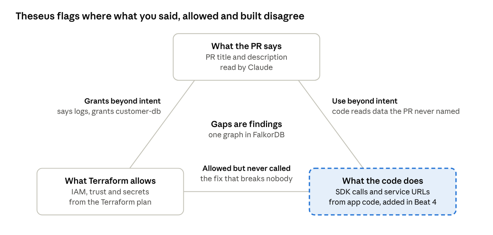

# Theseus

Theseus reviews Terraform pull requests as a graph in FalkorDB. It shows which sensitive data a change makes
reachable, compares that with what the PR says and what the code calls, proves the smallest safe fix on graph
copies, and commits it once a person approves. Built for
[FalkorDB Graph Hacks](https://www.wemakedevs.org/hackathons/falkordb), Track 01: agents that act on connected
data.



> **Status:** the plan, the spec, the task briefs and the agent instructions are in place. Product code starts
> with task F1; progress is on the [GitHub board](https://github.com/users/AjinkyaTaranekar/projects/3).

## What it does

| Mode | Starts from | Ends with |
| --- | --- | --- |
| PR | A pull request that changes Terraform or service code | One PR comment with cited paths and candidate fixes tested on graph copies; `/theseus apply <ID>` commits one |
| Finding | An advisory, such as a compromised GitHub Action | A containment PR and the exact list of secrets to rotate |
| Scan | `main` | The dangerous paths already there, and grants no code ever calls, each with a proven fix |

The engine decides facts, deterministically, from FalkorDB. an LLM (GLM 5.3 through LiteLLM) proposes and explains fixes; Jev (TypeSafe)
answers fast typed questions, such as how sensitive a resource is; a person approves. Anything outside the
supported IAM subset is reported as UNKNOWN, never guessed.


## The demo world

All data is synthetic. `demo-infra/` is a made-up online store that lives in this repo: about 110 Terraform
resources across 17 AWS services, six backend services on Lambda and ECS, and the company's CI workflows
([spec](docs/spec/02-demo-world.md)). There is no real AWS account and no GitHub org behind it. Demo PRs are PRs
in this repo that change only that folder.

## Repository map

| Path | What it holds |
| --- | --- |
| [`docs/plan-of-action.md`](docs/plan-of-action.md) | The plan: the four story beats, the task board, gates and fallbacks, testing, the video script |
| [`docs/project-overview.md`](docs/project-overview.md) | Why we build it: the problem, competitors, design choices, the graph model, the roadmap |
| [`docs/spec/`](docs/spec/README.md) | The product spec in seven files; the build follows it |
| [`docs/tasks/`](docs/tasks/README.md) | One brief per agent task, the human tasks, and the [dependency graph](docs/tasks/dependencies.md) |
| [`AGENTS.md`](AGENTS.md) | Rules for every coding agent and every person: commands, boundaries, conventions, commits |
| [`tools/`](tools/) | The task list, the board builder, the dependency graph, and the commit and agent guards |
| `demo-infra/`, `theseus/`, `tests/`, `deploy/` | The demo world, the product, its tests and its deployment, built task by task |

## Working in this repo

```bash
git clone https://github.com/AjinkyaTaranekar/theseus.git && cd theseus
git config core.hooksPath .githooks    # checks every commit message
```

1. Pick an issue on the board and open its brief in `docs/tasks/<ID>.md`.
2. Give your agent the prompt at the bottom of the brief. It reads `AGENTS.md`, the brief and the spec sections
   the brief lists, then writes the tests first and the code after.
3. The other person reviews the PR against the brief's "Done when" list, then merges it with a merge commit.

Commits and PR titles read `<type>: <Summary>` (`feat`, `fix`, `docs`, `test`, `refactor`, `chore`) and follow
[the seven rules](https://cbea.ms/git-commit/); see [`AGENTS.md`](AGENTS.md#commits).

## Stack

Python 3.12, FastAPI, Pydantic v2, FalkorDB, LiteLLM with GLM 5.3 on Crusoe, the MCP Python SDK, Jev over HTTP,
pytest and ruff.
Deployed with Docker Compose and Caddy on one VM.

## How we use AI

The spec, the task briefs and the planning docs were written before the event as notes, which the hackathon
rules allow; product code starts after it. Coding agents (Claude Code and Codex) write much of the code from
those briefs, and we review and can explain every line. `AI_USE.md` records which agent wrote what in each task,
and every commit an agent wrote names it in a `Co-Authored-By` trailer.
