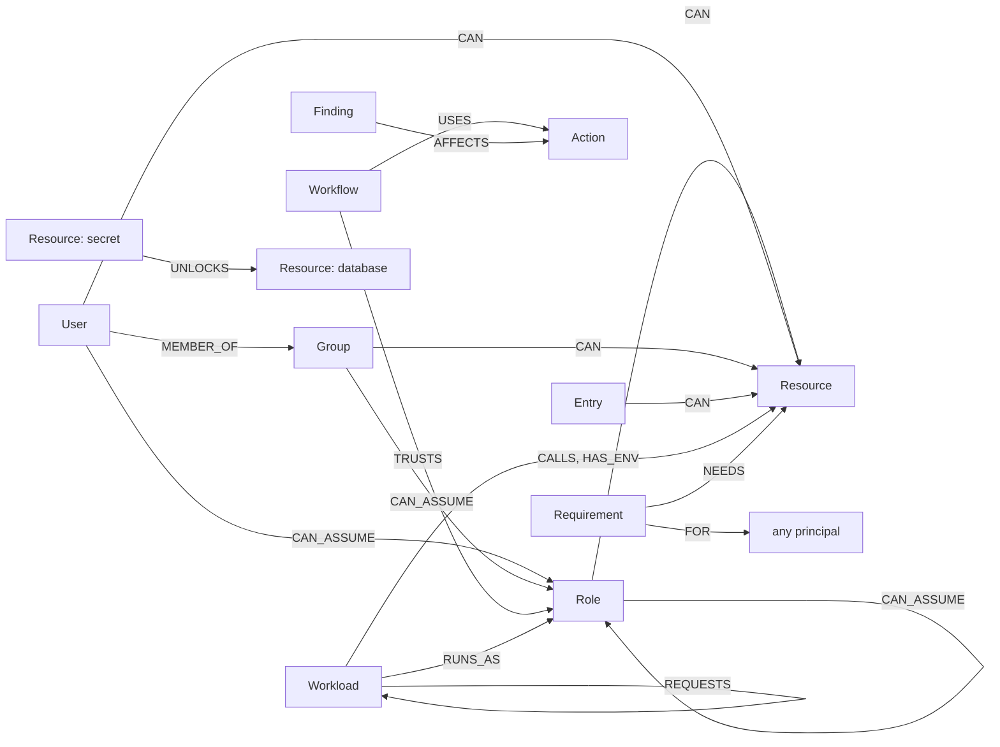

# Theseus

Theseus reviews Terraform pull requests as a graph in FalkorDB. It shows which sensitive data a change makes
reachable, compares that with what the PR says and what the code calls, proves the smallest safe fix on graph
copies, and commits it once a person approves. Built for
[FalkorDB Graph Hacks](https://www.wemakedevs.org/hackathons/falkordb), **Track 01: Agents That Act on Connected
Data**.

| | |
| --- | --- |
| **Try it live** | <https://guest-box.tail27b7c5.ts.net>: pick a preset and the real engine runs on FalkorDB ([`/health`](https://guest-box.tail27b7c5.ts.net/health)) |
| **Demo video** | _Link added at submission_ |
| **A real review** | [Demo PR #125](https://github.com/AjinkyaTaranekar/theseus/pull/125): an intern joins a support group "to read prod logs"; Theseus comments *"This PR would let priya-intern read and change customer-db"*, and `/theseus apply` commits the fix that turns the check green |
| **More demo PRs** | [#137](https://github.com/AjinkyaTaranekar/theseus/pull/137) makes a bucket public; [#124](https://github.com/AjinkyaTaranekar/theseus/pull/124) is a typo fix whose code reads the customer database; [#129](https://github.com/AjinkyaTaranekar/theseus/pull/129) tries to steer the review; [#126](https://github.com/AjinkyaTaranekar/theseus/pull/126) offboards a contractor and closes 6 paths; [#128](https://github.com/AjinkyaTaranekar/theseus/pull/128) is safe |
| **A containment PR** | [PR #111](https://github.com/AjinkyaTaranekar/theseus/pull/111), opened by Theseus for a compromised GitHub Action, and [issue #112](https://github.com/AjinkyaTaranekar/theseus/issues/112), the secret to rotate |


## How it works

**The engine decides facts; models propose; a person approves.**

1. **Read.** A GitHub Action plans the PR's base and head with Terraform (no cloud account) and sends the plan
   JSON. The backend also reads the `.tf` files for line numbers, the workflows and the Python service code.
2. **Build.** Each state becomes its own FalkorDB graph (`demo-infra__pr85-base`, `demo-infra__pr85-head`). Every
   edge carries the file and line that created it.
3. **Compare.** A variable-length Cypher match finds every route from every actor to every resource. The diff says
   which dangerous paths the PR opens. The LLM reads what the PR *says* it is for, as untrusted data, and the
   engine compares that with what it *grants*.
4. **Cut.** `algo.maxFlow`, inside FalkorDB, finds the fewest edges that close every opened route without cutting
   access a requirement in `theseus.yaml` needs.
5. **Fix.** Rule fixes and one fix the LLM designs with MCP tools are each applied to a `GRAPH.COPY` of the head
   and re-analyzed. Each gets a verdict: `pass`, `fail`, `unknown` or `invalid`.
6. **Act.** One PR comment, a required check, labels, and the passing fix as GitHub suggestions on the PR's
   own lines. A reviewer commits a suggestion, or comments `/theseus apply`, and the GitHub App commits the
   Terraform for the fix that passed; Theseus then reviews the new head.

The same graph serves four more modes: **finding** (an advisory such as a compromised Action becomes a
containment PR and a rotate list), **scan** (dangerous paths already on `main`, and grants no code calls),
**posture** (a dashboard of who reaches what, single points of failure, articulation points and the cost with
what could be saved; [setup](docs/onboarding.md)) and **incidents** (pick or paste an outage, such as "AWS
Lambda is down in eu-west-1", or let the nightly check of AWS Health and GitHub's status page find one, and see
what goes down, who loses access and which dependencies break). How it is built:
[docs/architecture/](docs/architecture/).


**The demo world is synthetic.** [`demo-infra/`](demo-infra/) is a made-up online store in this repo: about 140
planned Terraform resources, eight Python services on Lambda and ECS, five GitHub workflows and a
`theseus.yaml`. There is no AWS account and no GitHub org behind it ([spec 02](docs/spec/02-demo-world.md)).

## Graph model

Every node is a part of the infrastructure, every edge is a permission or a connection, and every edge carries
the evidence that proves it. The full schema is [spec 03](docs/spec/03-graph.md); its constants are in
[`theseus/contracts/schema.py`](theseus/contracts/schema.py).



**Nodes.** Every node has the label `:Node`, a kind label, and `:Principal` if it can act. IDs follow one grammar,
`<kind>:<name>` or `<scheme>://<path>`, and stay the same in every state of a world. Resources also carry
[Cartography's ontology labels](https://github.com/cartography-cncf/cartography/blob/master/cartography/models/ontology/labels.py)
(`Database`, `Secret`, `ObjectStorage`, ...) and a `category`, the only thing core code reasons on.

| Kind | Example ID |
| --- | --- |
| User, Group, Role | `user:priya-intern`, `group:support-engineers`, `role:prod-support` |
| Workload (Lambda or ECS service) | `workload:billing-api` |
| Workflow, Action | `workflow:demo-org/docs-site/preview.yml`, `action:demo-thirdparty/file-diff` |
| Entry | `entry:internet` |
| Resource | `s3://demo-company-files/invoices/`, `secret:prod-db-credentials`, `db:customer-db`, `dynamodb:demo-orders` |
| Requirement, Finding | `req:R1`, `finding:GHSA-demo-0001` |

**Edges.** Paths walk the traversal edges and end on a grant edge. Code edges come from reading the Python with
`ast`, never running it. Context edges are never traversed.

| Role | Types |
| --- | --- |
| Traversal | `MEMBER_OF`, `CAN_ASSUME`, `TRUSTS` (GitHub OIDC trust matched on `sub`), `RUNS_AS` |
| Grant | `CAN` (`grants`: `read`, `write`), `UNLOCKS` (a secret to its database) |
| Code | `CALLS`, `REQUESTS`, `HAS_ENV` |
| Context | `USES`, `FOR`, `NEEDS`, `AFFECTS` |
| Internal | `FLOW`, written before each max-flow call, never shown |

Each edge has an `eid`, a `kind` (`configured`, `inferred`, `assumed` or `unknown`) and evidence such as
`{"address": "aws_iam_user_group_membership.priya_support", "file": "terraform/people.tf", "line": 83}`. The LLM's
explanations must cite evidence IDs, and a checker rejects any ID that does not exist. One state is one graph:
`demo-infra__main`, `demo-infra__pr85-head`, `demo-infra__pr85-fix-b`, `fx__intern__head`.


## Cypher and graph algorithms

All Cypher is in [`theseus/graph/queries.py`](theseus/graph/queries.py) and runs through the FalkorDB store in
[`theseus/graph/store.py`](theseus/graph/store.py); the Python algorithms are in
[`theseus/graph/algos.py`](theseus/graph/algos.py) and [`theseus/engine/posture.py`](theseus/engine/posture.py).
Each canonical query was first checked against FalkorDB 4.22.0 on a toy graph with a known answer.

**Every route from an actor** (`Q_PATHS`). The engine keeps a route only if each hop is a valid step and it ends on
one grant.

```cypher
MATCH p = (a:Node {id: $actor})-[:MEMBER_OF|CAN_ASSUME|TRUSTS|RUNS_AS|CAN|UNLOCKS*1..7]->(r:Resource)
RETURN [rel IN relationships(p) | rel.eid] AS eids
```

**The minimum cut** (`Q_SET_FLOW`, `Q_MAXFLOW`). `algo.maxFlow` takes one relationship type and no parallel edges,
so the engine first writes one `FLOW` edge per (source, target) pair with its capacity: 1,000,000 for an edge a
requirement needs, 1,000 for a grant the code calls, 1 otherwise. A max flow of 1,000,000 or more means no cut
keeps every requirement, so the agent must design a structural fix.

```cypher
MATCH ()-[f:FLOW]->() DELETE f
WITH count(*) AS dropped
UNWIND $rows AS r
MATCH (a:Node {id: r.src}), (b:Node {id: r.dst})
CREATE (a)-[:FLOW {eids: r.eids, capacity: r.capacity}]->(b)
```

```cypher
MATCH (s:Node) WHERE s.id IN $sources WITH collect(s) AS ss
MATCH (t:Node) WHERE t.id IN $sinks WITH ss, collect(t) AS ts
CALL algo.maxFlow({sourceNodes: ss, targetNodes: ts, capacityProperty: 'capacity',
                   relationshipTypes: ['FLOW']})
YIELD maxFlow, edges, edgeFlows
RETURN maxFlow, [e IN edges | e.eids] AS eids, edgeFlows
```

**Finding mode and code checks** (`Q_WORKFLOWS_USING`, `Q_UNUSED_GRANTS`, `Q_CALLS`).

```cypher
MATCH (w:Workflow)-[u:USES]->(:Action {id: $action}) RETURN w.id AS workflow, u.version AS version

MATCH (w:Workload)-[:RUNS_AS]->(:Role)-[c:CAN]->(r:Resource {sensitive: true})
OPTIONAL MATCH (w)-[x:CALLS]->(r)
WITH w, c, r, x
WHERE x IS NULL OR NONE(g IN c.grants WHERE g IN x.grants)
RETURN w.id AS workload, r.id AS resource, c.eid AS eid
```

**Choke points** (`Q_BETWEENNESS`) and **candidate fixes** (`GRAPH.COPY`, then delete and create the changed rows;
`theseus/graph/load.py`).

```cypher
CALL algo.betweenness({relationshipTypes: $types}) YIELD node, score
RETURN node.id AS id, score ORDER BY score DESC, id
```

| Algorithm | Runs in | Used for |
| --- | --- | --- |
| Variable-length path match | FalkorDB | Every route on base, head and each candidate graph |
| `algo.maxFlow` on `FLOW` edges | FalkorDB | The minimum cut in PR, finding and scan modes. Edmonds-Karp in Python runs on the same rows only if the call fails, and logs it |
| `GRAPH.COPY` | FalkorDB | One graph per candidate fix, so a fix is tested without touching the head |
| Residual walk after max flow | Python | Turning flows into the cut edges, each with its evidence |
| Brandes betweenness | Python | Choke points. `algo.betweenness` is a sampled estimate whose ranking changed between runs on one graph, and a ranking that changes is not a fact, so results use the exact score |
| Tarjan's articulation points | Python | Posture: nodes whose removal splits the access graph |

**The product does not run without FalkorDB.** `theseus serve` refuses to start without it, `/health` reports
`degraded` when it goes away, and the in-memory store exists only for offline tests.

## Setup

A fresh clone needs Docker and Python 3.12, and no keys: the LLM and Jev replay from [`recordings/`](recordings/),
and the engine runs live on a local FalkorDB. One command after the clone:

```bash
git clone https://github.com/AjinkyaTaranekar/theseus.git && cd theseus
```

```bash
docker run -d -p 6379:6379 falkordb/falkordb:v4.22.0 && python3.12 -m venv .venv && .venv/bin/pip install -e . && .venv/bin/python -m theseus serve
```

Open <http://localhost:8000> and pick a preset; `GET /health` answers `{"status":"ok","falkordb":"4.22.0",...}`. If
port 6379 is taken, map another (`-p 6380:6379`) and start the API with `FALKORDB_PORT=6380`. On Windows use
`py -3.12 -m venv .venv` and `.venv\Scripts\...`. For FalkorDB Cloud, copy `.env.example` to `.env` and fill in
the `FALKORDB_*` settings.

```bash
.venv/bin/pip install -e ".[dev]"
.venv/bin/pytest -q                 # offline: unit, golden, contract, replay, e2e
.venv/bin/pytest -q -m falkordb     # the same answers from FalkorDB as from the in-memory store
```

To review your own pull requests, install the GitHub App and add `theseus.yaml` and the workflows:
[docs/onboarding.md](docs/onboarding.md). Every setting is in [`.env.example`](.env.example).

## Live deployment

<https://guest-box.tail27b7c5.ts.net> serves the Try-it page at `/` and the health check at
[`/health`](https://guest-box.tail27b7c5.ts.net/health). It is a container on an Oracle ARM host, published
through Tailscale Funnel, with FalkorDB on FalkorDB Cloud, and it also receives the GitHub App's webhooks for the
demo PRs. How it is set up and deployed: [deploy/README.md](deploy/README.md).

## Results

On a fresh clone of `main`, `pytest -q` gives 2,015 passed and 30 skipped (the FalkorDB tests), and
`pytest -q -m falkordb` against a local FalkorDB 4.22.0 gives 30 passed. The golden tests compare paths,
requirements, the cut, verdicts and the rotate list with each scenario's hand-written `expected.json`. The Try-it
presets, on that clone, with FalkorDB in Docker on an Apple laptop:

| Preset | Opened dangerous paths | Max flow | Fix verdicts | Engine time |
| --- | --- | --- | --- | --- |
| `intern` | 3: `customer-db`, `prod-db-credentials`, `invoices/` | 1,000,000, not cuttable | A fail, B pass, C unknown, D fail | 1.4 s (first run) |
| `public-bucket` | 1: `entry:internet` to `invoices/` | 1 | A fail, S pass | 0.33 s |
| `code-pr` | none; *"Your code now reads customer-db"* | | | 0.11 s |

Fix B in the intern case is the LLM's own design, replayed from one live GLM 5.3 run: a new role,
`intern-logs-read`, that reads only the app logs and trusts her, a grant to assume it, and her removal from
`support-engineers`.

**Benchmark against Checkov:** _S2 numbers go here: cases, true and false positives against Checkov, misses, and
timings on a large generated graph._

## Limits

**A path is a modeled path under labeled assumptions, not proof that an attacker can get in.**

- **The IAM subset.** `Allow` and `Deny`, wildcards, inline and attached policies, assume-role trust and GitHub
  OIDC trust on `aud` and `sub`. Anything else (`NotAction`, other condition keys, permission boundaries, SCPs, KMS
  key policies) returns UNKNOWN instead of a guess, which is why fix C is UNKNOWN in the intern case.
- **It may over-report, never under-report,** when one group's `Deny` meets another group's `Allow`.
- **Not modeled:** privilege escalation by rewriting IAM, and network reachability.
- **Static code reading** resolves literals, environment variables and module constants. Values built at run
  time produce no edge and are listed as unknowns, so a grant reached only that way looks unused.
- **One cloud, one IaC format, one language** today (AWS, Terraform, GitHub Actions, Python), each behind an
  adapter, so a second cloud is a new adapter, not an engine change ([spec 08](docs/spec/08-core-and-adapters.md)).
- **Our own test data.** We wrote the demo world, its PRs and their answer keys.

## How we used AI

**Building it.** The spec, the task briefs and the planning documents were written before the event as notes,
which [rule 8](https://www.wemakedevs.org/hackathons/falkordb/rules) allows; product code started after it.
Claude Code and Codex wrote much of the code from those briefs, one task per branch, and the other person reviewed
every diff. Humans wrote every `expected.json`, and a hook blocks agents from writing them.
[`AI_USE.md`](AI_USE.md) records which agent wrote what in each task and what the humans changed, every agent
commit names it in a `Co-Authored-By` trailer, and [`AGENTS.md`](AGENTS.md) holds the rules every agent reads.

**Inside the product.** The LLM (GLM 5.3 on Crusoe, through LiteLLM) reads PR intent and designs one candidate fix
with five read-only or sandboxed MCP tools; it has no tool that comments or commits. Jev (TypeSafe) answers fast
typed questions, such as how sensitive a resource is, and can veto a fix but never approve one. PR text and
advisories reach a model only inside `<untrusted_...>` tags and never count as evidence.

## More

[The spec](docs/spec/README.md) · [task briefs](docs/tasks/README.md) · [plan](docs/plan-of-action.md) ·
[project overview and roadmap](docs/project-overview.md). Built on [FalkorDB](https://docs.falkordb.com/), with
ideas from [Cartography](https://github.com/cartography-cncf/cartography); [Checkov](https://www.checkov.io/) runs
beside Theseus in the same Action. Licensed under the [MIT License](LICENSE).
