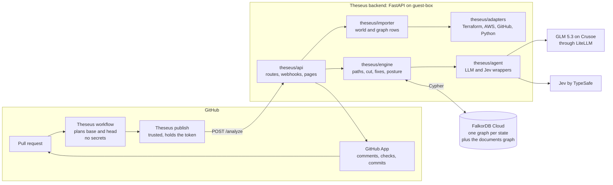
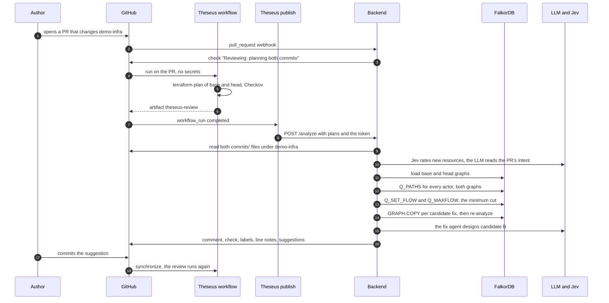

# 01. Overview

## What Theseus does

A company keeps its cloud setup as code: Terraform files that say which people, groups, roles and services
exist, and what each may read or change. A pull request (PR) that edits those files can quietly give someone
access to data they should never see. One added group membership can let an intern become a support role that
holds the password to the customer database. Reading the diff line by line rarely shows that, because the risk
is in the chain, not in any one line.

Theseus reads the whole chain. For each PR it builds two graphs, one for the code before the PR (the **base**)
and one for the code after it (the **head**). It then asks the same question of both: who can reach sensitive
data, and by which route? The routes that exist in the head but not the base are what the PR **opens**. Theseus
blocks the PR when one of them reaches sensitive data that nothing requires, explains every hop with the file
and line that created it, and offers the smallest fix that closes the routes without breaking anything the
company needs.

The same graph answers more questions on `main` itself:

- **Finding mode:** what can a compromised GitHub Action reach?
- **Scan:** which grants does no code use?
- **Posture:** who reaches what, which nodes are single points of failure, what does it cost?
- **Incidents:** what breaks if AWS Lambda goes down?

[06. Features](06-features.md) covers each of them.

## The one rule

> **The engine decides facts; models propose; a person approves.** ([`AGENTS.md`](../../AGENTS.md))

- **The engine decides facts.** The engine is the deterministic Python in `theseus/engine/` plus the Cypher in
  `theseus/graph/`. Whether a path exists, whether a fix passes and what a change costs all come from the engine.
- **Models propose.** A language model reads the PR's description and designs one candidate fix. Jev, a fast
  classifier, rates how sensitive each data store is. Neither can make anything true: the engine checks every
  proposal on a copy of the graph before it is shown.
- **A person approves.** Nothing is committed until a person with write access commits a suggestion or replies
  `/theseus apply`.

Every claim in a result cites **evidence**: the Terraform address, file and line that created the edge. A claim
with no evidence that exists is not made.

## The pieces

| Package | Role | Pure? |
| --- | --- | --- |
| `theseus/contracts/` | The shared Pydantic models: `AnalysisResult`, `GraphRows`, `Candidate`, `Posture`, `IncidentReport` and the adapter protocols | Yes |
| `theseus/adapters/` | The only code that names a vendor: `terraform/` reads plans and writes fixes back, `aws/` knows IAM, `github/` reads workflows, `python/` reads service code | Yes |
| `theseus/importer/` | Reads a world root into a `World` (`importer/world.py`) and turns it into graph rows (`importer/build.py`) | Yes |
| `theseus/graph/` | The FalkorDB client, the store, the Cypher, loading and `GRAPH.COPY` | No: talks to FalkorDB |
| `theseus/engine/` | Paths, the diff, the minimum cut, candidate fixes and simulation, findings, scan, posture, incidents | Yes, apart from the store passed in |
| `theseus/agent/` | The LLM wrapper (`llm.py`), intent, the fix agent (`fixer.py`), Jev (`jev.py`), the PR comment (`render.py`), labels | Calls models through record and replay |
| `theseus/mcp/` | The tool registry the fix agent uses, also served over MCP | Reads the store |
| `theseus/api/` | FastAPI routes, the GitHub client, webhooks, the pages' data and signed links | No |
| `theseus/web/` | The pages: the dashboard, the review page and the Try page | Static files |
| `theseus/cli.py`, `theseus/api/app.py` | The two **composition roots**: the only places that pick adapters and build `Deps` | No |

"Pure" means the code reads no network or environment. It gets the store and the adapters as arguments, so tests
can pass an in-memory store and the same code runs in production against FalkorDB
([`AGENTS.md`](../../AGENTS.md), "Code").

## A PR's journey

This is the main flow, the one most features build on. [06. Features](06-features.md) has the detail of each
step.

What each stage produces:

1. **Plan.** The `Theseus` workflow (`.github/workflows/theseus.yml`) runs `tools/plan.sh` on both commits. It
   produces Terraform's JSON plan, which lists every resource with its resolved values, without an AWS account:
   the provider block uses mock credentials.
2. **Read.** The backend reads the world root's files at both commits through the GitHub API
   (`GitHub.world_files` in `theseus/api/github.py`): the `.tf` files for line numbers, the workflows and the
   service code.
3. **Build.** `load_world` and `build_rows` turn each side into `GraphRows`: nodes such as `user:priya-intern`
   and edges such as `MEMBER_OF`, each with evidence. Jev rates the sensitivity of any data store a person has
   not already classified in `theseus.yaml`.
4. **Load.** Each side becomes a FalkorDB graph: `demo-infra__pr85-base` and `demo-infra__pr85-head`.
5. **Analyze.** `Q_PATHS` lists every route from each actor; the engine keeps the valid ones and marks the
   dangerous ones. The diff gives what the PR opens and closes.
6. **Intent.** The LLM reads the PR's title and body, as untrusted data, and says what access the PR claims to
   need. The engine compares that with what the change grants.
7. **Cut and fix.** `algo.maxFlow` finds the cheapest set of edges to cut. Rules propose fixes; the fix agent
   designs one more. Each is applied to a `GRAPH.COPY` of the head and analyzed again, giving a verdict.
8. **Report.** The backend posts one comment, a required check named `Theseus`, labels, notes on the changed
   lines, and the passing fix as GitHub suggestions. It keeps the result in FalkorDB for the review page and
   the dashboard.

## Where the numbers come from

Theseus reports only numbers it computed. A few that appear across these pages:

| Number | Where it is defined |
| --- | --- |
| A valid path has at most 7 edges | `MAX_PATH_EDGES` in `theseus/contracts/schema.py` |
| Capacities 1,000,000, 1,000 and 1 | `BIG`, `USED` in `theseus/contracts/schema.py`, used in `theseus/engine/mincut.py` |
| The fix agent makes at most 8 tool calls | `MAX_TOOL_CALLS` in `theseus/agent/fixer.py` |
| Jev's veto and steering thresholds, 0.5 | `theseus/engine/candidates.py`, `STEERING_THRESHOLD` in `theseus/agent/intent.py` |
| Page links carry a 32-character signature | `SIGNATURE_CHARS` in `theseus/api/reviews.py` |
