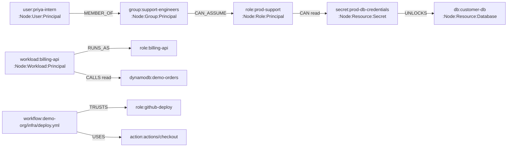
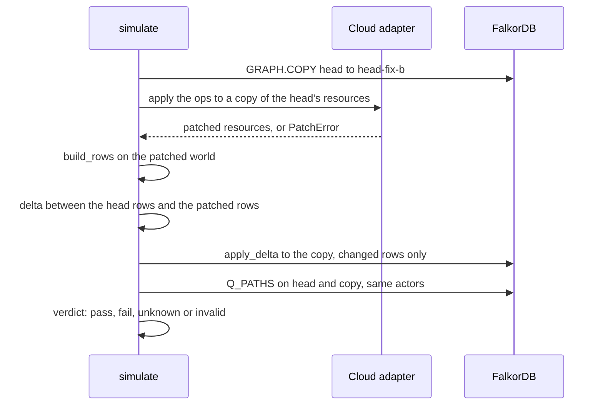

# 02. FalkorDB

FalkorDB is a graph database that speaks Cypher, built on Redis. Theseus keeps every graph it reasons on in
FalkorDB, runs its path queries and its minimum cut there, copies graphs there to test fixes, and keeps its
review results there too. This page explains how.

## Why a graph database

The question Theseus asks is a graph question: *can this person reach that data, through any chain of
memberships, role switches and grants?* In a table that question needs one self-join per hop, and the number of
hops is not known in advance. In a graph it is one variable-length match:

```cypher
MATCH p = (a:Node {id: $actor})-[:MEMBER_OF|CAN_ASSUME|TRUSTS|RUNS_AS|CAN|UNLOCKS*1..7]->(r:Resource)
```

FalkorDB also gives us the two other things we need in the database itself:

- **`algo.maxFlow`**, for the minimum cut: the fewest edges that close every dangerous route.
- **`GRAPH.COPY`**, for testing a fix on a full copy of the head graph without touching it.

[08. Decisions](08-decisions.md) records why FalkorDB is the only store the product runs on.

## Where it runs

| Environment | FalkorDB |
| --- | --- |
| The deployed API (guest-box) | FalkorDB Cloud, FalkorDB 4.22.0 on Redis 8.10.2, reached with the `FALKORDB_*` settings ([spec 07](../spec/07-github-and-deploy.md), "Where FalkorDB runs") |
| CI's `falkordb` job | A `falkordb/falkordb:v4.22.0` service container, the same version as the Cloud instance |
| A laptop | FalkorDB Cloud through `.env`, or `docker run -p 6379:6379 falkordb/falkordb:v4.22.0` |
| The default `pytest -q` run | No FalkorDB: `MemoryStore` in `theseus/graph/store.py` answers the same protocol in memory |

The client is made once in `theseus/graph/client.py` (`get_client`), which pings the server and raises
`GraphError` if it cannot connect. `theseus serve` and the API's startup refuse to run without it: the product
never runs on the in-memory store ([`AGENTS.md`](../../AGENTS.md), "Never").

## The store protocol

Core code never calls the FalkorDB client directly. It calls a `GraphStore` (`theseus/contracts/engine.py`),
which two classes implement in `theseus/graph/store.py`:

| Method | FalkorDB (`FalkorStore`) | What it is for |
| --- | --- | --- |
| `load(graph, rows)` | Delete, create nodes by label set, create the `Node(id)` index, create edges by type | Turning one state's rows into a graph |
| `copy(src, dst)` | `Graph.copy(dst)`, which is `GRAPH.COPY` | One graph per candidate fix |
| `delete(graph)` | `Graph.delete()` | Replacing a graph |
| `apply_delta(graph, delta)` | Delete changed edges and nodes, then add the new ones | Turning a copy into a fix's graph |
| `paths(graph, actor)` | `Q_PATHS` | Every route from one actor |
| `max_flow(graph, sources, sinks, rows)` | `Q_SET_FLOW` then `Q_MAXFLOW` | The minimum cut |
| `betweenness(graph)` | `Q_REL_TYPES` then `Q_BETWEENNESS` | The store's own choke-point scores |
| `workflows_using(graph, action)` | `Q_WORKFLOWS_USING` | Finding mode's first step |
| `unused_grants(graph)` | `Q_UNUSED_GRANTS` | Scan mode |
| `calls(graph)` | `Q_CALLS` | Code calls, for capacities and "use beyond intent" |
| `view(graph)` | Two `MATCH` queries returning every node and edge | The pages, which draw the graph as FalkorDB holds it |
| `put_doc`, `get_doc`, `docs`, `read_docs` | Queries on the documents graph | Keeping results for the pages |

`MemoryStore` implements the same methods on Python lists. `tests/integration/test_store_parity.py`, run with
`pytest -m falkordb`, checks that both stores give the same answers. Every query is listed in
[03. Cypher](03-cypher.md).

## One graph per state

A **state** is one version of the world: `main`, a PR's base, a PR's head, or one candidate fix applied to
that head. Each state is its own graph, never a filter on a shared one. Graph names use only `a-z`, `0-9`, `-`
and `_` (`NAME` in `theseus/graph/store.py`), and follow [spec 03](../spec/03-graph.md), "One graph per state":

| State | Graph name | Made by |
| --- | --- | --- |
| `main` | `demo-infra__main` | A posture run (`run_posture`), replaced on every run |
| PR 85's base and head | `demo-infra__pr85-base`, `demo-infra__pr85-head` | `run_pr`, through `graph_name` in `theseus/engine/pipeline.py` |
| Candidate B on PR 85 | `demo-infra__pr85-fix-b` | `candidate_graph` in `theseus/engine/simulate.py`, lowercased |
| A test fixture | `fx__intern__base`, `fx__intern__head`, `fx__intern__fix-b` | Fixture runs: tests, the CLI and the Try page |

Why one graph per state? Because a state's graph is a fact: "at this commit, this is who can reach what." Two
states never share a node, so a query on one can never see the other by mistake, and the review page can
draw the base and the head side by side by reading two graphs. [08. Decisions](08-decisions.md), "A graph per
state", has the reasoning.

**What is kept, and for how long.** FalkorDB Cloud holds about 100 MB and never evicts, and a graph costs about
0.8 MB, so graphs are not kept for ever ([decision 32](08-decisions.md#32-a-prs-graphs-live-as-long-as-the-pr-is-open)).

| Graphs | While | Deleted when |
| --- | --- | --- |
| `demo-infra__main` | Replaced by every posture run | Never by Theseus |
| A PR's base, head and one `-fix-<id>` for each candidate its newest review lists, so 3 to 5 | The PR is open. A push loads the same names again, which replaces them; a fix the newest review no longer lists is deleted when it is kept (`reviews.save`) | The PR closes or merges (`_on_closed` in the webhook), or `python -m theseus prune` finds it closed |
| `fx__<scenario>__<side>` | Fixture runs: tests, the CLI, the Try page | Never by Theseus |
| `theseus__docs` | Every review, finding and posture document | Never by Theseus |

A closed PR keeps its **review**, a document in `theseus__docs`, so the dashboard keeps its history and its page
keeps its text; the page says its graphs were removed instead of drawing an empty one. Reopening the PR reviews
it again and rebuilds them.

## What a node and an edge look like

The rows come from `importer/build.py`, through the adapters. [Spec 03](../spec/03-graph.md) defines every
type; here is what lands in FalkorDB.



**Nodes.** Every node has the label `Node`, a kind label (`User`, `Group`, `Role`, `Workload`, `Workflow`,
`Action`, `Entry`, `Requirement`, `Finding`, or `Resource` with its category such as `Secret` or `Database`), and
`Principal` if it can act (`theseus/contracts/schema.py`). Its properties are the typed fields of `NodeRow` (`id`,
`name`, `category`, `sensitive`, `sensitivity`, and so on) plus its `props`, such as the Terraform `address`
(`node_properties` in `theseus/graph/store.py`). Null values are never stored.

**Edges.** An edge has an `eid`, a `kind` (`configured`, `inferred`, `assumed` or `unknown`), its `grants`
(`read`, `write`, `assume`), and its **evidence** as JSON text: a list of `{address, part, file, line, note}`
(`edge_properties`). Evidence is what lets every step in a comment link to the line that created it.

| Edge types | Role in a path |
| --- | --- |
| `MEMBER_OF`, `CAN_ASSUME`, `TRUSTS`, `RUNS_AS` | **Traversal**: "can become" or "is part of" |
| `CAN`, `UNLOCKS` | **Grant**: the last step, "can read or write this data" |
| `CALLS`, `REQUESTS`, `HAS_ENV` | **Code**: what a service's code does, never walked as a path |
| `USES`, `FOR`, `NEEDS`, `AFFECTS` | **Context**: which Action a workflow uses, what a requirement needs |
| `FLOW` | **Internal**: written before each max-flow call, never shown and never evidence |

## How a graph is loaded

`FalkorStore.load` (`theseus/graph/store.py`):

1. Checks the name, then deletes the graph if it exists.
2. Groups the nodes by their label set and runs one `create_nodes` query per group. Cypher cannot take labels
   as parameters, so each group needs its own query text; the rows go in as `$rows`.
3. Creates the index `CREATE INDEX FOR (n:Node) ON (n.id)`, so every `MATCH (a:Node {id: ...})` is a lookup, not
   a scan.
4. Groups the edges by type and runs one `create_edges` query per type, matching both ends by `id`.

Everything is sorted first, so loading the same rows twice gives the same graph.

## How a fix gets its own graph

A **candidate fix** is a list of patch operations such as `remove_membership` or `add_role`
([spec 04](../spec/04-engine.md), section 13). To know whether it works, the engine must see the graph *after*
the fix. `simulate` in `theseus/engine/simulate.py` does it like this:



The copy is rebuilt from the patched resources, never edited by hand: an edge is not "hidden" to make a fix
look good. Only the rows that differ are written (`delta` in `theseus/graph/load.py`), so a fix on a large graph
costs a few writes, not a full reload.

## The documents graph

Results also live in FalkorDB, in a graph named `theseus__docs` (`DOCS` in `theseus/graph/store.py`). Each
result is one `Doc` node: `{key, text}`, where `text` is JSON.

| Key | What it holds | Written by |
| --- | --- | --- |
| `review:<owner/repo>#<number>` | A PR's newest result, verdict, title and head commit | `reviews.save`, after `/analyze` |
| `finding:<advisory id>` | A finding's result, and its containment PR and issue once opened | `reviews.save_finding`, `reviews.mark_contained` |
| `posture:<owner/repo>` | `main`'s newest posture report, including the outage basis | `reviews.save_posture`, after `/posture` |
| `history:<owner/repo>` | The numbers of each posture run, at most 365 runs (`HISTORY_KEPT`) | `reviews.save_posture` |
| `incidents:<owner/repo>` | The newest check of the providers' status feeds, with each incident's blast radius | `reviews.save_incidents`, after `/incidents/check` |

Why keep them in FalkorDB rather than in a file or a second database? The results sit next to the graphs they
describe, survive a redeploy, and need no second service to run. The documents are small (tens of kilobytes),
so a graph of `Doc` nodes is enough.

**Reading many at once.** The dashboard needs every review of a repo. `read_docs(prefix)` returns all documents
whose key starts with a prefix in one query. Reading them one by one cost two round trips each to FalkorDB
Cloud, about 140 ms apiece, which made the dashboard take 5.5 s. The store also remembers that the documents
graph exists once it has seen it, instead of listing every graph before each read.

## Pages read the graphs live

The review page (`/reviews/<owner>/<repo>/<number>`) and the dashboard's Graph view do not keep a copy of the
graph. Their data routes call `store.view(name)`, which reads every node and edge from FalkorDB at that moment
(`page_doc` and `main_graph` in `theseus/api/reviews.py`). So what a reviewer sees is exactly what the engine
reasoned on.

Those pages show a private repo's infrastructure, so their links are **signed**: the query string carries
`k=<signature>`, an HMAC-SHA256 of the document's key with `THESEUS_TOKEN`, cut to 32 hex characters (`sign` in
`theseus/api/reviews.py`). Anyone who can read the PR comment can open the page. A link without a valid
signature gets a 404, so the public URL alone shows nothing.

## What FalkorDB 4.22 requires

Found while checking each query on FalkorDB 4.22.0 ([spec 03](../spec/03-graph.md), "What FalkorDB 4.22
requires"):

- `algo.maxFlow` takes exactly one relationship type, and no parallel edges of it. That is why the engine
  writes `FLOW` edges, one per ordered pair of nodes with the capacities summed, and runs max flow on those.
- Max flow's sources and sinks must not overlap.
- `algo.maxFlow` returns only the edges that carry flow, in no fixed order. The engine sorts them and treats a
  missing edge as flow 0.
- `algo.betweenness` fails on a relationship type the graph does not have, hence `Q_REL_TYPES` first.
- `GRAPH.COPY` keeps the `Node(id)` index, and changing the copy leaves the source untouched.
