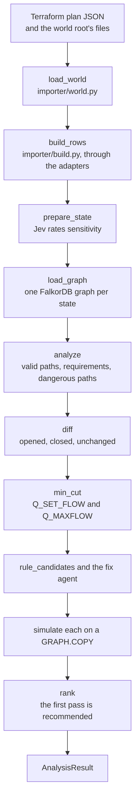

# 04. The engine

The **engine** is the deterministic part of Theseus: `theseus/importer/`, `theseus/engine/` and
`theseus/graph/`. Given the same inputs it always gives the same answer, with every list sorted and every ID
stable. Everything a review claims as a fact comes from here. The full rules are in
[spec 04](../spec/04-engine.md); this page walks through them in the order a PR review uses them.

## 1. From files to rows

**The world.** `load_world(root, plan, adapters)` in `theseus/importer/world.py` reads a **world root**: a
folder holding `theseus.yaml`, `terraform/`, `services/` and `workflows/` (`demo-infra/` in this repo). It returns
a `World`: the plan's resources, the source files, the fields Terraform could not resolve until apply, and how
many resources of each type Theseus does not model.

**The rows.** `build_rows` in `theseus/importer/build.py` asks each adapter for its part:

| Adapter | Reads | Produces |
| --- | --- | --- |
| Terraform (`adapters/terraform/`) | The plan JSON and the `.tf` files | `IacResource`s, and the file and line of every address (`locate`) |
| AWS (`adapters/aws/`) | Those resources and `theseus.yaml` | User, group, role, workload and resource nodes; `MEMBER_OF`, `CAN_ASSUME`, `TRUSTS`, `RUNS_AS`, `CAN`, `UNLOCKS` edges |
| GitHub (`adapters/github/`) | `workflows/<org>/<repo>/*.yml` | Workflow and Action nodes, `USES` edges, each workflow's OIDC identity |
| Python (`adapters/python/`) | `services/**/*.py` | `CALLS`, `REQUESTS` and `HAS_ENV` edges, from `ast`, never by running the code |

Requirement nodes (`req:R1`) and their `FOR` and `NEEDS` edges come from `theseus.yaml`'s `requirements` list.

**Sensitivity.** `prepare_state` in `theseus/engine/pipeline.py` sets each resource's class: `public`,
`internal`, `confidential` or `regulated`. A person's `sensitive_overrides` in `theseus.yaml` always wins; Jev is
asked only about the rest ([05. Models](05-models.md)). A resource is **sensitive** when it is `confidential` or
`regulated`.

## 2. Actors and valid paths

**Actors** are the things that can start a route: users, workflows, workloads and `entry:internet`, the public
internet (`actors` in `theseus/engine/pipeline.py`). Groups and roles are never actors: you reach them, you don't
start at them.

A **valid path** ([spec 04](../spec/04-engine.md), section 9) is:

- simple: no node appears twice;
- at most 7 edges long (`MAX_PATH_EDGES`);
- zero or more **traversal** edges (`MEMBER_OF`, `CAN_ASSUME`, `TRUSTS`, `RUNS_AS`), then one `CAN` to a
  resource, then optionally one `UNLOCKS` when that resource is a secret.

`analyze` in `theseus/engine/analyze.py` asks the store for every route (`Q_PATHS`), then `_record` keeps the
valid ones. Each becomes a `PathRecord`: the actor, the target, the grants of the last edge, the steps with their
evidence, and whether any edge was `unknown` or `inferred`. A path's ID is a hash of its steps' (source, type,
destination), never of `eid`s, so the same route in two graphs has the same ID.

## 3. Requirements, coverage and dangerous paths

A **requirement** is an access something must keep: (principal, access, resource). They come from two places:

| Source | ID | Example | Can approve sensitive access? |
| --- | --- | --- | --- |
| `theseus.yaml`, reviewed by its owners | `R1`, `R2`, ... | `user:sam-support` reads `db:customer-db` | Yes |
| The PR's own text, read by the LLM | `I1`, `I2`, ... | `user:priya-intern` reads `s3://demo-app-logs/` | No |

Each requirement gets a **status**: `satisfied` (a certain path gives that access), `unknown` (only paths with an
unknown edge do) or `missing`.

**Words explain, never approve.** A PR's text can say what a change is for, but it can never make access to
sensitive data acceptable. An intent requirement is **unapproved** when its resource is sensitive or the PR text
is `suspicious`; it gets a status but protects nothing (`approved` in `theseus/engine/intent_effect.py`).

A target is **covered** for an actor when a `theseus.yaml` requirement names it, or it lies on the route of a
path that satisfies one (a secret on the way to a required database). A **dangerous path** is a path to a
sensitive target that is not covered. Intent never covers.

## 4. The diff

PR mode analyzes the base and the head with the same actors and the same requirements, and compares the
dangerous paths by (actor, target) (`diff` in `theseus/engine/analyze.py`):

- `opened`: in the head, not the base. These block the merge.
- `closed`: in the base, not the head. The PR takes this access away.
- `unchanged`: in both. Already on `main`; listed, but not this PR's doing.

**Where the change lands** (`change_impact` in `theseus/engine/impact.py`, `AnalysisResult.impact`). Dangerous
paths only cover sensitive data nothing requires. An SRE asks a wider question about every change: what does it
touch, and what breaks if it goes wrong? So every PR result also carries its impact, whatever the data's class:

| Field | What it holds |
| --- | --- |
| `touched` | Nodes whose IaC address the change adds, updates or deletes, and both ends of every link it adds or removes. Each has who reaches it (`reached_by`), how many dependencies run through it (`relied_on`) and the services that call it (`dependents`, REQUESTS, transitively) |
| `edges` | Links added or removed, by (src, type, dst), each with its evidence |
| `access` | Every (actor, target) a valid path joins in one state and not the other: `gained` or `lost`, any class |
| `relies` | Dependencies (code calls and `theseus.yaml` requirements) whose routes run through what changed (`kept`), or that gain or lose their last route (`gained`, `lost`). A code call and a requirement for the same access count once |
| `most_affected` | The touched nodes most relied on, then most called, then most reached |
| `monthly_usd_before`, `monthly_usd_after` | The world's cost at list price before and after |

It reads only the rows and the paths the engine already traced, so it adds no query. The comment shows its
headline on the card (**Impact:**) and a "Where this change lands" section with a small diagram and the tables;
the dashboard's PR list shows the headline, so a clear PR still says where it lands.

## 5. What the PR says against what it does

**Intent.** `read_intent` sends the PR's title and body to the LLM, which returns `{purpose, stated,
suspicious, grants}` on the graph's own node IDs ([05. Models](05-models.md)). The engine then compares:

- **Grants beyond intent:** every opened dangerous path, since intent never covers sensitive data.
- **Use beyond intent** (`use_beyond_intent` in `theseus/engine/usage.py`): a code call the head adds, to
  sensitive data (or a secret that unlocks it), that no `theseus.yaml` requirement covers. A PR that only "fixes
  a typo" but whose code now reads `customer-db` is blocked by this, even though no IAM edge changed.

**The headline** (`headline` in `theseus/engine/intent_effect.py`) says the two side by side, in plain words
(`theseus/engine/words.py`): `Your PR says: <purpose>. Your change grants <target>.`, or `Your code now reads
<resource>.`, or `This change matches its stated purpose.` The resources the change creates, updates or deletes
come from the plan, never from a model (`changes`, `change_line`).

## 6. The minimum cut

The **minimum cut** is the cheapest set of edges whose removal closes every dangerous route of the given actors.
"Cheapest" uses capacities, so the cut avoids what must keep working:

| Capacity | Edges | Meaning |
| --- | --- | --- |
| `BIG` = 1,000,000 | `RUNS_AS`, `UNLOCKS`, and every edge on a path that satisfies an approved requirement | Never cut this |
| `USED` = 1,000 | A `CAN` edge a service's code uses | Cut only if nothing cheaper works |
| 1 | Everything else | Free to cut |

`min_cut` in `theseus/engine/mincut.py`:

1. Builds one `FlowRow` per ordered pair of nodes, capacities summed (`capacities`).
2. Runs `Q_SET_FLOW` and `Q_MAXFLOW` in FalkorDB, or Edmonds-Karp in Python if that call fails
   (`theseus/graph/algos.py`).
3. Walks the residual graph from the sources; every edge from a reached to an unreached node is cut.
4. Reports `{sources, sinks, value, cuttable, cut}`, each cut edge with its evidence.

**`cuttable` is false when the value is `BIG` or more:** every cut breaks an approved requirement. That is the
intern's case: her membership is the only way in, and the same membership is how she reads the app logs she
asked for. A simple removal cannot fix it; a new, narrower role can.

[03. Cypher](03-cypher.md) shows the queries; [08. Decisions](08-decisions.md) explains why the cut runs on
`FLOW` edges.

## 7. Candidate fixes

A **candidate** is a list of patch operations (`remove_membership`, `set_statement_resources`, `add_role`,
`set_oidc_sub` and so on, [spec 04](../spec/04-engine.md), section 13). Its ID says where it came from
(`CANDIDATE_IDS` in `theseus/contracts/schema.py`):

| ID | Proposed by | What it does |
| --- | --- | --- |
| A | A rule | **Revert:** remove the memberships or statements the PR added on the opened paths |
| B | The LLM fix agent | A **structural** fix, such as a new narrower role ([05. Models](05-models.md)) |
| C | A rule | A `Deny` on the role that grants the data, conditioned on the new principal. Always `unknown` by design: the engine does not model that condition |
| D | A rule | Remove the statement that lets a group or role switch into the role on the path |
| S | A rule | **Scope down:** limit a statement that grants both a required and a dangerous location to the required one |
| K | A rule, finding mode | **Containment:** restrict the cut role's OIDC trust to the workflows a requirement needs |
| U | A rule, scan mode | Remove a grant on a dangerous path that no code calls |
| H1, H2, ... | A person | A fix someone proposes on the PR |

Rules decide their fix in graph terms (`rule_candidates` in `theseus/engine/candidates.py`), as a neutral
`Change` such as "remove edge e136"; the cloud adapter turns it into patch ops (`ops_for` in
`theseus/adapters/aws/changes.py`). Only candidates that apply to the paths in hand are made, and names are read
from the graph, never typed in.

## 8. Simulation and verdicts

`simulate` in `theseus/engine/simulate.py` tests one candidate:

1. `GRAPH.COPY` the head graph to the candidate's graph, such as `demo-infra__pr85-fix-b`.
2. Apply the ops to a copy of the head's resources (the cloud adapter's `apply_ops`). An op that cannot apply
   raises `PatchError`.
3. Rebuild the rows from the patched world, compute the delta from the head's rows, and write only that delta
   to the copy.
4. Analyze the head and the copy with the same actors and requirements.

| Verdict | When |
| --- | --- |
| `invalid` | An op raised `PatchError` |
| `fail` | A dangerous path of the actor remains, or a new one appears |
| `fail` | A `theseus.yaml` or approved intent requirement becomes `missing` |
| `fail` | A code call loses its access: the code would break. The reason names the file and line |
| `unknown` | Such a requirement becomes `unknown`, or a remaining path is unknown |
| `pass` | Every dangerous path closed, every approved requirement kept, every code call kept |

**Ranking** (`rank` in `theseus/engine/candidates.py`) is fixed code, not a model's opinion:

1. `pass`, then `unknown`, then `fail`, then `invalid`.
2. Fewer unknown steps on the paths that remain.
3. The smallest change: fewer ops, then fewer permissions removed.
4. No broad wildcard in an added statement (the cloud adapter checks, `patch_traits`).
5. A person's candidate before a rule's before the LLM's, then by ID.

The first `pass` is **recommended**. Jev can veto it, never approve: a breakage score above 0.5 marks it "needs a
closer look" and it is not recommended. If nothing passes, the result says so; the engine never quietly picks
the least bad option.

## 9. Unknowns and the IAM subset

Some IAM features are outside what the engine models: conditions other than GitHub OIDC's `aud` and `sub`,
`NotAction`, `NotResource`, `NotPrincipal`, permission boundaries, SCPs, KMS key policies, and resource policies
other than S3 bucket policies ([spec 04](../spec/04-engine.md), section 5). An edge that depends on one of them is
marked `unknown` instead of guessed. A path with an unknown edge is reported as such, a requirement it alone
satisfies is `unknown`, and a fix that leaves one gets the verdict `unknown`. The result's `unknowns` list says
what could not be checked; the PR comment shows it under "Needs a look".

One known over-report: a member's own `Deny`, or one group's `Deny` against another group's `Allow`, does not
remove what the member reaches through `MEMBER_OF`. So Theseus may report a path IAM would deny, but never miss
one.

## 10. The other modes

The same building blocks answer other questions. [06. Features](06-features.md) has the flows.

| Mode | Entry point | What it adds |
| --- | --- | --- |
| Finding | `run_finding` in `theseus/engine/pipeline.py` | The advisory's workflows become actors, assumed compromised; their blast radius, the cut, candidate K and the secrets to rotate (`theseus/engine/finding.py`) |
| Scan | `run_scan` | `main`'s dangerous paths, its unused grants (`Q_UNUSED_GRANTS`) and candidate U |
| Posture | `run_posture`, then `posture` in `theseus/engine/posture.py` | Reach per actor, single points of failure, articulation points, unreached data, the cost and its savings, the outage basis |
| Incident | `blast` in `theseus/engine/incident.py` | What an outage of one provider service takes down, from the outage basis a posture run kept |
