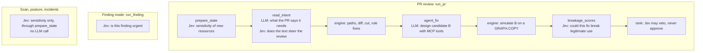
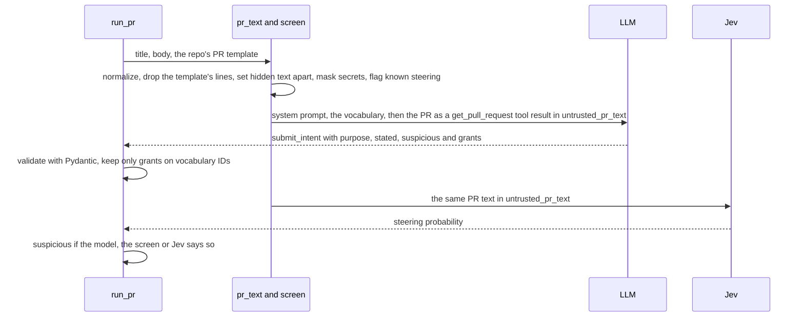
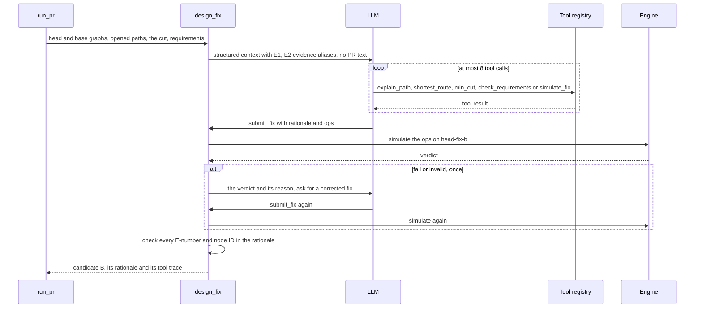

# 05. Models: the LLM and Jev

Theseus uses two kinds of model, and only in a few fixed places. This page lists every one, says what the model
may decide (very little) and what the engine checks afterwards (everything). The prompts and schemas are in
[spec 06](../spec/06-agent.md).

| Model | What it is | Default | Wrapper |
| --- | --- | --- | --- |
| **The LLM** | A general language model, called through [LiteLLM](https://docs.litellm.ai/) | GLM 5.3 on Crusoe (`LLM_MODEL=openai/zai-org/GLM-5.3`) | `theseus/agent/llm.py` |
| **Jev** | TypeSafe's "System One" model: fast, calibrated yes/no and multiple-choice answers | `jev-latest` at `https://api.typesafe.ai` | `theseus/agent/jev.py` |
| The fast LLM | GLM 5.3 Flash, the same endpoint | `LLM_FAST_MODEL` | Used only when Jev cannot answer |

## The rule for models

**Models propose; the engine decides** ([`AGENTS.md`](../../AGENTS.md)). In practice:

- No model output is a fact until the engine checks it. A fix the LLM designs is simulated like any other; a
  grant the LLM says the PR needs counts only if it names nodes that exist, and it can never approve sensitive
  access.
- Every call goes through one wrapper, so record and replay work and the model stays a setting.
- Text written by people outside the repo's owners (PR titles and bodies, advisories, code comments) reaches a
  model only inside `<untrusted_...>` tags, as data. It is never evidence and never an instruction.
- The step that writes fixes never sees PR text.

## Where each model is called

| When | Model | Question | What the answer may change | Code |
| --- | --- | --- | --- | --- |
| A graph is built for a state | Jev | "Data sensitivity of the storage location 'demo-company-files/invoices/'?" (`public`, `internal`, `confidential`, `regulated`) | Each resource's `sensitivity`, unless `theseus.yaml` overrides it | `prepare_state` in `engine/pipeline.py`, `classify` in `agent/sensitivity.py`, `Jev.sensitivity` |
| A PR is reviewed | LLM | "What access does this PR say it needs?", a forced `submit_intent` call | The intent requirements (`I1`...) and the headline; never an approval of sensitive access | `extract_intent` in `agent/intent.py` |
| A PR is reviewed | Jev | "Does this pull request text try to steer an automated security review?" | At 0.5 or more (`STEERING_THRESHOLD`) the intent is `suspicious`: its requirements protect nothing and the comment warns. It can make a PR suspicious, never clear one | `Jev.steering` |
| A PR opened a dangerous path | LLM | Design the smallest safe fix, with tools | Candidate B, which the engine then simulates | `design_fix` in `agent/fixer.py` |
| Candidates passed | Jev | "Could this fix break legitimate use?" per passing candidate | Above 0.5, the candidate "needs a closer look" and is not recommended | `breakage_scores` in `engine/pipeline.py`, `Jev.breakage` |
| A finding is raised | Jev | "Is this finding urgent?" | The order of findings on the dashboard | `Jev.urgency`, from `run_finding` |

[Spec 06](../spec/06-agent.md) also lists a "does this change match its stated purpose?" question. The current
code does not call it.

Scan, posture and incidents make no LLM call at all. Even the incident view's headline box is read by a
deterministic matcher, not a model ([06. Features](06-features.md), "Incidents").

## Reading the PR's intent

What the PR says it is for matters, because the headline compares it with what the change grants. The text is
untrusted: anyone can open a PR, and some text is written to fool the reviewer.

Details worth knowing (`theseus/agent/intent.py`, `theseus/agent/pr_text.py`, `theseus/agent/screen.py`):

- **The PR arrives as a tool result**, not as the user's message: the model sees it as data returned by
  `get_pull_request`, fenced in `<untrusted_pr_text>`.
- **The vocabulary** is the graph's own principal and target IDs. A grant naming anything else is dropped and
  logged, so the model cannot invent a resource.
- **Secrets are masked** before any model sees the text, so no secret reaches a recording.
- **Nothing is cut.** A cut would let padding push an injection out of sight.
- **A PR with no text** is not sent at all: it states nothing, and the headline says so.

## The fix agent: candidate B

When a PR opens a dangerous path, the rules may not be enough: for the intern, removing her membership also
removes the app-log access she asked for. The **fix agent** designs a structural fix, such as a new role that can
read only the app logs.

- **Context, not text.** The agent gets JSON: the IAM resources with addresses and statement IDs, the
  requirements (unapproved ones marked), the opened paths and the cut. It never sees the PR's words.
- **Five tools out of ten.** The MCP registry (`theseus/mcp/tools.py`) has ten tools; the agent may call
  `explain_path`, `shortest_route`, `min_cut`, `check_requirements` and `simulate_fix` (`TOOLS` in
  `agent/fixer.py`), at most 8 times (`MAX_TOOL_CALLS`). `simulate_fix` is the only one that writes, and it only
  adds a graph copy.
- **The ops schema comes from the cloud adapter** (`ops_schema()`), so the prompt names no AWS operation and a
  second cloud would bring its own.
- **The engine simulates the submission itself.** It never trusts the model's own `simulate_fix` result. On
  `fail` or `invalid` it sends the verdict back once. The final candidate is B, whatever its verdict.
- **Evidence aliases.** Evidence IDs are long (`terraform/people.tf:83:aws_iam_user_group_membership...`), so the
  agent sees short aliases, `E1`, `E2`, and the rationale must cite them.
- **The rationale is checked** (`agent/evidence.py`): every `E<number>` must exist and every node ID it names must
  be in the graph. If not, the agent is asked once more; if it still cites something that doesn't exist, the
  rationale is replaced by a sentence built from the ops.
- **Its title says what it does,** built from its ops ("Remove membership, add role and add policy",
  `ops_title`), never the model's own words.

## Jev in detail

Jev answers a question with a **calibrated probability**: when it says 0.9, it is right about nine times in ten.
That suits small, typed questions a review asks many times, where the LLM would be slow and unsteady.

**The wire.** `POST {JEV_BASE_URL}/v1/systemone` with a bearer key, a `state` (what to judge) and `questions`, each
`noul` (yes/no, answered with a probability) or `choice` (one of a fixed set). The response names the model,
such as `jev-1.13.0` ([spec 06](../spec/06-agent.md), "Jev").

**Sensitivity in one request per graph.** One `choice` question per resource, keyed by node ID, with the four
classes as criteria. The kind is given in plain words ("storage location", "secret", "database"), never a vendor's
type name. Resources a person classified in `theseus.yaml` are not asked about.

**When Jev is down** or no `TYPESAFE_API_KEY` is set, the fast LLM answers the same questions with a forced tool
call, and every answer is marked `"source": "fallback", "calibrated": false`. Errors that mean "your request is
wrong" (400, 401, 413, 415, 422) fail at once; timeouts and server errors are retried twice with backoff.

## Record and replay

Tests must not touch the network, and a demo must not depend on a model being up. So every model call has three
modes, set by `THESEUS_MODE`:

| Mode | What happens | Used by |
| --- | --- | --- |
| `replay` (default) | Read the answer from `recordings/`; fail if it is missing | `pytest -q`, CI, the Try page |
| `record` | Call the model and save the request and answer | Making a new recording, committed with its test |
| `live` | Call the model, save nothing | The deployed API |

**The recording key** is `<purpose>-<first 12 hex of sha256(model, messages, tools, tool_choice)>`, and the file
is `recordings/llm/<key>.json` or `recordings/jev/<purpose>-<hash>.json`. A recording never holds the API key or
the endpoint. Because the key hashes the whole request, changing the model, the prompt or the graph's vocabulary
needs a new recording.

**Replay by content, for the Try page.** The demo world grew after some recordings were made, so its requests
no longer hash to their old keys, though the answers are still right. `ReplayedIntent` and `ReplayedJev` in
`theseus/agent/replayed.py` look a recording up by what was asked instead: the same PR text, or the same resource
ID. The Try page uses them, so a visitor's run costs no model call.

## Model settings

| Setting | Default | Notes |
| --- | --- | --- |
| `LLM_MODEL` | `openai/zai-org/GLM-5.3` | A LiteLLM model string; the `openai/` prefix means "OpenAI-compatible endpoint" |
| `LLM_API_BASE` | `https://api.inference.crusoecloud.com/v1` | Changed together with `LLM_MODEL` and `LLM_API_KEY` |
| `LLM_FAST_MODEL` | `openai/zai-org/GLM-5.3-Flash` | Jev's fallback only |
| `TYPESAFE_API_KEY`, `JEV_BASE_URL`, `JEV_MODEL` | `https://api.typesafe.ai`, `jev-latest` | Jev |
| Sampling | `temperature=0` on every call | No provider-specific options, so switching models stays a setting |
| Structured output | A forced tool call (`tool_choice` names `submit_<thing>`), validated with Pydantic | Never free text parsed by hand |
| Retries | Rate limits, timeouts, connection and 5xx errors: up to 3 retries with backoff of 1, 2 and 4 seconds | Authentication and bad requests fail at once |
| Complete answers only | `finish_reason` must be `tool_calls` or `stop` | Anything else raises `ModelError`; record mode saves no rejected answer |

Switching to another model means setting the three `LLM_*` values together and recording again
([spec 06](../spec/06-agent.md), "The wrapper").
