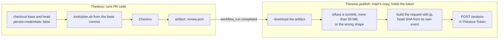
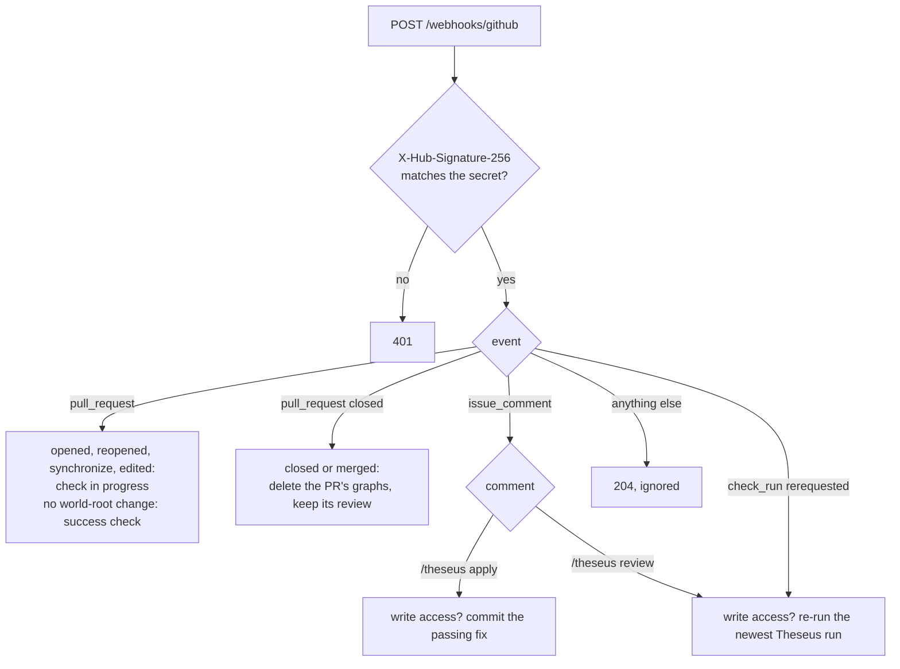
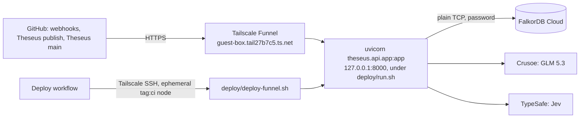

# 07. GitHub and deployment

How Theseus talks to GitHub, how its workflows are split so untrusted code never meets a secret, and how the
backend is deployed. The authoritative rules are in [spec 07](../spec/07-github-and-deploy.md).

## The pieces on GitHub

| Piece | File | Trusted? | What it does |
| --- | --- | --- | --- |
| `Theseus` workflow | `.github/workflows/theseus.yml` | No | Plans the world root at the PR's base and head, runs Checkov, uploads the artifact `theseus-review`. Holds no secrets |
| `Theseus publish` workflow | `.github/workflows/theseus-publish.yml` | Yes | When `Theseus` completes, reads the artifact as data and sends it to `POST /analyze` with `THESEUS_TOKEN`. Never checks out PR code |
| `Theseus main` workflow | `.github/workflows/theseus-main.yml` | Yes | On a push to `main`, nightly and on demand: plans `main`, sends it to `POST /posture`; nightly and on demand also calls `POST /incidents/check` |
| `CI` workflow | `.github/workflows/ci.yml` | Yes | The test suite (`check`), Windows (`windows`), FalkorDB parity (`falkordb`), the image build (`image`) |
| `Deploy` workflow | `.github/workflows/deploy.yml` | Yes | Deploys a ref to guest-box, by hand |
| The GitHub App | `theseus-graph-review` | Yes | Posts comments, checks, labels and suggestions; commits fixes; receives webhooks |

## Why two workflows for one review

Planning a PR runs **the PR's own Terraform**. A `data "external"` block runs a program during `terraform plan`,
and anything it plants can reach every later step of that job. So the run that plans must hold nothing worth
stealing.

- **`Theseus`** has `contents: read` and no secrets, and plans with the base commit's copy of `tools/plan.sh`, so
  a PR cannot change how it is planned.
- **`Theseus publish`** runs on `workflow_run`, which GitHub always takes from `main`, so a PR cannot change it
  either. It treats the artifact as untrusted data: a size limit, a shape check, then `jq`.
- **The commit comes from the trusted event** (`workflow_run.head_sha`), not the artifact. The PR number does come
  from the artifact, so the backend reads the PR from the API and comments only if that PR's head is the
  reviewed commit.
- **No `run:` step uses `${{ }}`;** values reach the shell through `env:`, so text in a branch name or title
  cannot become a command. Unit tests in `tests/unit/test_github.py` check this.
- **Fork PRs** get reviewed too: GitHub withholds secrets from the fork's own run, but not from `Theseus publish`.

## The GitHub App

| Setting | Value |
| --- | --- |
| Name | Theseus Graph Review (`theseus-graph-review`); the check it posts is named `Theseus` |
| Permissions | Contents, pull requests, issues, checks, actions: read and write. Metadata: read |
| Events | `pull_request`, `issue_comment`, `check_run`, `push` |
| Webhook | `https://<DOMAIN>/webhooks/github`, signed with `GITHUB_WEBHOOK_SECRET` |
| Auth | A JWT signed with the App's private key, exchanged for an installation token (`theseus/api/github.py`) |

**Why an App, not the Action's token?** The backend, not the Action, posts the comment and the check. A commit
made with the Action's `GITHUB_TOKEN` would not trigger a new workflow run; a commit made by the App does, so an
applied fix is reviewed again.

**Writing is fenced to the world root.** Every commit the App makes (an applied fix, a containment PR) may change
only files under `THESEUS_WORLD_ROOT` (`demo-infra`). The backend checks each path and refuses the whole commit
otherwise (`GitHub.writable`).

**Reading a commit.** `GitHub.world_files` lists the world root with one tree request, then reads the files with
one GraphQL query per 100 files, each path passed as a variable. A file GraphQL cannot give whole is read through
the contents API.

## The webhook

`POST /webhooks/github` (`github_webhook` in `theseus/api/routes.py`):

- **The signature is checked before anything in the body is read**, and an event from a repository outside
  `THESEUS_REPOS` is refused.
- **A closed PR's graphs are deleted** (`_on_closed`): its base, head and every fix graph, by name, from the number
  in the event, so GitHub is not called. Its review stays. If the store cannot delete, the delivery fails with a
  502 and can be redelivered. See [decision 32](08-decisions.md#32-a-prs-graphs-live-as-long-as-the-pr-is-open).
- **The handlers run in a thread pool.** The route is `async`, but the handlers call GitHub synchronously, and
  applying a fix takes seconds. Running them on the event loop once made GitHub give up on the next delivery
  (`ClientDisconnect`), so a `/theseus review` sent during an apply was lost.
- **While a review runs, the check says so**: "Reviewing: planning both commits", then "Reviewing: tracing paths
  in FalkorDB", then the verdict or "Review could not finish" with the reason. A failed review fails closed: the
  merge stays blocked and says why. When the workflow itself fails, `Theseus publish` calls `POST /review-failed`.

## The API routes

| Route | Auth | Purpose |
| --- | --- | --- |
| `GET /health` | None | `{status, falkordb, version}`; 503 while FalkorDB is unreachable |
| `POST /analyze` | `X-Theseus-Token` | A PR review, from `Theseus publish` |
| `POST /review-failed` | Token | Marks a review failed when the workflow failed |
| `POST /apply` | Token | Applies a fix (the comment command uses the same code) |
| `POST /posture` | Token | `main`'s posture, from `Theseus main` |
| `POST /incident`, `POST /incidents/check` | Token | An outage's blast radius; a check of the status feeds |
| `POST /finding` | None for a fixture's stored answer; the token for a real run | Finding mode on a fixture |
| `POST /scan` | None, fixtures only | Scan mode on a fixture |
| `POST /webhooks/github` | Webhook signature | The App's events |
| `GET /reviews/<owner>/<repo>/<n>`, `/data`, `/fixes/<id>` | Signed link | The review page |
| `GET /findings/<id>`, `/data` | Signed link | A finding's page |
| `GET /dashboard/<owner>/<repo>` and its `/data`, `/reviews`, `/graph`, `/incident`, `/incidents/check` | Signed link | The dashboard |
| `GET /org/<owner>`, `/data` | Signed link | The organisation view |
| `GET /`, `POST /try/<preset>`, `GET /web/<name>` | None, rate limited | The Try page |

**Signed links.** A page link carries `k`, an HMAC-SHA256 of the page's document key (`review:<repo>#<n>`,
`finding:<id>`, `dashboard:<repo>`, `dashboard:org:<owner>`) with `THESEUS_TOKEN`, cut to 32 hex characters. A
missing or wrong `k` is a 404, so the public hostname alone reveals nothing.

## Deployment

The API runs on **guest-box**, a container on an Oracle ARM host (Ubuntu 24.04, arm64, 4 cores). It has no Docker,
no systemd and no public port, so:

- **Tailscale Funnel** publishes the API at `https://guest-box.tail27b7c5.ts.net` with Tailscale's certificate.
  It is the only public way in; GitHub's webhooks and the workflows' `THESEUS_URL` use it.
- **`deploy/run.sh`** keeps the API running from a venv on `127.0.0.1:8000`, restarting it if it exits. Logs go
  to `~/theseus-logs/api.log`.
- **The Deploy workflow** joins the tailnet as an ephemeral node, logs in over Tailscale SSH (no SSH key stored in
  GitHub), and runs `deploy/deploy-funnel.sh`, which deploys a commit and rolls back if the public `/health` never
  answers.
- **Secrets** live in `~/theseus/.env` on the host, readable by its user only, and the App's key in
  `~/theseus/secrets/`.
- **A host with Docker** and public ports can run `deploy/docker-compose.yml` instead: the API built from
  `deploy/Dockerfile` behind Caddy with automatic HTTPS.

## Settings

All settings come from the environment and `.env`, through `theseus/config.py`; `.env.example` lists them. The
code never reads the environment anywhere else.

| Group | Variables |
| --- | --- |
| Models | `THESEUS_MODE`, `LLM_MODEL`, `LLM_FAST_MODEL`, `LLM_API_BASE`, `LLM_API_KEY`, `TYPESAFE_API_KEY`, `JEV_BASE_URL`, `JEV_MODEL` |
| FalkorDB | `FALKORDB_HOST`, `FALKORDB_PORT`, `FALKORDB_USERNAME`, `FALKORDB_PASSWORD`, `FALKORDB_TLS` |
| GitHub | `GITHUB_APP_ID`, `GITHUB_APP_PRIVATE_KEY_PATH`, `GITHUB_WEBHOOK_SECRET` |
| Theseus | `THESEUS_TOKEN` (the workflows' shared secret, and the key that signs page links), `THESEUS_REPOS` (the only repositories it acts on), `THESEUS_WORLD_ROOT` (`demo-infra`), `THESEUS_ADVISORIES` (`advisories`), `DOMAIN` |
