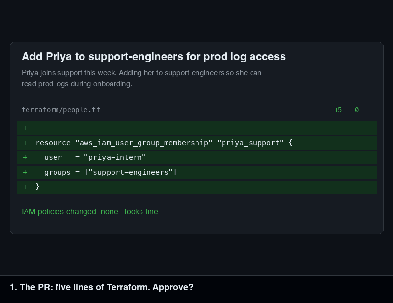
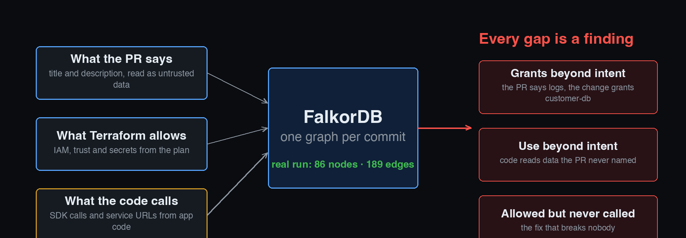
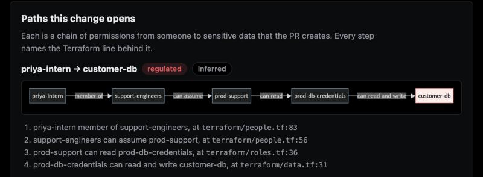
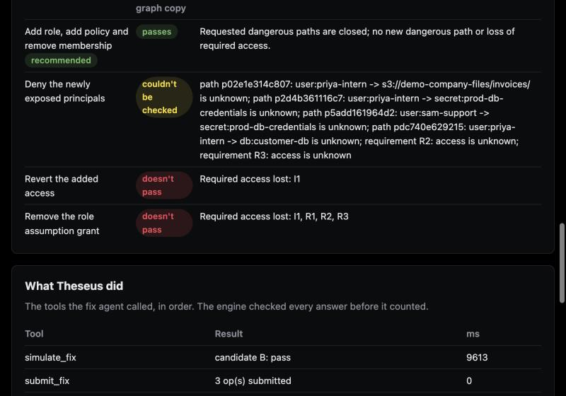

<!--
PUBLISHING NOTES (delete this whole comment before you publish)

1. Fill the one placeholder: [[VIDEO LINK]] (search for "[[").
2. Make the repo PUBLIC first (task S7). It is private today, so the repo links 404 for judges.
3. Upload these files from docs/blog/assets/ in the editor (raw GitHub links do not work while the repo is
   private, and the editor needs its own copies anyway):
     cover.png          use as the cover image (1000x420, the size dev.to expects)
     pr-diff.png        the "would you approve this?" hook
     intern-run.gif     the real run on the live demo
     three-sources.png  what the PR says, what Terraform allows, what the code calls
     shot-path.png      one opened path with its Terraform lines
     shot-fixes.png     the four fixes and their verdicts
   Replace each `assets/...` path below with the URL the editor gives you.
4. The section "What went wrong on the way" is written from events recorded in the repo (the PoC notes,
   the architecture decisions, AI_USE.md). Read it once and change any wording that does not match how
   you remember it. It is the part of the post that must sound like you.
5. Suggested tags (the organizers have not published any): falkordb, hackathon, graphdatabase, security.
6. Publish before 11:59 PM IST on 18 Oct 2026, then paste the link into the hackathon form.
-->


# This pull request changed no policy. It still gave an intern the customer database.

*How we reviewed a Terraform change as a graph in FalkorDB, found the path nobody could see in the diff, and
proved a fix that keeps her working. Built for FalkorDB Graph Hacks, Track 01.*

## You are the reviewer

It is Monday. Priya, an intern, joins the support team. This pull request lands in your queue:


Five lines. It adds one group membership and touches no IAM policy. The description makes sense: she needs to
read production logs during onboarding. Would you approve it?

Most of us would, and that is the problem. Here is what those five lines do once they merge.

`support-engineers` can already assume the `prod-support` role. That role can read the app logs, which is what
Priya needs. It can also read `invoices/*`, and the `prod-db-credentials` secret, which unlocks the customer
database. So the change opens this path:

> **priya-intern** → member of → **support-engineers** → can assume → **prod-support** → can read →
> **prod-db-credentials** → can read and write → **customer-db**

Four hops, and nothing in the diff shows any of them. A policy-diff tool has nothing to compare, because no policy
changed. A scanner that checks one resource at a time sees an ordinary group membership. The danger is not in any
resource. It is in the *path between them*, and paths are what graph databases are for.

So we built **Theseus**. It reads a Terraform pull request, builds a graph of who can reach what, shows which
sensitive data the change makes reachable, and proves the smallest fix on copies of that graph. A person
approves. Here is a real run on our live demo:



## Try it in 60 seconds

- **Live demo:** <https://guest-box.tail27b7c5.ts.net>. Pick the `intern` preset. The engine runs for real on
  FalkorDB, and the model's answers replay from recordings, so a try costs nothing. A click returns in about
  two seconds. The page's "Analyzed in" figure (56,982 ms for `intern`) is the engine time the server recorded when
  it computed the result at startup, not the time your click takes.
- **On your machine:** FalkorDB in Docker, then the app. This is the README's setup:

```bash
git clone https://github.com/AjinkyaTaranekar/theseus.git && cd theseus
docker run -d -p 6379:6379 falkordb/falkordb:v4.22.0 && python3.12 -m venv .venv && \
  .venv/bin/pip install -e . && .venv/bin/python -m theseus serve
```

Open <http://localhost:8000>. The same run on a laptop with a local FalkorDB takes 1.4 seconds.

## One graph per state, and every edge cites a line

Theseus keeps three sources of truth in one graph: **what the PR says**, **what Terraform allows**, and **what
the code actually calls**. Every gap between them is a finding.



Each state of the world is its own FalkorDB graph: `demo-infra__main`, `demo-infra__pr85-base`,
`demo-infra__pr85-head`, and later one per candidate fix. Every edge keeps its evidence:

```json
{"address": "aws_iam_user_group_membership.priya_support", "file": "terraform/people.tf", "line": 83}
```

A result never contains a claim without a line like that behind it. If a line cannot be found, the edge says
`file="unknown"` and says why. We never guess one.

One variable-length match finds every route from an actor to a resource. We run it on the base graph and the head
graph, and the difference is what the PR *opened*:

```cypher
MATCH p = (a:Node {id: $actor})-[:MEMBER_OF|CAN_ASSUME|TRUSTS|RUNS_AS|CAN|UNLOCKS*1..7]->(r:Resource)
RETURN [rel IN relationships(p) | rel.eid] AS eids
```



Three paths opened and none closed: to `customer-db`, to `prod-db-credentials` and to `invoices/`.

## The obvious fix fails

The first idea is the one you had a minute ago: remove Priya from the group. We tested it, and it does close every
path. It also takes away the log access she joined to get. Her onboarding is a declared requirement in
`theseus.yaml`, and the engine checks every requirement on every fix.

So we asked the graph a sharper question: what is the *smallest* set of permissions we could remove to cut Priya
off from the sensitive data, without cutting a requirement? That is a minimum cut, and FalkorDB ships
`algo.maxFlow`. Every edge gets a capacity, so the cut cannot cross something that must stay:

- **1,000,000** for an edge a declared requirement depends on
- **1,000** for a grant the code really calls
- **1** for everything else

The answer for the intern pull request was a max flow of **1,000,000 or more**. That number means *no
permission can be removed without breaking something that has to work.* The one edge that closes every route is her
group membership, and she needs it. A rule can say "remove access". It cannot say "there is no removal that works".

So the fix has to be a new shape, not a smaller cut. Theseus tests four candidates, each on its own `GRAPH.COPY` of
the head graph, and re-runs the full analysis on each:

| What the fix does | Result on its graph copy |
| --- | --- |
| Revert the added access (remove her from the group) | **Fails.** Required access lost: her own log access |
| Remove the role-assumption grant | **Fails.** Four declared requirements lose access |
| Deny the newly exposed principals | **Unknown.** Needs a condition we do not model, so a person must look |
| A new, narrower role that reads only the app logs, plus her removal from the group | **Passes.** Every path closed, nothing required lost |



The passing fix is the model's own design. A rule could not invent a new role, and that is what the model adds.
What the model cannot do is declare the fix safe, because the engine decides that.

## Where the models are allowed to help

The first rule in our `AGENTS.md` is the shape of the whole product:

> **The engine decides facts. Models propose. A person approves.**

- **FalkorDB and the engine** decide which paths exist, what the diff is, and whether required access survives.
- **An LLM** (GLM 5.3 through LiteLLM) reads what the PR says it is for and designs one candidate fix. It calls
  five graph tools: `explain_path`, `shortest_route`, `min_cut`, `check_requirements` and `simulate_fix`. It has
  **no tool that comments or commits**.
- **Its explanation must cite evidence IDs**, and a checker rejects any ID that does not exist in the graph. A
  claim the engine did not return cannot reach the page.
- **Text from outside**, such as PR bodies, advisories and commit messages, reaches a model only inside
  `<untrusted_...>` tags and never counts as evidence.
- **A person** approves. A reviewer replies `/theseus apply B`, the GitHub App commits the Terraform for the fix
  that passed, and Theseus reviews the new head. On our demo PR, the comment then turns green: *No new access to
  sensitive data*.

The same ten-tool registry is also an MCP server, so an outside client such as Claude Code can ask the graph
directly. Ask it "What does the intern PR open?" and it answers with the three paths above.

## Three FalkorDB details worth stealing

**1. `algo.maxFlow` takes one relationship type and no parallel edges.** Our graph has six traversal and grant
types, and sometimes two edges between the same pair. So before every call the engine writes one `FLOW` edge per
(source, target) pair, with the capacities summed, and runs the algorithm on those:

```cypher
MATCH ()-[f:FLOW]->() DELETE f
WITH count(*) AS dropped
UNWIND $rows AS r
MATCH (a:Node {id: r.src}), (b:Node {id: r.dst})
CREATE (a)-[:FLOW {eids: r.eids, capacity: r.capacity}]->(b)
```

```cypher
CALL algo.maxFlow({sourceNodes: ss, targetNodes: ts, capacityProperty: 'capacity',
                   relationshipTypes: ['FLOW']})
YIELD maxFlow, edges, edgeFlows
RETURN maxFlow, [e IN edges | e.eids] AS eids, edgeFlows
```

**2. `algo.betweenness` is a sampled estimate.** On one of our graphs the top "choke point" changed from one run to
the next. A ranking that changes between runs is not a fact, and facts are what the engine promises, so the results
use the exact algorithm (Brandes) in Python. FalkorDB's own scores stay available for anyone who wants them. At our
size the exact version takes milliseconds.

**3. A graph per state is cheap to make and easy to leak.** `GRAPH.COPY` made candidate fixes trivial. Then our
shared FalkorDB Cloud instance hit its 100 MB cap because test graphs were never deleted. Now a PR's graphs are
deleted when the PR closes, and a test fails if it leaves a graph behind.

## What went wrong on the way

<!-- Every event below is recorded in the repo. Edit the wording so it sounds like you. -->

The model's first instinct was the blunt fix. In our feasibility spike, it did not design a new role. It removed
Priya from the group and granted her log access directly, which is a fix a rule could have written. We had to
change the prompt to *ask* for a new, narrower role, and then check every answer, because asking is not the same as
getting a fix that works.

A Terraform plan has no line numbers. We wanted every claim to cite a file and line, and the plan JSON does not
carry them. So the importer also reads the `.tf` files, and the repo has to be checked out next to the plan.

And our own tooling failed us on the machine we were building on. The project's MCP server would not start on a
stock Mac, because there is no `python` on its PATH, and the hook that guards the answer keys exited with an error
that nobody saw. The fix was one setting, `THESEUS_PYTHON`, but it taught us to test setup on a clean machine, and
not only the code.

## What it cannot do

We would rather say this than have you find it:

- **A path is a modeled path, not an exploit.** Every step is labeled `configured`, `inferred` or `assumed`.
- **We support a subset of IAM:** Allow and Deny, wildcards, inline and attached policies, assume-role trust, and
  GitHub OIDC trust on `aud` and `sub`. `NotAction`, other condition keys, permission boundaries and SCPs return
  **UNKNOWN**, which is a real answer and not a failure.
- **The code reader is static.** A name built at runtime produces no edge and is listed as unknown, so a grant
  reached only that way can look unused.
- **The test data is ours.** The demo world is a synthetic online store: 137 planned Terraform resources, eight
  Python services and five GitHub workflows. There is no AWS account behind it.
- **Others got to graphs first.** Cartography and SubImage map what already runs, and Wiz does attack paths. Our
  narrow claim is to judge a change *before* merge and to test each fix against the access the app needs.

## The numbers

| Scenario | Opened dangerous paths | Max flow | Fix verdicts | Engine time (laptop, local FalkorDB) |
| --- | --- | --- | --- | --- |
| `intern` | 3 (`customer-db`, `prod-db-credentials`, `invoices/`) | 1,000,000, not cuttable | A fail, B pass, C unknown, D fail | 1.4 s (first run) |
| `public-bucket` | 1 (`entry:internet` to `invoices/`) | 1 | A fail, S pass | 0.33 s |
| `code-pr` | none; *"Your code now reads customer-db"* | | | 0.11 s |

`code-pr` is a pull request titled as a typo fix whose code starts reading the customer database: the case where
what a change says and what it does disagree.

## How we used AI

We used Claude Code and Codex to write much of the code from task briefs written beforehand, one task per branch,
and the other teammate reviewed every diff. Humans wrote every `expected.json` answer key, and a hook blocks agents
from writing them. [`AI_USE.md`](https://github.com/AjinkyaTaranekar/theseus/blob/main/AI_USE.md) records which
agent wrote what and what we changed. This post was drafted with Claude Code from our README, specs, test fixtures
and a real run of the live demo, and then checked and edited by us.

## Why "Theseus"

Two Greek stories fit. Theseus followed a thread through the labyrinth and found the way out, which is what the
graph does with a maze of roles and permissions. And in the Ship of Theseus, the planks are replaced one at a time
until people ask whether it is the same ship.

Every pull request replaces a plank. Theseus checks the ship still floats.

- **Live demo:** <https://guest-box.tail27b7c5.ts.net>
- **Code:** <https://github.com/AjinkyaTaranekar/theseus>
- **A real review:** [demo PR #125](https://github.com/AjinkyaTaranekar/theseus/pull/125)
- **Demo video:** [[VIDEO LINK]]
