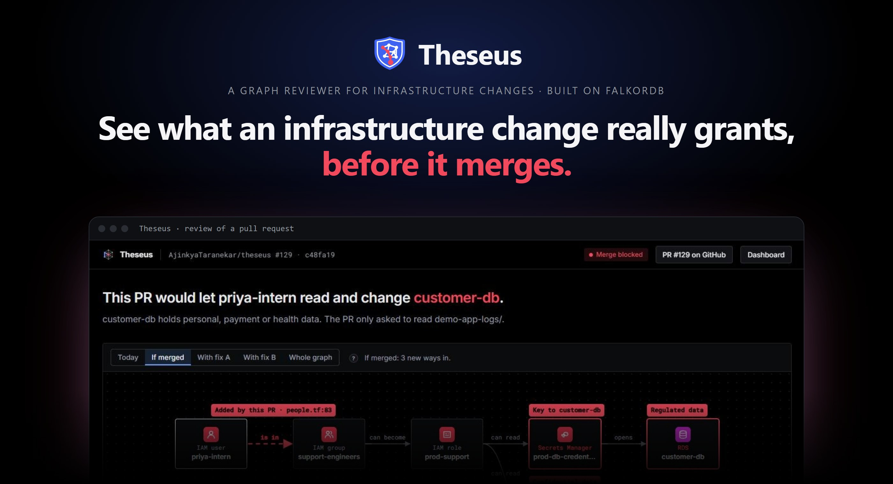
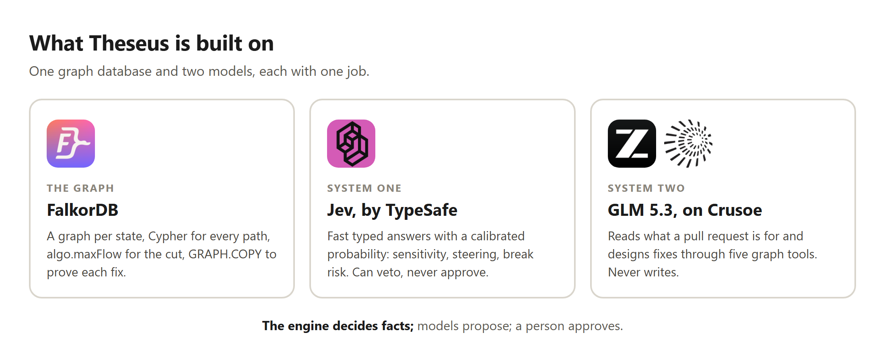
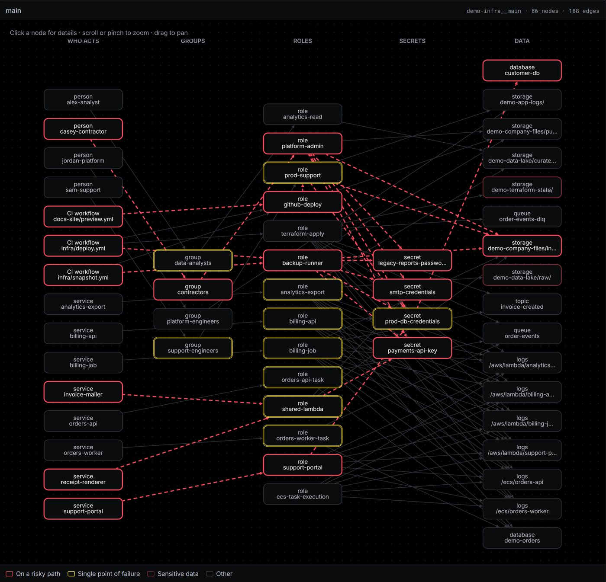
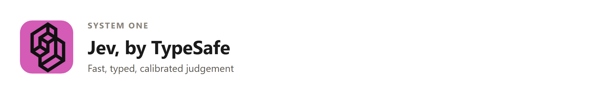
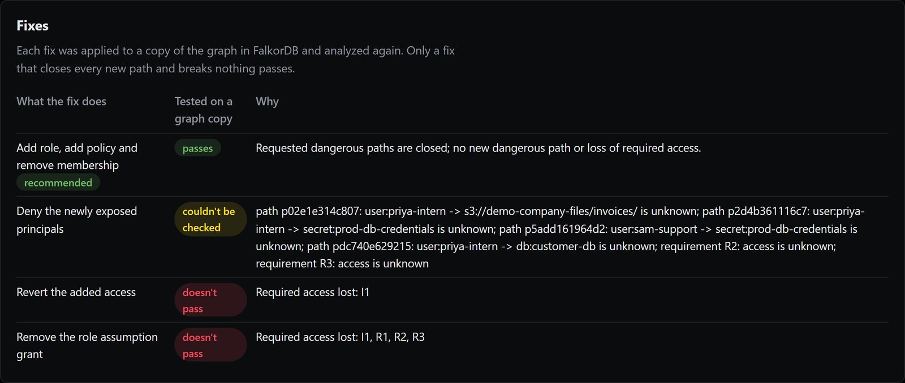
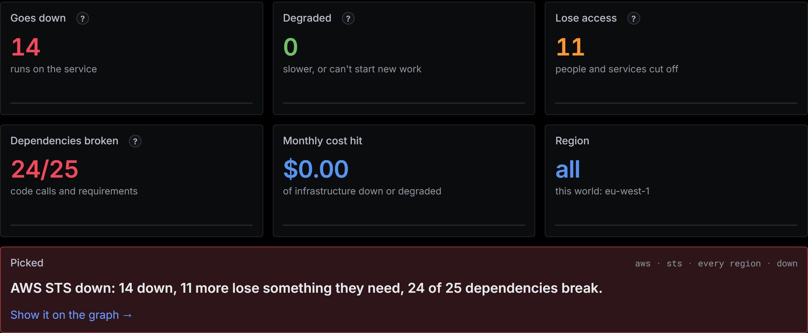

<!--
PUBLISHING NOTES (delete this comment before you publish)

This post is written for Medium. Medium has no tables, no maths and no Mermaid, so the post uses none of them,
and it uses only two heading levels, which match Medium's large and small headings.

1. Make the repository public first, or every repository link in the post returns 404.
2. Open this file on GitHub, copy the rendered post (everything after this comment), and paste it into a new
   Medium story. Make the first heading the title and the italic paragraph the subtitle. Medium shows one
   author per story, so keep the byline line as text.
3. Images from a private repository do not paste across. Upload each one from docs/blog/assets/ where it
   belongs, and move the italic line under it into the image's caption:
     cover-intro.jpg    the cover, under the subtitle (Medium uses the first image as the preview)
     pr-diff.png        the five-line pull request
     blast-radius.png   what one account reaches, before and after the change
     built-on.png       what Theseus is built on: FalkorDB, Jev, GLM 5.3 on Crusoe
     architecture.png   the architecture: inputs, FalkorDB, the two models, the engine, the person
     badge-falkordb.png, badge-jev.png, badge-glm.png   one at the top of each part's section
     shot-graph.jpg     main's whole access graph, read live from FalkorDB
     shot-fixes.jpg     the four fixes and their verdicts
     shot-comment.jpg   the comment on a real pull request
     shot-incident.jpg  the dashboard's Incidents page: an outage's blast radius
4. Check each code block after pasting. Medium keeps code blocks but drops the language name.
5. The video link is filled in, in the TL;DR and under "Available today".
6. The live dashboard link carries a signed key, so the post points to the README for it.
7. Tags (Medium allows five): Graph Database, Site Reliability Engineering, Cloud Security, AI Agents, Terraform.
-->

# Introducing Theseus: see what an infrastructure change really grants, before it merges

**By Ajinkya Taranekar and Sakshi Chitnis** · Team Project Hail Mary

*A graph reviewer for infrastructure changes, built on FalkorDB. A fast System One model labels the data, a System Two model designs fixes, a deterministic engine decides what is true, and a person approves every change.*


*Theseus's review of a pull request: one added line, and the four hops it opens to the customer database.*

**TL;DR**

- Theseus reads every Terraform pull request as a graph in FalkorDB and finds every path the change opens to sensitive data, with each hop cited to the line of code that created it.
- It proves the smallest fix on a copy of the graph before anyone is asked to approve it, and its GitHub App commits the fix once a person does.
- Jev, a System One model, labels data and can veto; GLM 5.3, a System Two model, reads intent and designs fixes; a deterministic engine decides every fact.
- The same graph gives the blast radius of a compromised Action or an outage in under a second, and a Claude Code plugin and an MCP server bring the check to the terminal before a pull request exists.
- It is open source, built for FalkorDB Graph Hacks. [Try it live](https://guest-box.tail27b7c5.ts.net), or [watch the three-minute demo](https://www.youtube.com/watch?v=oKLoHeoLxqk).

## Why we built it

Anyone who has run production infrastructure knows two bad mornings. On the first, a postmortem or an access review finds that someone had access they were never meant to have: a contractor who could read the payments database, a CI job that could assume an admin role. On the second, something is compromised, a leaked key or a poisoned third-party GitHub Action, and the first question in the incident channel is the hardest one: what could it reach? Answering it means opening Terraform files and tracing roles by hand while everyone waits for a list of secrets to rotate.

Both mornings have the same root. Cloud access is rarely granted directly. It is granted through groups, through roles that people and services can take on, and through secrets that unlock other systems. A change that looks harmless on its own, one user added to one group, can complete a path that runs through three other files written months earlier by other people. The risk is not in the change. It is in what the change connects to.

The tools we had did not follow those connections:

- **Code review reads the diff.** The diff is exactly the part that looks fine.
- **Static analysers, such as [Checkov](https://www.checkov.io/), check rules one resource at a time.** That catches a public bucket or a wildcard policy, not a path that crosses four resources.
- **Cloud graph tools, such as the CNCF's [Cartography](https://github.com/cartography-cncf/cartography), map what is already deployed.** They see the path, but after the merge, when closing it is a ticket and a second change under pressure.
- **A language model reviewing the diff** reads intent well, but it cannot be the gate. The same input does not always give the same verdict, it cannot prove that its fix breaks nothing, and the pull request's own text can steer it.

The cost of finding out late is real. IBM's [Cost of a Data Breach Report 2026](https://www.ibm.com/reports/data-breach) puts the global average breach at $4.99 million, a record. We wanted the question "who can reach what, through which path?" answered on every pull request, before the merge, with the path cited to the line and the fix already proven. And we wanted the same answer available in seconds during an incident.

## What Theseus does

Theseus reads every infrastructure pull request as a graph in [FalkorDB](https://docs.falkordb.com/). It follows each permission from every person, workflow and service to the data it reaches, and compares what the change grants with what the pull request says it needs and what the code actually calls. When a change opens a path it should not, Theseus blocks the merge, explains the path line by line, and offers the smallest fix that it has already tested on a copy of the graph. A person approves the fix, and Theseus commits it.

Here is a short example from our demo world, a synthetic online store in the [repository](https://github.com/AjinkyaTaranekar/theseus) with no real account behind it. A pull request adds an intern to the support team's group so that she can read the production logs.


*Five lines, no policy changed. Checkov passed all 438 of its checks on this commit.*

Theseus follows the access past the diff. The group can take on a role, `prod-support`, granted in `people.tf`. That role can read a secret, `prod-db-credentials`, in `roles.tf`. And the secret is the password to `customer-db`, tagged in `data.tf`:

```hcl
resource "aws_secretsmanager_secret" "prod_db" {
  name = "prod-db-credentials"
  tags = { db_instance = "customer-db" }
}
```

Four hops, each one correct on its own, and three of them written long before this pull request. Asked as a blast-radius question, "if this account leaked, what would an attacker reach?", the answer goes from nothing to three sensitive targets.


*What one account reaches, before and after the change. Only the first hop is new.*

The same graph answers the second bad morning. Given an advisory that a third-party GitHub Action leaks secrets, Theseus finds the two workflows that use it, follows their trust into the cloud, and reports in 0.2 seconds that one of them reaches the customer database. It names the single trust edge to cut, tests that cut on a copy of the graph, opens a [containment pull request](https://github.com/AjinkyaTaranekar/theseus/pull/111), and files [an issue listing the secret to rotate](https://github.com/AjinkyaTaranekar/theseus/issues/112). When a provider goes down instead, the same graph shows what fails and who loses access.

## Powered by FalkorDB, Jev and GLM 5.3


*One graph database and two models, each with one job.*


*Every input becomes a graph in FalkorDB. Two models help, the engine decides, and only a person turns a tested fix into a commit.*

Theseus is one FastAPI service beside FalkorDB. A GitHub Action plans the base and the head of each pull request with Terraform, with no cloud credentials, and sends both plans as [JSON](https://developer.hashicorp.com/terraform/internals/json-format). Adapters for Terraform, AWS, GitHub Actions and Python turn the plans, the CI workflows and the services' code into graph rows. From there, four parts share the work, and the design rests on one rule about what each may do:

> The engine decides facts; models propose; a person approves.

### Why FalkorDB


Access is reachability, and reachability is a graph question. Who can reach `customer-db`? Every chain of edges, of any length, from any principal, that ends on it. In a relational database, that is a recursive query across a join table for every kind of grant. In a graph database, it is one pattern. FalkorDB is where every fact in Theseus is computed, and the product will not start without it.

We use it in four ways.

**One graph per state.** Each state of the infrastructure is its own graph: the base and the head of every pull request (`demo-infra__pr129-base`, `demo-infra__pr129-head`) and a standing graph for `main`. Nodes are principals (users, groups, [IAM roles](https://docs.aws.amazon.com/IAM/latest/UserGuide/id_roles.html), services, CI workflows) and resources (buckets, secrets, databases, queues), labelled with Cartography's ontology so a live cloud map can feed the same engine later. Edges are permissions, such as `MEMBER_OF`, `CAN_ASSUME`, `TRUSTS` for [GitHub's OIDC trust](https://docs.github.com/en/actions/concepts/security/openid-connect) and `CAN`, and every edge carries the file and line of Terraform that created it.

**Cypher for every path.** One variable-length match finds every route from an actor to a resource. Running it on the base and the head and comparing the results gives what a pull request opens and closes:

```cypher
MATCH p = (a:Node {id: $actor})-[:MEMBER_OF|CAN_ASSUME|TRUSTS|RUNS_AS|CAN|UNLOCKS*1..7]->(r:Resource)
RETURN [rel IN relationships(p) | rel.eid] AS eids
```

For the intern's change, that is three paths opened, none closed and 23 unchanged, in 0.6 seconds of engine time.

**[`algo.maxFlow`](https://docs.falkordb.com/algorithms/maxflow) for the smallest fix.** The fewest permissions whose removal closes every new path is a minimum cut, and by the [max-flow min-cut theorem](https://en.wikipedia.org/wiki/Max-flow_min-cut_theorem) FalkorDB can find it inside the database. The capacities carry what must keep working: 1,000,000 for an edge a declared requirement needs, 1,000 for a grant the services' code actually calls, and 1 for everything else. A small maximum flow means a cheap cut that removes only unused permissions. A flow of 1,000,000 or more means no removal is safe, which tells the engine that a new, narrower structure has to be designed instead. For the intern, the flow is 1,000,000: the only edge that closes every path is her membership, and she needs it for the logs.

**[`GRAPH.COPY`](https://docs.falkordb.com/commands/graph.copy.html) to prove every fix.** Each candidate fix runs on its own copy of the head graph. The engine applies the change to the copy and runs the whole analysis again, paths, requirements, code calls and unknowns, so a fix is proven before anyone is asked to approve it, and the real graph is never touched.


*The demo world's `main`, read live from FalkorDB: 86 nodes and 188 edges. Red links reach sensitive data nothing requires; yellow borders are single points of failure.*

The same graphs serve everything else: the dashboard of `main`, the incident view, the compromised-Action analysis and the ten tools the agents call. Nothing keeps a second copy of the truth.

### The Cypher behind Theseus

Every fact Theseus reports comes from a handful of queries. Here they are, as the engine runs them on FalkorDB 4.22.

**Loading a state.** Each graph is written in batches, one query per node label and per edge type, because labels and relationship types cannot be parameters. An index on the node ID keeps every later lookup fast:

```cypher
CREATE INDEX FOR (n:Node) ON (n.id)

UNWIND $rows AS r CREATE (n:Node:Principal:User) SET n = r

UNWIND $rows AS r MATCH (a:Node {id: r.src}), (b:Node {id: r.dst})
CREATE (a)-[e:MEMBER_OF]->(b) SET e = r.props
```

**Every route from an actor.** The query from above, run on the base, the head, `main` and every fix copy. The engine then checks each hop against the IAM rules it models:

```cypher
MATCH p = (a:Node {id: $actor})-[:MEMBER_OF|CAN_ASSUME|TRUSTS|RUNS_AS|CAN|UNLOCKS*1..7]->(r:Resource)
RETURN [rel IN relationships(p) | rel.eid] AS eids
```

**The flow network, then the cut.** `algo.maxFlow` follows one relationship type and expects no parallel edges, so before each call the engine replaces the old flow edges with one `FLOW` edge per pair of nodes, carrying the summed capacity and the IDs of the edges it stands for:

```cypher
MATCH ()-[f:FLOW]->() DELETE f
WITH count(*) AS dropped
UNWIND $rows AS r
MATCH (a:Node {id: r.src}), (b:Node {id: r.dst})
CREATE (a)-[:FLOW {eids: r.eids, capacity: r.capacity}]->(b)
```

```cypher
MATCH (s:Node) WHERE s.id IN $sources WITH collect(s) AS ss
MATCH (t:Node) WHERE t.id IN $sinks WITH ss, collect(t) AS ts
CALL algo.maxFlow({sourceNodes: ss, targetNodes: ts, capacityProperty: 'capacity',
                   relationshipTypes: ['FLOW']})
YIELD maxFlow, edges, edgeFlows
RETURN maxFlow, [e IN edges | e.eids] AS eids, edgeFlows
```

**A copy per fix.** Each candidate gets its own graph, and the fix is written to the copy as deleted and created rows, so the head is never touched:

```text
GRAPH.COPY demo-infra__pr129-head demo-infra__pr129-fix-b
```

```cypher
UNWIND $rows AS r MATCH (:Node {id: r.src})-[e:MEMBER_OF]->(:Node {id: r.dst}) DELETE e
```

**Where a compromise starts.** Finding mode begins by asking which workflows run the affected Action, and at which version, then walks the graph from each of them:

```cypher
MATCH (w:Workflow)-[u:USES]->(:Action {id: $action})
RETURN w.id AS workflow, u.version AS version
```

**What the code really uses.** Every call a service's code makes, read from its Python, so the cut knows which grants are in use:

```cypher
MATCH (w:Workload)-[x:CALLS]->(r:Resource)
UNWIND x.grants AS access
RETURN w.id AS workload, r.id AS resource, access, x.eid AS eid
```

**Grants nobody uses.** A service's access to sensitive data that its own code never exercises is the safest permission to remove:

```cypher
MATCH (w:Workload)-[:RUNS_AS]->(:Role)-[c:CAN]->(r:Resource {sensitive: true})
OPTIONAL MATCH (w)-[x:CALLS]->(r)
WITH w, c, r, x
WHERE x IS NULL OR NONE(g IN c.grants WHERE g IN x.grants)
RETURN w.id AS workload, r.id AS resource, c.eid AS eid
```

**Choke points.** The nodes that the most routes pass through, over the traversal and grant types the graph actually has. FalkorDB ranks them in one call; Theseus keeps the call, but reports the exact score it computes in Python instead, for a reason explained below:

```cypher
CALL db.relationshipTypes() YIELD relationshipType RETURN relationshipType

CALL algo.betweenness({relationshipTypes: $types}) YIELD node, score
RETURN node.id AS id, score ORDER BY score DESC, id
```

### System One: Jev, for fast typed judgement



Some questions need judgement but not long reasoning. Is a resource named `customer-db` regulated data? Does this pull request's description try to steer the review? Is this advisory urgent? How likely is a fix to break legitimate use? Kahneman's [*Thinking, Fast and Slow*](https://en.wikipedia.org/wiki/Thinking,_Fast_and_Slow) calls this fast, intuitive thinking System One, and Theseus uses a model built for it: **Jev**, from [TypeSafe](https://docs.typesafe.ai/).

Jev answers typed questions, a yes or no or one choice from a list, with a calibrated probability rather than prose. That shape matters. A probability can be thresholded the same way every time, so a steering score of 0.5 or more marks the intent as suspicious, and an answer can be recorded and replayed, so tests run without a key. Its sensitivity answers label every resource node, as public, internal, confidential or regulated, before the graph is loaded, and an override in the repository's `theseus.yaml` always wins.

Measured on the demo world, Jev labelled 9 of 10 resources the way our specification does, in about 0.3 seconds for all ten. On 31 recorded pull requests, it flagged 13 of the 14 that try to steer the review, in Spanish, in Chinese, with typos or dressed as a config block, and none of the 17 ordinary ones. Its power is deliberately one-sided: Jev can raise a flag or veto a fix as likely to break something, but it can never approve access or call a change safe.

### System Two: GLM 5.3, for intent and fix design


Two questions need deliberate reasoning, Kahneman's System Two. What access does this pull request say it needs? And when no permission can simply be removed, what is the smallest new structure that keeps the legitimate access and closes the paths? For these, Theseus uses a language model: GLM 5.3, from [Z.ai](https://github.com/zai-org), served on [Crusoe](https://crusoe.ai/cloud) and called through [LiteLLM](https://docs.litellm.ai/), so the model is a setting rather than a dependency.

It is fenced in on every side. It reads the pull request only as data inside `<untrusted_pr_text>` tags, and it must answer with IDs from a vocabulary of nodes in the graph, so it cannot invent a resource. On the 31 recorded pull requests, it read the requested access correctly in all 31 and flagged all 14 steering attempts. To design a fix, it calls five of the engine's graph tools (`explain_path`, `shortest_route`, `min_cut`, `check_requirements` and `simulate_fix`), at most eight times, and submits patch operations. It has no tool that comments, commits or merges.

For the intern, it designed fix B: a new role, `intern-logs-read`, that reads only the application logs and that only she can assume, plus her removal from the support group. The engine never trusts the model's own simulation. It runs the submitted change on a graph copy itself, sends any failure back once for a correction, and checks that every piece of evidence the model cites exists. The model designed the fix; the graph decided that it works.


*Four candidate fixes, each tested on its own graph copy. Only the model's new role closes every path without breaking the access the pull request asked for.*

### The engine, and the person

The engine is ordinary deterministic code, and it is the only part allowed to state a fact. It runs the Cypher, calls the flow solver, applies fixes to graph copies, and returns the same answer for the same inputs every time. When it meets an IAM feature outside the subset it models, such as a condition key or a permission boundary, it returns `UNKNOWN` rather than a guess, and `UNKNOWN` is never treated as safe.

The person is the last part of the architecture, not an afterthought. Theseus posts one comment and sets a required check, so a blocked change cannot merge. The comment sets what the pull request asked for against what it would grant, cites every hop, and offers the passing fix as [suggested changes](https://docs.github.com/en/pull-requests/collaborating-with-pull-requests/reviewing-changes-in-pull-requests/incorporating-feedback-in-your-pull-request) on the pull request's own lines. Only after a reviewer comments `/theseus apply` does the GitHub App commit the fix, and Theseus then reviews the new head.


*The comment on a pull request whose description also tries to steer the review. The warning says the text was ignored.*

### How the parts meet on one pull request

1. The GitHub Action plans the base and the head, and the adapters load each as a graph in FalkorDB.
2. Jev labels every resource's sensitivity, and checks the pull request's text for steering.
3. The LLM reads what the pull request says it needs, as a list of node IDs.
4. The engine finds the paths the change opens, and asks `algo.maxFlow` whether one cut can close them.
5. If no safe cut exists, the LLM designs a fix through the graph tools.
6. Every candidate fix runs on its own `GRAPH.COPY`; Jev can veto one as likely to break something.
7. Theseus comments, blocks the merge and suggests the fix; a person approves, and the App commits it.

## How a team uses it

The same engine and graphs are reachable from wherever the work happens.

- **The GitHub App** reviews every pull request that touches the infrastructure, as described above.
- **The dashboard** shows the posture of `main`: dangerous paths that already exist, single points of failure, grants no code ever calls, and "what if this is compromised?" for any principal.
- **The incident view** takes an outage, such as AWS STS failing, and shows what goes down, who loses access and which dependencies break.
- **The CLI**, `python -m theseus check`, runs the same check on a developer's working tree and exits with code 2 when the change would be blocked.
- **The [Claude Code plugin](https://code.claude.com/docs/en/plugins)** adds `/theseus:check` and `/theseus:investigate`, a skill that tells the agent how to report, and a hook that stops a commit or a pull request that would open a path to sensitive data.
- **The [MCP](https://modelcontextprotocol.io) server** exposes the ten graph tools to any agent, so a coding assistant asks the graph instead of guessing.


*The incident view on `main`: if AWS STS goes down, 14 things fail, 11 more lose access, and 24 of 25 dependencies break.*

## How fast it is

Every number here is from our own runs on the demo world, with FalkorDB 4.22.

- **A pull request review:** 0.6 seconds of engine time for the intern's change in a replay run, and 1.4 seconds on a first run with FalkorDB in Docker on a laptop. A change that makes a bucket public takes 0.33 seconds; a code change that starts reading the customer database takes 0.11.
- **A compromised Action:** 0.2 seconds from the advisory to the blast radius, the cut and the rotation list.
- **Labelling data:** Jev labels all ten demo resources in about 0.3 seconds.
- **On a laptop, before the pull request:** the first local check takes about two minutes, most of it Terraform downloading the AWS provider; later checks take about 15 seconds, and the check's own analysis, 86 nodes and 189 edges on FalkorDB Cloud, takes 6.3 seconds.
- **Tests:** more than 2,200 offline tests on every change, and a FalkorDB suite that checks the database returns the same answers as the in-memory store.

## What we learned building it

Several problems changed the design, and the decisions they forced are part of the result.

1. **A ranking that changes is not a fact.** FalkorDB's [`algo.betweenness`](https://docs.falkordb.com/algorithms/betweenness-centrality) is a sampled estimate, and on one unchanged graph its ranking of choke points changed between runs. A security report that names a different choke point when nothing has changed loses trust at once. We kept FalkorDB for paths and flows, and compute exact [Brandes betweenness](https://doi.org/10.1080/0022250X.2001.9990249) in Python for the ranking.
2. **The solver's input shape became a feature.** `algo.maxFlow` follows one relationship type and expects no parallel edges, while our graph has several edge types and sometimes a read and a write between the same pair of nodes. So before each call the engine writes one temporary `FLOW` edge per pair, with the summed capacity. That projection turned out to be exactly the right place to encode what must keep working.
3. **Line numbers are not in the plan.** Terraform's plan knows a resource will be created, but not where it was written. The adapter parses the `.tf` files at the same revision with [`python-hcl2`](https://github.com/amplify-education/python-hcl2) to find each declaration, and records `unknown` with a reason when it cannot, never a guess. A wrong line is worse than a missing one.
4. **Graph copies are cheap to make and easy to forget.** Our shared FalkorDB Cloud instance, 100 MB with no eviction, filled up when tests left their candidate-fix graphs behind. A guard now fails any test module that leaves a graph and deletes it by its exact name.
5. **Untrusted text is a structural problem.** Better prompts helped, but the defence that does not depend on catching every attack is structure: the pull request's text never reaches the fix agent, a model can answer only with IDs from the graph, and intent can explain a change but never approve access to sensitive data.

## Limits

A path in Theseus is a modelled route under labelled assumptions, not proof that an attacker can get in. The engine models a defined IAM subset: Allow and Deny statements, wildcards, inline and attached policies, assume-role trust, and GitHub OIDC trust. Anything else, such as other condition keys, permission boundaries or service control policies, returns `UNKNOWN`. Network reachability and privilege escalation by rewriting IAM are not modelled. Static code reading resolves literals, environment variables and module constants, and lists anything built at run time as unknown. Today it covers one cloud, one IaC format and one language, AWS, Terraform and Python, each behind an adapter. And our test data is our own: we wrote the demo world, its pull requests and their answer keys.

## Where we're going next

Not every team writes Terraform, and some paths exist only in the deployed account. Cartography already maps a live cloud into a graph, and Theseus's labels follow Cartography's ontology for that reason. Once Cartography can write to FalkorDB, the same engine can read the deployed estate as one more state, and check a pull request against what is actually running as well as what the code declares. Each new cloud, IaC format or language is a new adapter, not a change to the engine. The next measurement we owe is a benchmark against a rule-based scanner on a larger generated graph, with true and false positives across many cases.

## How we built it

We are Ajinkya Taranekar and Sakshi Chitnis, team Project Hail Mary, and we built Theseus for [FalkorDB Graph Hacks](https://www.wemakedevs.org/hackathons/falkordb), Track 01: Agents That Act on Connected Data. We wrote the specification and task briefs first. Claude Code and Codex wrote much of the code from those briefs, one task per branch, and the other person reviewed every diff. Humans wrote every answer key the tests compare against, and a hook stops agents from editing them. More than 2,200 offline tests run on every change, and a separate set checks that FalkorDB returns the same answers as the in-memory store the offline tests use.

The name comes from the ship of Theseus, rebuilt one plank at a time until no original plank remains. Infrastructure changes the same way, one small pull request at a time. The question worth asking of each plank is not whether it is well made, but what the ship can reach once it is in place.

## Resources

- **FalkorDB:** [documentation](https://docs.falkordb.com/), [`algo.maxFlow`](https://docs.falkordb.com/algorithms/maxflow), [`GRAPH.COPY`](https://docs.falkordb.com/commands/graph.copy.html), [betweenness centrality](https://docs.falkordb.com/algorithms/betweenness-centrality), [Cypher support](https://docs.falkordb.com/cypher/cypher-support)
- **Models:** [TypeSafe's Jev](https://docs.typesafe.ai/), [LiteLLM](https://docs.litellm.ai/), [*Thinking, Fast and Slow*](https://en.wikipedia.org/wiki/Thinking,_Fast_and_Slow)
- **Agents:** [Model Context Protocol](https://modelcontextprotocol.io), [Claude Code plugins](https://code.claude.com/docs/en/plugins)
- **Infrastructure:** [Terraform's JSON plan format](https://developer.hashicorp.com/terraform/internals/json-format), [IAM roles](https://docs.aws.amazon.com/IAM/latest/UserGuide/id_roles.html), [AWS Secrets Manager](https://docs.aws.amazon.com/secretsmanager/latest/userguide/intro.html), [GitHub Actions OIDC](https://docs.github.com/en/actions/concepts/security/openid-connect), [`python-hcl2`](https://github.com/amplify-education/python-hcl2)
- **Tools beside it:** [Checkov](https://www.checkov.io/), [Cartography](https://github.com/cartography-cncf/cartography) ([CNCF Sandbox](https://www.cncf.io/projects/cartography/))
- **Ideas:** [max-flow min-cut](https://en.wikipedia.org/wiki/Max-flow_min-cut_theorem), [Brandes betweenness](https://doi.org/10.1080/0022250X.2001.9990249), [blameless postmortems](https://sre.google/sre-book/postmortem-culture/), [IBM Cost of a Data Breach Report](https://www.ibm.com/reports/data-breach)

## Available today

Theseus is open source under the MIT licence. To put it on your own infrastructure repository:

1. Run the service beside FalkorDB, on FalkorDB Cloud or the `falkordb/falkordb` image.
2. Install the GitHub App on the repository, and add `theseus.yaml` with what must keep working.
3. Open a pull request. The review and the tested fix arrive in minutes.

To check a change before the pull request, in Claude Code:

```text
/plugin install theseus --marketplace AjinkyaTaranekar/theseus
/theseus:check give priya read access to the logs
```

And to see it working now:

- **The live site**, where the presets run the real engine on FalkorDB: [guest-box.tail27b7c5.ts.net](https://guest-box.tail27b7c5.ts.net)
- **The source**, with steps to run it locally and deploy it, and the live dashboard linked from the README: [github.com/AjinkyaTaranekar/theseus](https://github.com/AjinkyaTaranekar/theseus)
- **A real review**, from the first comment to `/theseus apply`: [pull request #125](https://github.com/AjinkyaTaranekar/theseus/pull/125)
- **A real containment**, for a compromised Action: [pull request #111](https://github.com/AjinkyaTaranekar/theseus/pull/111) and [issue #112](https://github.com/AjinkyaTaranekar/theseus/issues/112)
- **The demo video:** [youtube.com/watch?v=oKLoHeoLxqk](https://www.youtube.com/watch?v=oKLoHeoLxqk)
