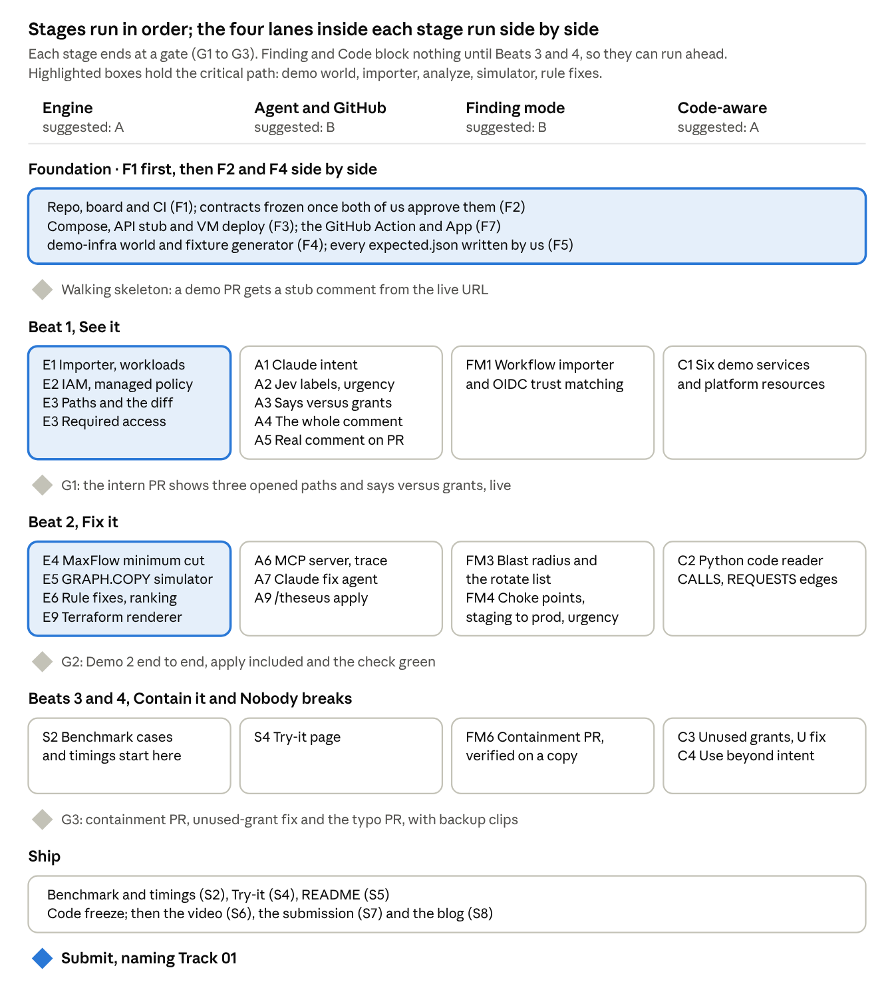
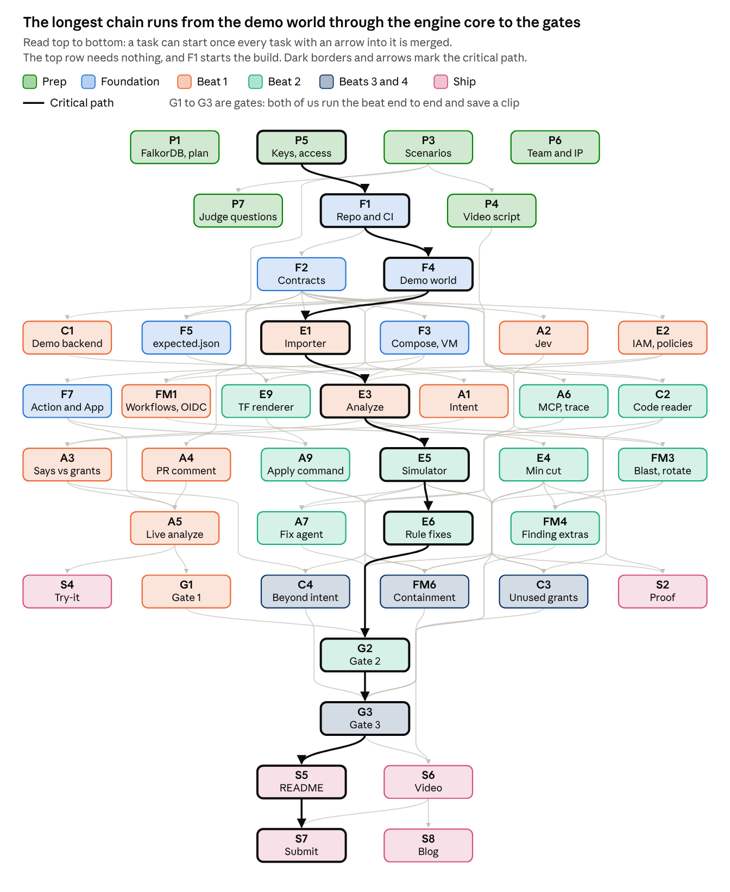

# Plan of action

**We ship four story beats, each ending in an action the agent takes, and we build them as tasks either of us can pick up and finish end to end.** The story decides the scope, and the task board decides who does what. The drawing shows which tasks run side by side and which wait for a gate.

## What we ship and why it matters

**We ship an agent that reviews each Terraform pull request as a graph, shows which sensitive data the change makes reachable, and acts on it.** It explains the path, proves the smallest safe fix and commits it once a person approves. Given a security finding, such as a compromised GitHub Action, it opens a containment PR and lists exactly which secrets to rotate.

| Who | Today | With Theseus |
| --- | --- | --- |
| Developer | Waits for a security review, or merges without one | One comment per PR, about 20 seconds in the PoC, with the fix already tested |
| Security reviewer | Traces group, role, bucket, secret and database by hand | Reads a cited path and approves a proven fix |
| CTO or platform lead | Learns about over-grants after an incident or an audit | Sees each change's effect before merge, with evidence an auditor can read |
| Incident responder | Rotates every secret after a supply-chain compromise | Rotates only the secrets the compromised workflow could reach |

### What a CTO judge will ask

Assume every judge runs a large engineering org and has lived through this problem. Each answer needs something they can see in the demo, and both of us should be able to give any of them (task P7).

| Question | Our answer | What we show |
| --- | --- | --- |
| What does it prevent? | Access that creeps in through changes no rule flags: group membership, role trust, CI OIDC trust | Beat 1: Checkov passes, Theseus shows the path to customer-db |
| Checkov or AWS checks already catch this. | Not this PR: it changes no policy. Checkov passes, and AWS's policy checks have nothing to check | Checkov run in the same GitHub Action, its result beside ours |
| Cartography, SubImage and Wiz exist. Why you? | They map what exists. Theseus reviews what a change will do before merge, compares it with what the PR says and what the code calls, and proves the smallest fix | Fixes tested on graph copies; the three sources of truth |
| Why a graph, and why FalkorDB? | The risk is a path four or five hops long, and rule engines read one resource at a time. FalkorDB keeps one graph per state with `GRAPH.COPY` and runs MaxFlow inside the database. Stop the container and every check fails | The Mermaid path, the graph list, the Cypher in the README, timings |
| Why is this an agent and not a CI script? | The agent picks its tools, reads the minimum cut, designs fixes rules can't, and retries when one fails. Only the final gate is fixed rules, on purpose | The MCP tool trace, and a retry that runs in the demo |
| Can I trust an AI's verdict? What if it invents a permission? | The models suggest. The engine decides what is reachable, every claim cites an evidence ID, a checker rejects unknown IDs, and every fix is re-checked on a graph copy | Evidence links and the fix table with verdicts |
| What stops it committing something harmful? | The model has no write tools. A commit needs a reviewer's command and a fix that passed the gate, and the GitHub App reaches only the demo repos | The wiring, shown in the README |
| Can PR text or an advisory inject instructions? | Outside text reaches the model only as data, is scanned, and never counts as evidence. Even a PR that openly asks for sensitive data cannot approve it: only `theseus.yaml` can | The injection cases in the replay tests; a PR asking for `customer-db` stays flagged |
| What about KMS, SCPs, permission boundaries and conditions? | We model allows, explicit denies, wildcards, assume-role and KMS decrypt. Everything else returns UNKNOWN instead of a guess | Fix C returns UNKNOWN in Beat 2 |
| Does a path prove an attacker can get in? | No. It is a modeled path under labeled assumptions | Edges marked configured, inferred or assumed |
| Will it slow developers or flood them? | One comment per PR, and only for paths to sensitive data. About 20 seconds per PR in the PoC | The timing in the comment, and false alarms counted in the benchmark |
| How accurate is it? | Measured on about 20 PRs against Checkov, misses included. We wrote the PRs ourselves and say so | The benchmark table |
| Does it scale? | One graph per state in FalkorDB; candidate fixes run on graph copies | Timings on a large generated graph |
| What access does it need? | The repo and the plan JSON the CI already produces. It holds no cloud credentials | The architecture slide and the README |
| Why two models, and why Jev? | Jev makes fast typed judgments with probabilities, such as whether a resource is sensitive: 30 of 30 resource names right in the PoC, about a third of a second per call. The LLM (GLM 5.3 through LiteLLM) proposes and explains. Neither decides facts | Jev's numbers in the README |
| Who writes the required access? | A short `theseus.yaml` today. The code-aware graph can draft it from what the code calls, and a person prunes it | The yaml in the demo repo |
| Does passing the required-access check mean nothing breaks? | No: the declared needs still hold within the supported model. Beat 4 adds the code's own calls as evidence | Beat 4 |
| Who would buy this? | Platform teams who own the fix. It complements SubImage or Wiz; its edge is fixes that keep the app working | One honest slide, no market-size numbers |

## What Track 01 asks for

**The track page names five focus areas and no scoring rubric, so every beat must show at least two of them.** Its prize line is "for the best agent that uses a graph to make decisions and take action" ([hackathon page](https://www.wemakedevs.org/hackathons/falkordb)).

| Focus area (track page) | How Theseus shows it | Beats |
| --- | --- | --- |
| Multi-hop reasoning | Intern to group to role to bucket and secret to database; Action to workflow to OIDC role to database | 1, 3 |
| Graph queries and algorithms as agent tools | Path queries, MaxFlow, betweenness and BFS, each wrapped as an MCP tool | 2, 3, 4 |
| Tool selection through MCP | The LLM chooses among blast radius, minimum cut, simulate and code-use tools, and the tool trace is shown | 2, 3, 4 |
| Actions based on what the graph shows | A PR comment, a committed fix, a containment PR, a rotation list | All |
| Explainable results | Every step cites a file and line, and each fix says why it passed or failed | All |

## The story: four beats

**Each beat is one scene in the video, one fixture and one `expected.json`, and each ends with the agent doing something.** We write the video script first (task P4) and build the beats in order, so wherever time runs out, the video is finished up to that beat.

| Beat | What the judge sees | What the agent does | Phase |
| --- | --- | --- | --- |
| 1. See it | The intern PR: "Your PR says logs. Your change grants the customer database." Checkov passes | Posts the cited path on the PR | 1 |
| 2. Fix it | The minimum cut, and four fixes tested on graph copies | Commits fix B after `/theseus apply B` | 1 |
| 3. Contain it | A compromised Action reaches customer-db through a staging workflow | Opens a containment PR and lists the secrets to rotate | 2 |
| 4. Nobody breaks | The code never calls the grant that opens the path | Proposes removing it: the fix that breaks nobody | 3 |
| Close | One graph, three teams | Roadmap: survives the outage, dead stacks and their cost, live accounts | 4 and 5 |

Demo 1, the public bucket, becomes a preset on the Try-it page instead of a scene.

## Parallel or in order

**Stages run in order and each ends at a gate; the four lanes inside a stage run side by side.** The first stage is the only one we do together, because everything else plugs into the contracts it freezes.



Read across a stage for what runs at the same time, and down for what waits on a gate.

- **Critical path:** F1, F4 demo world, E1 importer, E3 analyze, E5 simulator, E6 rule fixes, Gate 2, Gate 3, the README, then submission. F2 contracts and F5 expected.json run beside F4. Whoever is free helps there first.
- **Can run ahead:** the Finding and Code lanes block nothing until Beats 3 and 4, so they fill gaps beside the critical path.
- **Suggested owners:** A takes Engine and Code, B takes Agent and GitHub plus Finding. Either of us can claim any task on the board.

### Which task waits on which

**The top row needs nothing, F1 starts the build, and the longest chain to submission runs P5, F1, F4, E1, E3, E5, E6, G2, G3, S5, S7.** Each arrow points from a task to one that needs it merged first; arrows implied by a longer route are left out. The same graph comes from `tools/tasks.csv`.



The picture is a snapshot. The up-to-date version is [tasks/dependencies.md](tasks/dependencies.md), regenerated from `tools/tasks.csv` by `python tools/dep_graph.py`.

The demo world (F4) and the engine core (E1, E3, E5, E6) sit on the critical path. F2 and F5 no longer do: F4 needs only the repo, E1 needs only the generated fixtures, and the apply command and the containment PR no longer wait for E6, because the renderer (E9) needs only the op contract. Measured to the containment PR, the longest chain is about a quarter shorter than in the first plan.

## Agent kit: what Claude and Codex read

**Every agent works from three things in the repo, so it never has to guess: `AGENTS.md`, its task's brief, and the spec sections that brief lists.** We wrote them before the event as notes (rule 8 allows notes and sketches), and they are the first commits of the private repo, [AjinkyaTaranekar/theseus](https://github.com/AjinkyaTaranekar/theseus). This plan and the [project overview](project-overview.md) live in `docs/` beside them, so every decision stays in the repo.

| File | What it gives the agent |
| --- | --- |
| `AGENTS.md` (`CLAUDE.md` imports it) | Commands first, then Always, Ask first and Never boundaries, code conventions with one example, tests, the definition of done, the commit and pull request rules, where to look, and the start prompt. Codex reads it directly and Claude Code through CLAUDE.md, where a hook blocks writes to expected.json and .env. demo-infra/AGENTS.md adds the demo world's own rules |
| `docs/spec/` (8 files) | What Theseus does; the demo world with every name and the five scenarios' expected outcomes; the graph schema and canonical Cypher; every engine rule; the full file skeleton and shared models; LLM and Jev prompts; GitHub and deployment; what is core and what is an adapter |
| `docs/tasks/<ID>.md` (31 briefs) | The feature, why it matters, the spec sections to read, each file to create or change and its purpose, steps, done when, out of scope, and the prompt to paste |
| `docs/tasks/README.md` | Every task by stage, with the files it creates and what it achieves; how to set up the board; which IDs were merged and why |
| `docs/tasks/human-tasks.md` | The 13 tasks only people do: prep checks, expected.json, the three gates, the video and the submission |

**How a task runs:** claim the issue (its body links the brief), paste the brief's prompt into Claude Code or Codex, let the agent write the tests first and then the code, and the other person reviews against "Done when" before merging. The prompt:

> You are working on task `<ID>` in the Theseus repo. Read `AGENTS.md`, then `docs/tasks/<ID>.md`, then every spec section it lists under "Read first". Work only in the files the brief lists. Write the tests under "Done when" first, then the code, until `pytest -q` and `ruff check .` pass. If anything in the spec is unclear, stop and ask instead of guessing. Finish by drafting the PR description, including any check you could not run, and the `AI_USE.md` line.

**Decisions the kit settles, so agents never invent them:**

- Every name in the demo world (137 resources and eight services), from Terraform addresses to statement Sids, and each scenario's expected outcome. The world lives in demo-infra/ in this repo; demo PRs change only that folder, and the App may write only there.
- The IAM subset, and that everything outside it is UNKNOWN.
- Capacities: 1,000,000 for required routes and non-permission edges, 1,000 for grants the code uses, 1 otherwise.
- Candidate IDs: A revert, B the LLM, C conditional Deny, D cut the shared hop, S scope down, K containment, U unused grant.
- `expected.json` holds only the compared fields, and only people write it.
- An in-memory graph store exists for offline tests only; the product refuses to run without FalkorDB (rule 3).
- Every LLM call goes through one wrapper with record and replay; the fix agent never sees PR text.

### What each stage builds

**Each agent task creates these files; its brief lists every file, its purpose and its tests.** "Changes" names files another task created first.

**Foundation**

| Task | Creates | Changes |
| --- | --- | --- |
| F1 Repo, board and CI | `pyproject.toml`, `theseus/__init__.py`, `theseus/__main__.py`, `theseus/cli.py`, `theseus/errors.py`, `theseus/config.py`, `tests/conftest.py`, `tests/unit/test_config.py`, `.github/workflows/ci.yml`, `.github/pull_request_template.md`, `.github/CODEOWNERS`, `.env.example`, `LICENSE`, `AI_USE.md` | none |
| F2 Freeze the contracts | `theseus/contracts/schema.py`, `theseus/contracts/result.py`, `theseus/contracts/engine.py`, `tests/contract/test_models.py` | none |
| F3 Run it: Compose, API stub and VM deploy | `deploy/docker-compose.yml`, `deploy/Dockerfile`, `deploy/Caddyfile`, `deploy/deploy.sh`, `deploy/README.md`, `theseus/graph/client.py`, `theseus/api/app.py`, `theseus/api/routes.py`, `theseus/api/stub.py`, `tests/data/stub_expected.json`, `tests/integration/test_falkordb_smoke.py`, `tests/unit/test_api_stub.py` | none |
| F4 Demo world and fixture generator | `demo-infra/README.md`, `demo-infra/terraform/providers.tf`, `people.tf`, `roles.tf`, `policies.tf`, `ci.tf`, `data.tf`, `services.tf`, `containers.tf`, `demo-infra/theseus.yaml`, `demo-infra/workflows/demo-org/` (four workflows), `demo-infra/services/<six folders>/__init__.py`, `tools/plan.sh`, `tools/make_fixture.py`, `fixtures/intern/`, `public-bucket/`, `compromised-action/`, `unused-grant/`, `tests/unit/test_demo_world.py` | none |
| F7 GitHub Action and App skeleton | `.github/workflows/theseus.yml`, `theseus/api/github.py`, `tests/unit/test_github.py` | `theseus/api/routes.py` |

**Beat 1: See it**

| Task | Creates | Changes |
| --- | --- | --- |
| E1 Importer: plan, structure, workloads and coverage | `theseus/importer/world.py`, `build.py`, `theseus/adapters/terraform/plan.py`, `source_index.py`, `adapter.py`, `theseus/adapters/aws/resources.py`, `adapter.py`, `tests/unit/importer/`, `tests/unit/adapters/` | none |
| E2 IAM: statements, matching, CAN and CAN\_ASSUME | `theseus/adapters/aws/iam.py`, `policies.py`, `managed.py`, `access.py`, `tests/unit/adapters/aws/test_iam.py`, `test_policies.py`, `test_access.py` | `theseus/adapters/aws/adapter.py` |
| E3 Graph load, path diff and required access | `theseus/graph/store.py`, `load.py`, `queries.py`, `theseus/engine/analyze.py`, `pipeline.py`, `tests/golden/test_intern.py`, `test_main.py`, `tests/integration/test_store_parity.py` | `theseus/cli.py` |
| A1 LLM intent extraction | `theseus/agent/llm.py`, `intent.py`, `tests/replay/intents.yaml`, `recordings/llm/intent-*.json`, `tests/replay/test_intent.py` | none |
| A2 Jev: sensitivity labels and advisory urgency | `theseus/agent/jev.py`, `sensitivity.py`, `tests/replay/test_sensitivity.py`, `test_triage.py` | none |
| A3 Says versus grants | `theseus/engine/intent_effect.py`, `tests/unit/test_intent_effect.py` | `theseus/engine/pipeline.py`, `tests/golden/test_intern.py` |
| A4 PR comment: paths, fix table, trace and coverage | `theseus/agent/templates/comment.md`, `theseus/agent/render.py`, `tests/unit/test_render.py` | none |
| A5 Real analyze behind the Action | `tests/e2e/test_analyze_route.py` | `theseus/importer/world.py`, `theseus/api/routes.py` |
| FM1 CI in the graph: workflows and OIDC trust | `theseus/adapters/github/workflows.py`, `theseus/adapters/aws/oidc.py`, `tests/unit/adapters/github/test_workflows.py`, `tests/unit/adapters/aws/test_oidc.py` | `theseus/adapters/github/adapter.py`, `theseus/adapters/aws/adapter.py` |
| C1 Demo backend: service code and platform resources | `demo-infra/services/` (the services in spec 02), `demo-infra/terraform/network.tf`, `platform.tf` | `tools/make_fixture.py`, `fixtures/*/` |

**Beat 2: Fix it**

| Task | Creates | Changes |
| --- | --- | --- |
| E4 Minimum cut with MaxFlow | `theseus/engine/mincut.py`, `theseus/graph/algos.py`, `tests/unit/test_mincut.py`, `tests/golden/test_mincut_fixtures.py` | `theseus/engine/pipeline.py`, `theseus/graph/store.py` |
| E5 Simulator on GRAPH.COPY | `theseus/adapters/aws/patch.py`, `theseus/engine/simulate.py`, `tests/unit/adapters/aws/test_patch.py`, `tests/golden/test_simulate_intern.py` | `theseus/graph/load.py` |
| E6 Rule-based fixes and ranking | `theseus/engine/candidates.py`, `theseus/adapters/aws/changes.py`, `tests/unit/adapters/aws/test_changes.py`, `tests/golden/test_public_bucket.py`, `tests/unit/test_ranking.py` | `theseus/engine/pipeline.py`, `tests/golden/test_intern.py` |
| E9 Terraform patch renderer | `theseus/adapters/terraform/render.py`, `tests/unit/adapters/terraform/render/` | `theseus/adapters/terraform/adapter.py` |
| A6 MCP server and tool trace | `theseus/mcp/tools.py`, `server.py`, `theseus/agent/trace.py`, `.mcp.json`, `tests/unit/test_mcp_tools.py`, `test_trace.py` | none |
| A7 LLM fix agent | `theseus/agent/fixer.py`, `evidence.py`, `recordings/llm/fix-*.json`, `tests/replay/test_fixer.py` | none |
| A9 /theseus apply command | `theseus/api/webhooks.py`, `tests/unit/test_webhooks.py` | `theseus/api/github.py`, `theseus/api/routes.py` |
| C2 Python code reader | `theseus/adapters/python/code.py`, `tests/unit/adapters/python/test_code.py` | `theseus/adapters/python/adapter.py` |
| FM3 Finding mode: blast radius and rotate list | `theseus/engine/finding.py`, `tests/golden/test_compromised_action.py` | `theseus/engine/pipeline.py`, `theseus/api/routes.py`, `theseus/cli.py` |
| FM4 Finding extras: choke points, staging to prod, urgency | `theseus/engine/staging.py` | `theseus/graph/algos.py`, `theseus/engine/pipeline.py`, `tests/golden/test_compromised_action.py`, `tests/golden/test_intern.py` |

**Beats 3 and 4: Contain it, Nobody breaks**

| Task | Creates | Changes |
| --- | --- | --- |
| FM6 Containment PR | `tests/unit/test_containment_pr.py` | `theseus/engine/finding.py`, `theseus/api/github.py`, `theseus/api/routes.py`, `tests/golden/test_compromised_action.py` |
| C3 Unused grants, with usage capacities | `theseus/engine/usage.py`, `tests/golden/test_unused_grant.py` | `theseus/engine/mincut.py`, `simulate.py`, `pipeline.py`, `theseus/api/routes.py`, `theseus/cli.py` |
| C4 Use beyond intent | `tests/golden/test_code_pr.py` | `theseus/engine/usage.py` (creates it if C3 has not), `theseus/engine/pipeline.py` |

**Ship**

| Task | Creates | Changes |
| --- | --- | --- |
| S2 Proof: benchmark against Checkov, and large-graph timings | `bench/cases/<id>/`, `bench/run.py`, `checkov.py`, `scale.py`, `report.md` | none |
| S4 Try-it page | `theseus/web/index.html`, `app.js`, `style.css`, `tests/unit/test_try.py` | `theseus/api/routes.py` |
| S5 README | `README.md` | none |

## The task board

**Every row is one GitHub issue: one branch and one PR, with the title starting with the ID.** "Needs first" lists what must be merged before you start. Sizes are relative effort with agents doing the typing: S small, M medium, L large. The ID letters name the lane: P prep, F foundation, E engine, A agent and GitHub, FM finding mode, C code-aware, G gate, S story and proof. There are 44 tasks: 31 have an agent brief, and 13 are done by people.

### Prep: notes and throwaway checks only (rule 8)

| ID | Task | Lane | Needs first | Done when | Size |
| --- | --- | --- | --- | --- | --- |
| P1 | Throwaway checks: FalkorDB and Terraform plan (people) | Prep | nothing | Every check returns a result, and the notes are written | M |
| P3 | Check the five scenarios on paper (people) | Prep | nothing | We both agree on every expected path | S |
| P4 | Finalize the video script (people) | Prep | P3 | Read aloud, and its length noted | S |
| P5 | Check access and keys (people) | Prep | nothing | Each one tested once | S |
| P6 | Register the team and agree IP ownership (people) | Prep | nothing | Registered, and the agreement signed by both of us | S |
| P7 | Rehearse the judge questions (people) | Prep | P3 | Each of us answers every question | S |

### Foundation

| ID | Task | Lane | Needs first | Done when | Size |
| --- | --- | --- | --- | --- | --- |
| F1 | Repo, board and CI | Foundation | P5 | CI is green on the first PR | S |
| F2 | Freeze the contracts | Foundation | F1 | Both humans reviewed and approved | M |
| F4 | Demo world and fixture generator | Foundation | F1 | `terraform plan` gives JSON for `demo-infra/terraform` with no AWS account | L |
| F3 | Run it: Compose, API stub and VM deploy | Foundation | F2 | FalkorDB starts in Compose, the stub API is live over HTTPS | M |
| F5 | Hand-write expected.json (people) | Foundation | F4, P3 | We both sign off every expected.json | M |
| F7 | GitHub Action and App skeleton | Foundation | F2, F3 | The trial PR gets a stub comment from the live URL | M |

### Beat 1: See it

| ID | Task | Lane | Needs first | Done when | Size |
| --- | --- | --- | --- | --- | --- |
| E1 | Importer: plan, structure, workloads and coverage | Engine | F2, F4 | Intern base has 4 users, 3 groups, 11 roles, 6 workloads, 19 resources and 17 requirements; head adds exactly one `MEMBER_OF` edge | L |
| E2 | IAM: statements, matching, CAN and CAN\_ASSUME | Engine | F2 | All unit tests pass, including attached and shared managed policies | L |
| E3 | Graph load, path diff and required access | Engine | E1, E2, F3, F5 | `analyze` on the intern fixture matches `expected.json` for opened, closed and R1 to R17 | M |
| A1 | LLM intent extraction | Agent and GitHub | F2 | Replay tests pass on 10 PR texts | M |
| A2 | Jev: sensitivity labels and advisory urgency | Agent and GitHub | F2 | Every demo resource is rated and cached | M |
| A3 | Says versus grants | Agent and GitHub | E3, A1 | The intern headline names `customer-db` | S |
| A4 | PR comment: paths, fix table, trace and coverage | Agent and GitHub | F2 | Renders from every `expected.json` | L |
| A5 | Real analyze behind the Action | Agent and GitHub | E3, A3, A4, F7 | On a real `demo/intern-1` PR the comment shows the headline and three opened paths | S |
| FM1 | CI in the graph: workflows and OIDC trust | Finding mode | F4, E2 | `preview.yml` has `id_token` true and `subs` `[repo:demo-org/docs-site:pull_request]` | M |
| C1 | Demo backend: service code and platform resources | Code-aware | F4 | Every resource name in the code comes from an environment variable | L |
| G1 | Gate 1: Beat 1 live (people) | Gate | A5 | The live comment shows three opened paths and says versus grants; the clip is saved | S |

### Beat 2: Fix it

| ID | Task | Lane | Needs first | Done when | Size |
| --- | --- | --- | --- | --- | --- |
| E4 | Minimum cut with MaxFlow | Engine | E3, A3 | Intern max flow is 1,000,000; the Action's is 1, with the right cut edge | M |
| E5 | Simulator on GRAPH.COPY | Engine | E3 | Each candidate gets a verdict | M |
| E6 | Rule-based fixes and ranking | Engine | E5 | For the intern: A fails, C is UNKNOWN, D fails | M |
| E9 | Terraform patch renderer | Engine | F2, F4 | Every op renders and the result parses | M |
| A6 | MCP server and tool trace | Agent and GitHub | F2 | Claude Code lists and calls every tool on the fixtures | M |
| A7 | LLM fix agent | Agent and GitHub | E5, A6 | Fix B verified | M |
| A9 | /theseus apply command | Agent and GitHub | F7, E9 | On a `demo/` PR, `/theseus apply <ID>` commits the rendered fix and the Action re-runs | M |
| C2 | Python code reader | Code-aware | F2, C1 | Every call in the backend becomes an edge, a counted skip or an unknown | L |
| FM3 | Finding mode: blast radius and rotate list | Finding mode | FM1, E3 | The five-hop trace to `customer-db` | M |
| FM4 | Finding extras: choke points, staging to prod, urgency | Finding mode | FM3, E4, A2 | `prod-support` ranks first among roles | M |
| G2 | Gate 2: Demo 2 end to end (people) | Gate | G1, E4, E6, A7, A9 | The check turns green after the apply; the clip is saved | S |

### Beats 3 and 4: Contain it, Nobody breaks

| ID | Task | Lane | Needs first | Done when | Size |
| --- | --- | --- | --- | --- | --- |
| FM6 | Containment PR | Finding mode | FM3, E4, E5, E9, A9 | A containment PR opens in this repo with only `ci.tf` changed | M |
| C3 | Unused grants, with usage capacities | Code-aware | C2, E4, E5 | The cut lands on the unused grant | M |
| C4 | Use beyond intent | Code-aware | C2, A3 | Flagged on the code-PR fixture | S |
| G3 | Gate 3: Contain it and nobody breaks (people) | Gate | G2, FM4, FM6, C3, C4 | All three run live; the clips are saved | S |

### Ship

| ID | Task | Lane | Needs first | Done when | Size |
| --- | --- | --- | --- | --- | --- |
| S2 | Proof: benchmark against Checkov, and large-graph timings | Story and proof | E4, E5 | A table of catches and misses | L |
| S4 | Try-it page | Story and proof | A5 | Works on the live URL | M |
| S5 | README | Story and proof | G2, G3 | A fresh clone runs with one command | M |
| S6 | Final video (people) | Story and proof | G3, P4 | Uploaded | M |
| S7 | Tag the release and submit (people) | Story and proof | S5, S6 | Submitted | S |
| S8 | Blog post (people) | Story and proof | S6 | Published after submission | M |

### Merged task IDs

Small tasks that edit the same files became one agent session each, as long as that kept side work off the critical path. These IDs are retired:

| Retired | Now part of | Why |
| --- | --- | --- |
| P2 | P1 | Terraform plan with mock credentials is part of the throwaway checks |
| F6 | F3 | Compose, the API stub and the VM deploy share one file and one person |
| FM2 | FM1 | OIDC matching needs the workflow importer's `subs`; one session does both |
| FM5 | FM3 | The rotate list is one query over the blast radius |
| E7 | FM4 | Staging-to-prod, choke points and urgency are extras on the same result, off the critical path |
| FM7 | A2, FM4 | The urgency question rides the Jev client (A2); FM4 puts it in the result |
| E8 | C3 | Usage capacities and unused grants share one golden test |
| A8 | A4 | The stub result already has candidates, so the fix table renders from the start |
| A10 | A6, A4 | The recorder wraps the tool registry (A6); the comment shows it (A4) |
| S1 | G1, G2, G3 | A backup clip is recorded at each gate |
| S3 | S2 | Benchmark and timings share `bench/` and run together on the VM |

## How we work the board

**Agents write the code; we own the contracts, the expected results and the review.** That split is what keeps fast code correct, and it is what rules 11 to 13 ask of us.

1. **Claim:** assign yourself on the issue and move it to In progress. At most two tasks in progress per person, one per agent.
2. **Build:** one branch per task, named after its ID (`e4-min-cut`), kept short. Agents read AGENTS.md, the task's brief in docs/tasks/, and the spec sections it lists. Commits and PR titles read `<type>: <Summary>` (feat, fix, docs, test, refactor, chore) with no task ID, and the commit-msg hook checks every message.
3. **Done:** the "Done when" check passes in CI, and the other person has read the diff before merging. CI must pass to merge, so `main` is always deployable.
4. **Folders:** `CODEOWNERS` maps each folder to its lane owner. The other person reviews, but rarely edits.
5. **Contracts:** frozen once both of us approve F2, and after that they only grow. A change is a tiny PR that adds fields, agreed by both of us and merged before other work continues.
6. **Stubs both ways:** the Agent lane builds against `expected.json` through a stub engine; the Engine lane builds against pytest and fixtures, never against the live app.
7. **Expected results:** every `expected.json` is written by us, never by an agent. A owns the fixtures, and B asks A to change one. B owns Compose and the environment files.
8. **Demo PRs:** branch `demo/<scenario>-<take>`, label `demo`, changing only `demo-infra/`. Practise on one branch, then record the video on a fresh one.
9. **Deploy:** every merge to `main` deploys to the VM. If a deploy breaks, revert first and debug second.
10. **AI log:** `AI_USE.md` records which agent wrote what in each task, for the disclosure in rule 11.
11. **Rhythm:** a sync at the start of each working session to plan and agree contract changes, a joint run at each gate, then a walkthrough where each of us explains the other's merged code (rule 12).

## Contracts and repo layout

**Task F2 freezes these eight contracts, and every other task plugs into them.** The first name in the last column writes the contract; the second reviews it.

| Contract | File | What it pins down | Writes, reviews |
| --- | --- | --- | --- |
| Graph schema | `contracts/schema.py` | Node labels and IDs, edge types (including `USES`, `CALLS`, `REQUESTS`, `HAS_ENV`), edge kinds, the `env` tag, the evidence object, the capacities `BIG` and `USED` (spec: `03-graph.md`) | A, B |
| Shared models | `contracts/result.py` | Every model that crosses a module boundary, including `AnalysisResult`, plus `project()` and `compare()` for golden tests (spec: `05-contracts.md`) | A, B |
| Engine functions | `contracts/engine.py` | The graph-store protocol and the signatures of `load_world`, `build_rows`, `analyze`, `diff`, `min_cut`, `simulate`, `rank`, `run_pr`, `run_finding`, `run_scan` | A, B |
| Adapter protocols | `contracts/adapters.py` | The IaC, cloud, CI and code protocols; `IacResource`, `CiIdentity` and `Change`; the patch-op envelope. Vendor names live only in `adapters/` (spec: `08-core-and-adapters.md`) | A, B |
| Fixture format | `fixtures/<scenario>/` | `scenario.yaml`, `base/` and `head/` trees, both plans, `pr.md` or `advisory.json`, and `expected.json` (only compared fields, written by us) | A, B |
| MCP tools | `mcp/tools.py` | Ten tools in one registry, used by the MCP server and the fix agent | B, A |
| API | `api/routes.py` | `/health`, `/analyze`, `/finding`, `/scan`, `/apply`, `/webhooks/github`, `/graphs`, `/try` | B, A |
| PR comment | `agent/templates/comment.md` | Ten sections, filled only from `AnalysisResult` fields | B, A |

```
theseus/            repo root; every file and its owner task is in docs/spec/05-contracts.md
  AGENTS.md, CLAUDE.md, .claude/settings.json, AI_USE.md, README.md, pyproject.toml, .env.example
  theseus/
    contracts/   schema, result, engine, adapters: vendor-neutral                         F2
    importer/    world, build (E1): compose the adapters into a World and its rows
    adapters/    everything that names a vendor or a format (docs/spec/08-core-and-adapters.md)
      terraform/ plan, source_index, adapter (E1); render (E9)
      aws/       kinds, ops (F2); resources, adapter (E1); iam, policies, managed, access (E2);
                 oidc (FM1); patch (E5); changes (E6)
      github/    workflows, adapter (FM1)
      python/    code, adapter (C2)
    graph/       client (F3); store, load, queries (E3); algos (E4, FM4)
    engine/      analyze, pipeline (E3); mincut (E4, C3); simulate (E5); candidates (E6);
                 intent_effect (A3); finding (FM3, FM6); staging (FM4); usage (C3, C4)
    agent/       llm, intent (A1); jev, sensitivity (A2); trace (A6); fixer, evidence (A7); render, templates (A4)
    mcp/         tools, server (A6)
    api/         app, stub, routes (F3); github (F7, A9); webhooks (A9)
    web/         the Try-it page (S4)
  demo-infra/    the synthetic world: terraform/, services/, workflows/, theseus.yaml (F4, C1)
  fixtures/      five scenarios generated by make_fixture.py; expected.json by people (F4, F5)
  recordings/    recorded LLM and Jev replies (A1, A2, A7)
  tests/         unit, golden, contract, replay, integration, e2e
  bench/         benchmark and timings (S2)
  deploy/        Dockerfile, docker-compose.yml, Caddyfile, deploy.sh (F3)
  tools/         make_board.py, tasks.csv, dep_graph.py, agent_guard.py; plan.sh, make_fixture.py (F4)
  docs/          spec/ (8 files) and tasks/ (31 briefs)
```

A sample `expected.json` for the intern scenario. It holds only the fields we compare, and we write it by hand; it is the answer key the agents' code is graded against. The line numbers come from `demo-infra/` once F4 is merged.

```json
{
  "scenario": "intern",
  "mode": "pr",
  "intent": {"grants": [["user:priya-intern", "read", "s3://demo-app-logs/"]], "suspicious": false},
  "opened": [
    {"actor": "user:priya-intern", "target": "db:customer-db",
     "route": ["user:priya-intern", "group:support-engineers", "role:prod-support",
               "secret:prod-db-credentials", "db:customer-db"],
     "cites": ["terraform/people.tf:20", "terraform/people.tf:30", "terraform/roles.tf:31", "terraform/data.tf:12"]}
  ],
  "closed": [],
  "requirements": {"R1": "satisfied", "R2": "satisfied", "R3": "satisfied", "I1": "satisfied"},
  "min_cut": {"cuttable": false, "value_at_least": 1000000},
  "candidates": {"A": "fail", "B": "pass", "C": "unknown", "D": "fail"},
  "recommended": "B",
  "rotate": [], "unused_grants": [], "use_beyond_intent": [], "staging_to_prod": []
}
```

## Testing

**Fast code only counts when a test we wrote says it is right.** The layers below run automatically, and the acceptance tests under them are what "done" means for the four beats.

| Layer | What it checks | Runs | Owner |
| --- | --- | --- | --- |
| Unit | IAM matching: wildcards, Deny precedence, `NotAction` returning UNKNOWN, OIDC `sub` matching. The code extractor on each call pattern | Every commit | A |
| Golden fixtures | Engine output against `expected.json` for each scenario and each benchmark PR | Every commit | A |
| Contract | Results from the stub and from the real engine both validate against the schema | Every commit | Both |
| Agent replay | Recorded LLM replies replayed. The evidence checker rejects unknown IDs, and an injected instruction in PR text is flagged | Every commit | B |
| Live model | A few real LLM and Jev calls on the scenarios | At every gate | B |
| End to end | A real demo/ PR in this repo: comment, check, apply, re-run | At every gate | Both |
| Deploy smoke | Health endpoint up, FalkorDB reachable, Try-it renders | After every deploy | B |
| Benchmark | About 20 PRs: Theseus against Checkov, plus timings | Once E3 passes, and again before the video | A |
| Integration | FalkorDB and the in-memory test store give the same paths and cuts on every fixture | Every PR, with FalkorDB as a CI service | A |

### Acceptance tests

- [ ] Adding the intern to the group opens paths that the base graph does not have
- [ ] Removing her from the group closes them but breaks her declared need to read app-logs
- [ ] The minimum cut reports that no single permission can be cut without breaking required access
- [ ] The `intern-onboarding` role closes every path and keeps every requirement
- [ ] Making the bucket public exposes `invoices/*`, and public read on `public/*` only does not
- [ ] The compromised-Action alert traces Action, workflow, OIDC trust and role to the customer database
- [ ] The rotation list holds exactly the secrets the compromised workflow can reach
- [ ] The docs-site preview workflow is flagged as a staging-to-prod path
- [ ] A grant on a sensitive path with no `CALLS` edge behind it is listed, and the usage-weighted cut lands on it
- [ ] When a second route exists, Theseus never claims the risk is fully blocked
- [ ] A statement with an unsupported condition returns UNKNOWN
- [ ] A finding is shown as an assumed compromise, never a confirmed one
- [ ] Injected instructions in PR text or an advisory are flagged and never count as evidence
- [ ] Resetting restores the base graph, and a re-run gives the same result
- [ ] The explanation cannot add paths, permissions or evidence that the engine did not return

## Gates and fallbacks

**Each gate is a G task on the board with a fallback decided now, so nobody argues under pressure.** At a gate both of us run the beat end to end on a fresh `demo/` branch and save a backup clip.

| Gate or risk | Checked | If it fails |
| --- | --- | --- |
| Walking skeleton | End of Foundation | Keep building on fixtures. If the VM is blocked, run Docker locally behind a tunnel |
| G1: Beat 1 live | End of Beat 1 | Show the comment from fixtures; fixing the importer comes before anything else |
| G2: Demo 2 end to end | End of Beat 2 | Both of us stop everything else and finish it. Beat 3 shrinks to the trace, without the containment PR |
| G3: Beats 3 and 4 | End of Beats 3 and 4 | An unfinished beat runs on fixtures in the video, or moves to the roadmap slide |
| A demo-world resource type fails to plan under mock credentials | P1 or F4 | Move it to the skipped files or drop it; no scenario depends on network or platform resources |
| MaxFlow missing or unusable | P1 or E4 | Compute the cut in Python from graph copies, and say so in the README |
| Intent extraction unreliable | A1 | Add a purpose field to the PR template and keep the comparison |
| Code freeze | Before the video | After the freeze, only the README, the video and fixes for breakage |
| Submission | Well before the deadline | The time left is buffer |

## Rules we must meet

**Every rule on the [event page](https://www.wemakedevs.org/hackathons/falkordb) has an owner task, so none is left for the end.**

| Rule | What we do |
| --- | --- |
| 2 and 3: FalkorDB is primary, and the product must not work without it | The README says what breaks without FalkorDB, with a one-line test: stop the container and every check fails |
| 5: name every track entered | Track 01 only |
| 6: only public, synthetic or own data | Invented names only, never a teammate's or an employer's. The compromised Action is a fixture advisory, and we never run a real tampered Action. No real secrets in the demo org |
| 8: main coding and design start after the event begins | The PoC stays private and is never copied into the repo. The first commit landed after the event started. The repo, with this plan, stays private until we submit. The agent kit (specs and task briefs, no code) was written before the event as notes, and the README says so |
| 10: repo, README with setup and graph model, the Cypher and algorithms used, video, live deployment or local setup, track named | Tasks S5 to S7. The README's queries-and-algorithms section is written first, not left for the end |
| FAQ: a live deployment is preferred | The Try-it page runs the real engine and FalkorDB live and caches only the LLM's text, so it is genuinely live and still cheap |
| 11 to 13: disclose AI use, every member can explain the code, not entirely AI-generated | `AI_USE.md`, the evening walkthroughs, every `expected.json` reviewed and saved by us (an agent may draft the values), and real commits from both of us |
| 1, 4, 7, 9, 15 to 18 | IP ownership agreed in writing (P6), and Cartography, SubImage and AWS research credited in the README |

## Submission

**The video carries the story and the README carries the proof.** Record a backup clip at each gate (tasks G1 to G3), so a late failure never costs a beat.

### Video script, about 3 minutes

| Time | On screen | Voice-over |
| --- | --- | --- |
| 0:00 to 0:15 | The intern PR: "Add Priya to support-engineers so she can read prod logs", with Checkov passing | "This PR passes every check we have." |
| 0:15 to 0:40 | Theseus's PR comment: intent versus effect, and a Mermaid path to the customer database, each step with its file and line | "Your PR says logs. Your change grants the customer database." |
| 0:40 to 1:05 | The MaxFlow result, the fix table, the LLM's `intern-onboarding` role verified, the Deny option shown as UNKNOWN | "The math rules out deleting a permission. The agent designs a new role, and the graph proves it." |
| 1:05 to 1:20 | A reviewer types `/theseus apply B`, the commit lands, the check turns green | "Nothing changes until a person says so." |
| 1:20 to 1:50 | The compromised-Action advisory, the trace through the staging workflow, the containment PR and the list of secrets to rotate | "A compromised Action, a few hops from your database. One PR contains it, and you rotate only what it could reach." |
| 1:50 to 2:15 | `support-portal`'s role can read the database secret, but its code never asks for it, so the cut lands on that grant | "Your code never uses this grant. Remove it, and nothing breaks." |
| 2:15 to 2:40 | The FalkorDB graph list, the MaxFlow call, the MCP tool trace, timings, the benchmark against Checkov | "FalkorDB does the work: one graph per state, and algorithms as the agent's tools." |
| 2:40 to 3:00 | The roadmap, the limits and the Try-it link | "One graph, three teams. AWS only today, and UNKNOWN when unsure. Try it yourself." |

### README outline

1. One-line pitch, plus a 20-second GIF of the intern PR and Theseus's comment
2. Why it matters: the incidents table, short
3. How it works: one diagram
4. Graph model: nodes, edges (code edges included) and the evidence each edge keeps
5. Queries and algorithms: every Cypher query, plus the MaxFlow and betweenness calls (rule 10)
6. Setup: one Docker Compose command, environment variables, the demo org
7. Results: the benchmark against Checkov, timings, Jev's numbers
8. Limits: supported rules, when UNKNOWN appears, what static code reading misses
9. How we used AI: in building, and inside the product (rules 11 to 13)
10. Roadmap: Phases 4 and 5, each with a Cypher sketch
11. Credits: Cartography, SubImage, AWS research, the FalkorDB docs

### Repo hygiene

- The first commit lands after the event starts, and commits come from both of us, small and clearly described.
- Include a license, a `.env.example`, no secrets, and the tests running in CI.
- Tag the commit you submit, so judges see exactly what was judged.
- Write the blog post alongside the README, and publish it after submitting, for the side prize.
