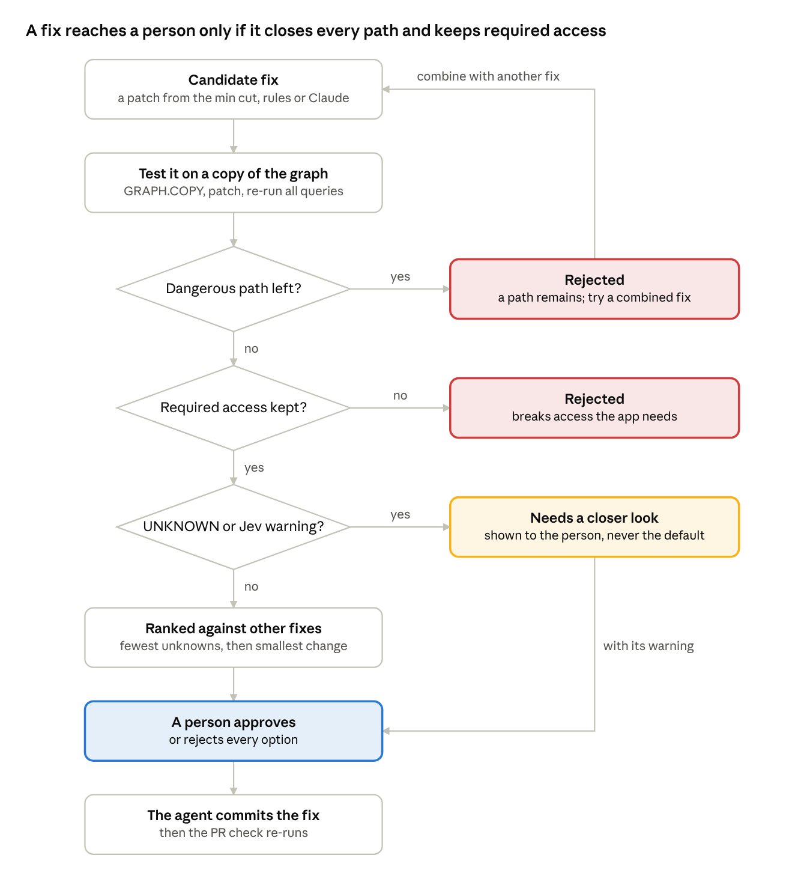
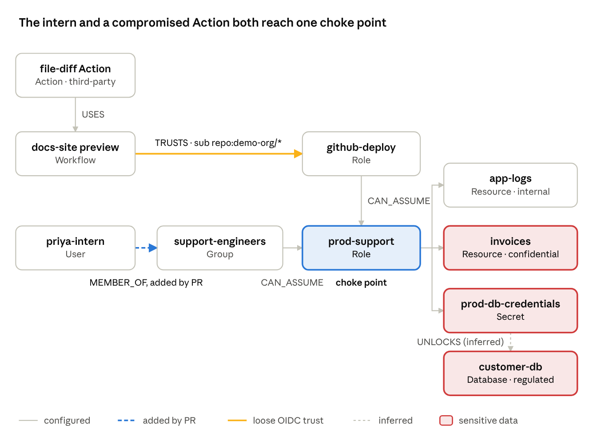
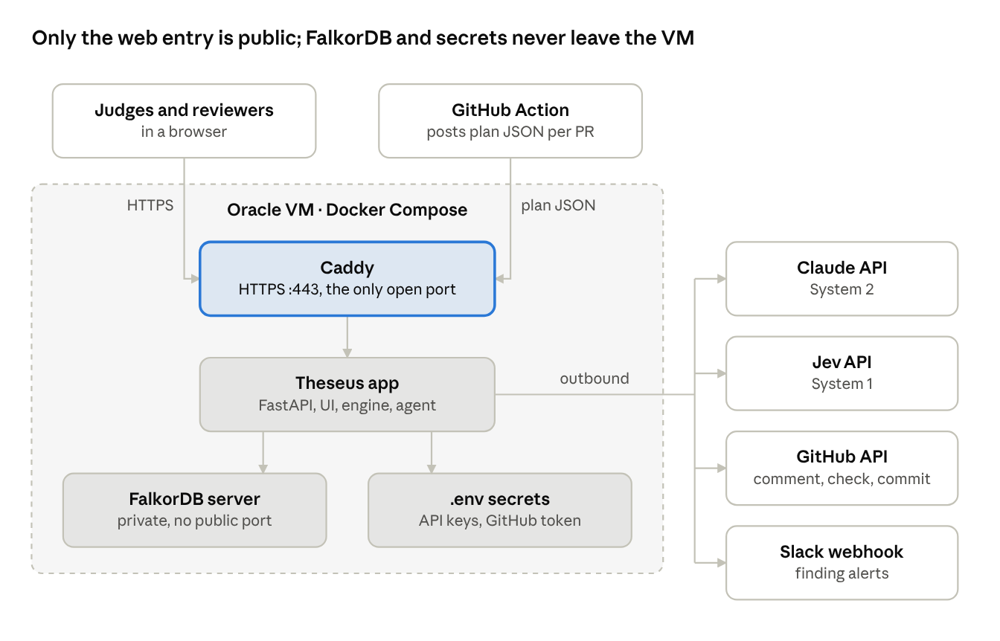
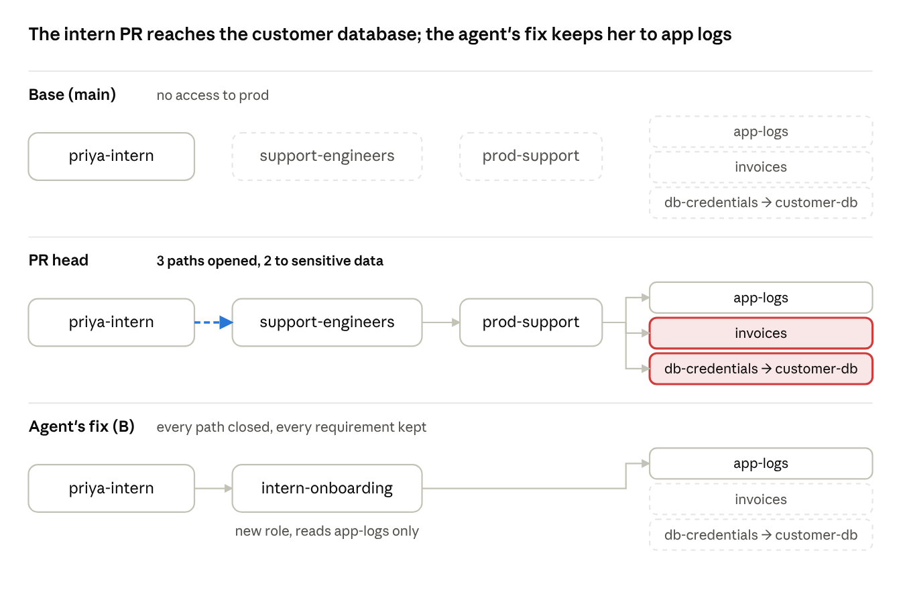
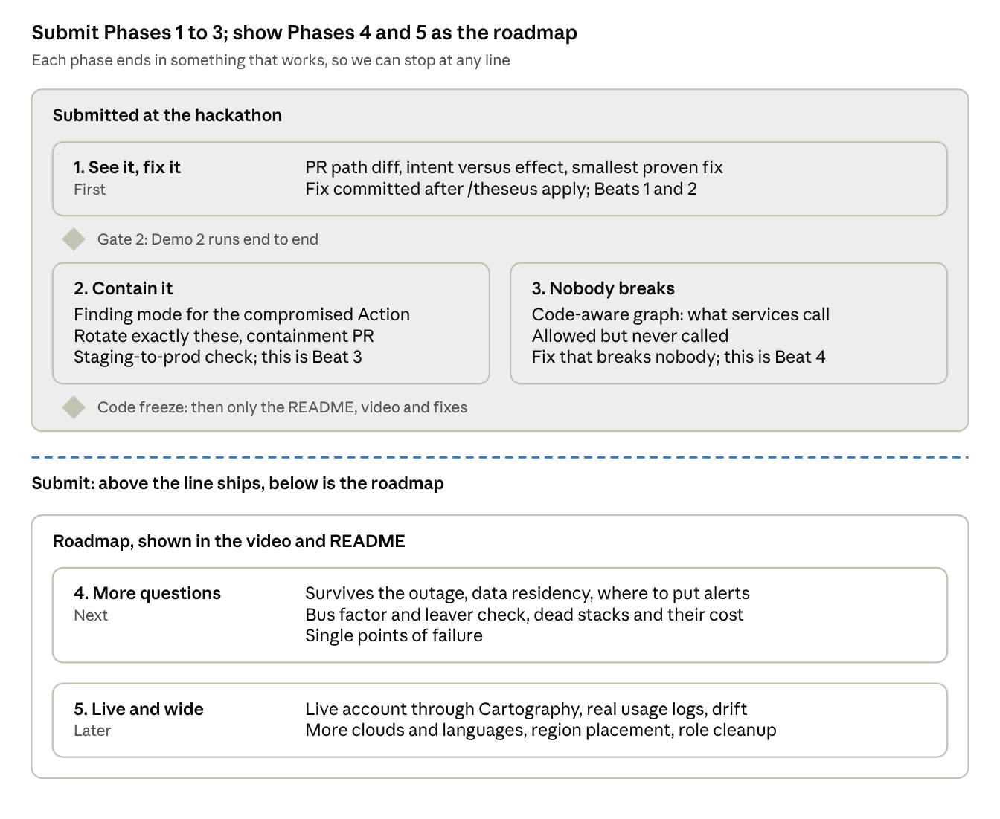

# Theseus: Project overview

## Summary

**Theseus shows what a security change will do before anyone applies it.** It is a graph agent for infrastructure-as-code (IaC). It runs in two cases:

- a pull request changes the IaC
- a scanner reports a vulnerable component

In both cases Theseus does four things:

1. Maps which sensitive resources can be reached, through which workloads, roles and permissions.
2. Proposes candidate fixes.
3. Tests each fix on its own copy of the graph.
4. Recommends the fix that closes the dangerous paths while keeping the access the app needs.

Every claim cites the config line behind it, and a person approves before anything changes.

**We are building Theseus for Track 01, Agents That Act on Connected Data.** The track lists security finding triage as an example and names five focus areas, and Theseus is built around each:

- multi-hop reasoning
- graph queries and algorithms as agent tools
- tool selection through MCP
- actions based on what the graph shows
- explainable results

| Decision | Choice |
| --- | --- |
| Focus | The step after a risk is found: choosing a fix, before merge. Finding attack paths alone already exists in other tools |
| Entry points | PR mode (a Terraform pull request) and finding mode (a CVE, advisory or scanner report), sharing one engine |
| Three sources of truth | What the PR says, what Terraform allows, and what the code calls. Every gap between them is a finding |
| Who decides what | FalkorDB and deterministic code decide what is true. Jev (System 1) ranks and can veto. The LLM (System 2, GLM 5.3 by default) proposes and explains. A person approves |
| Stack | Python and FastAPI, FalkorDB Cloud, the API on the Oracle VM, a PR comment with Mermaid paths as the main UI, a small Try-it page, a GitHub Action and App on a public demo org |
| Story | Four beats: the intern PR (see it), its proven fix (fix it), a compromised GitHub Action (contain it), and a grant the code never calls (nobody breaks). The public bucket becomes a Try-it preset |
| Status | A throwaway PoC passed 5 of 7 feasibility questions. Task P1 then ran FalkorDB Cloud: GRAPH.COPY, betweenness and max flow all work, with max flow over one relationship type |
| Plan | The task board, gates, video script and agent kit: [Plan of action](plan-of-action.md) |

## What we thought initially

**We started with a broad cloud security graph and narrowed it to one decision: choosing a safe fix.** The first idea was to put resources, identities, permissions, trust relationships and findings into one graph. The aim was to find risks that only appear when several pieces combine.

Take a Lambda that reads from an S3 bucket. That is legitimate on its own. It becomes dangerous only if three more things are true:

- untrusted data can reach the bucket
- the function handles that data unsafely
- its IAM role can also reach sensitive services

Together those form a path: external input, then S3, then Lambda, then IAM role, then sensitive resource. An agent would explain why the path is dangerous, how far it reaches, and which connection to change.

### What we learned while exploring it

| Finding | What it meant for the project |
| --- | --- |
| The problem is real and graph-shaped. [Tenable's 2025 Cloud Security Risk Report](https://investors.tenable.com/news-releases/news-release-details/tenable-research-finds-pervasive-cloud-misconfigurations) found 29% of organizations have a workload that is publicly exposed, critically vulnerable and highly privileged. 38% of organizations with sensitive data in databases also expose those databases publicly. | Multi-hop combinations are where single-resource scanners fall short, so a graph earns its place. |
| Finding attack paths is already well served. [Cartography](https://github.com/cartography-cncf/cartography) is open source and maps clouds into Neo4j. [SubImage](https://ycombinator.com/companies/subimage) (YC W25, $4.2M seed) sells attack paths for AI security agents. [Google closed its $32B purchase of Wiz](https://www.clearygottlieb.com/news-and-insights/news-listing/google-completes-32-billion-acquisition-of-wiz) in March 2026. | "A graph of the cloud that finds attack paths" would read as a copy, and its best-known open-source version runs on FalkorDB's main competitor. |
| A connected path does not prove an attack works. Untrusted input reaching a function does not prove the function can be compromised, and unsafe data handling cannot be seen in configuration. | Every step must cite evidence or be labeled as an assumption. A finding is "a modeled path under stated assumptions", never "exploitable". |
| IAM rules are deep: conditions, explicit denies, permission boundaries, service control policies, wildcards. | Support a documented subset and return UNKNOWN for the rest. UNKNOWN is a real result, not a failure. |
| Scanning a real account is slow, costs money, and its findings would be ones we planted. | Use synthetic, public Terraform fixtures. They meet the event's data rule (public, synthetic or own data only) and give the same result every run. |
| Fixing is the unsolved part. Security teams find risks, but engineering teams delay fixes for fear of breaking production. A blunt fix ("remove the permission") often breaks the app. | The most useful work is helping someone choose a fix they can trust. |

### How the idea narrowed

1. **From scanning a whole cloud to analyzing a change.** A pull request is the moment someone decides, and the change is small enough to explain.
2. **From finding paths to choosing a fix.** Each candidate fix is tested for two things: does it close the dangerous path, and does the app keep the access it declared it needs?
3. **Finding mode added.** When a scanner, or a model like [Claude Mythos Preview](https://www.anthropic.com/glasswing), reports a vulnerable component, Theseus assumes that component is compromised. It maps what an attacker could reach from there and runs the same fix comparison.
4. **System 1 and System 2 added.** Fast typed judgments come from Jev, reasoning and explanation from an LLM, and facts from the graph.

The goal: **make a security change easier to assess before someone applies it.**

## The name: Theseus

**We chose the name Theseus.** Two well-known Greek stories fit the product:

- **The labyrinth.** Theseus followed a thread through the labyrinth and found the way back out. The product follows every path through a maze of roles and permissions and finds the fix that gets you out safely.
- **The Ship of Theseus.** The ship's planks were replaced one at a time, and people asked whether it was still the same ship. Every pull request replaces a plank of your infrastructure, and Theseus checks the ship is still safe after each one.

Pitch line: **"Every PR replaces a plank. Theseus checks the ship still floats."**

The stories give the product its own vocabulary:

- the graph view is "the labyrinth"
- a dangerous path is "a thread"
- the recommended fix is "the way out"
- the PR check keeps the plain name **PathDiff**

Before we submit, check that the GitHub organization, a domain and the trademark are free.

## The problem: choosing a fix

**A small IaC change can make sensitive data reachable through a chain that no single rule looks at, and the obvious fix often breaks something people need.** Reviewers see a text diff, not what the change unlocks.

### A concrete case: the intern

- `priya-intern` joins the team. A PR adds her to the `support-engineers` group "so she can read prod logs during onboarding".
- `support-engineers` may assume the `prod-support` role. That role can:
  - read `app-logs`
  - read `invoices/*`
  - read the `prod-db-credentials` secret, which unlocks the customer database
- The PR changes no policy. Checkov finds no broken rule, and AWS's policy checks have no changed policy to check.
- After merge, an intern on her first day can reach invoices and the customer database, three hops away.

### The question Theseus answers

> What dangerous access paths does this change open or close, and what is the smallest change that blocks them without removing access people and apps need?

### Why today's answers fall short

| Today's answer | What it misses |
| --- | --- |
| IaC scanners such as Checkov check each resource against rules | The risk sits between resources: group membership, assumed roles, what a secret unlocks |
| AWS's custom policy checks prove whether one policy grants new access | This PR changes no policy at all |
| Attack-path tools map the running cloud | They run after deploy, not on the pull request where the decision is made |
| Remediation advice says "follow least privilege" | Which fix keeps the access people actually need |
| Remove the edge and call it fixed | A second route may still exist |

### Fixes for the intern case

| Candidate fix | Dangerous paths | Required access | Verdict |
| --- | --- | --- | --- |
| A: remove her from the group | Closed | Fails: she can no longer read `app-logs` | Too blunt |
| B: a new `intern-onboarding` role that reads only `app-logs` (proposed by the LLM) | Closed | Kept, for her and for the support team | Recommended |
| C: a Deny on invoices and the secret, conditioned on her user name | Closed only if the condition holds | Kept | UNKNOWN: we don't model that condition key, so a person must look closer |
| D: stop `support-engineers` assuming `prod-support` | Closed | Fails for every support engineer | Rejected |

The minimum-cut search proves no single permission can be removed without breaking someone's required access. That is why the winning fix is a new, narrower role. Rules can't invent that fix; the agent can, and the engine then verifies it.

Theseus never claims a system is secure. Its strongest result is "no matching dangerous path within the supported model", shown next to the model's limits.

### Real incidents with this shape

**None of these break-ins started with the kind of change Theseus reviews, but in each one a permission or trust setting decided how far the attacker got.** That reach is exactly what Theseus measures, before merge or when an alert arrives. These are public reports. We describe what Theseus would have shown, not a claim that it would have prevented the incident.

| Incident | What widened the damage | What Theseus would have shown | What it would not have done |
| --- | --- | --- | --- |
| [UNC6426 after the nx supply-chain attack](https://labs.cloudsecurityalliance.org/research/csa-research-note-oidc-trust-chain-abuse-cloud-takeover-2026/) (Aug 2025, reported in Google's Cloud Threat Horizons H1 2026) | A stolen GitHub token, plus a GitHub Actions deploy role whose OIDC trust lacked a properly scoped `sub` and whose CloudFormation rights could create IAM roles. Full AWS admin in about 72 hours: S3 data taken, production instances terminated, secrets decrypted. | On the PR that created the role: any workflow in the org can assume it, and it can create principals stronger than itself. Fix: pin `sub` to one repo and branch, and add a permission boundary. | Stop the token theft |
| [tj-actions/changed-files](https://www.endorlabs.com/learn/github-action-tj-actions-changed-files-supply-chain-attack-what-you-need-to-know) (Mar 2025, CVE-2025-30066, 23,000+ repos) | A tampered Action dumped CI secrets into build logs, so each job's reach became the attacker's reach | At alert time: every workflow using the Action, every AWS role those workflows can assume, what those roles reach, and a containment PR | Detect the tampered Action |
| GitHub OIDC roles that check `aud` but not `sub` (Datadog Security Labs research; 500+ role ARNs across 275+ accounts per the [CSA note](https://labs.cloudsecurityalliance.org/research/csa-research-note-oidc-trust-chain-abuse-cloud-takeover-2026/)) | Any GitHub repository could assume the role | On the PR that wrote the trust policy: the role is reachable from outside the org, and here is what it reaches | Find roles created before Theseus was installed, until someone scans `main` |
| [Codefinger](https://www.helpnetsecurity.com/2025/01/13/codefinger-encrypting-aws-s3-data-without-ransomware-sse-c/) (Jan 2025) | Leaked long-lived keys with S3 read and write let attackers encrypt buckets with their own keys and set deletion timers | For a leaked-key alert: every bucket the key can write, plus a fix that scopes it to what its app needs | Detect the leak |
| [Midnight Blizzard at Microsoft](https://wiz.io/blog/midnight-blizzard-microsoft-breach-analysis-and-best-practices) (disclosed Jan 2024) | A legacy test OAuth app with elevated access to the corporate environment, granted earlier and left in place, led to corporate mailboxes | The pattern: an old grant on a path to sensitive data, flagged with removal as the fix | Cover Entra ID: v1 models AWS only |

## Who already does what

**Graphing a cloud and finding attack paths already exist; testing each fix against what the app needs, on the pull request, is where we found little.** We claim a focused workflow, not a new category.

| Tool | What it does | Where it overlaps | What Theseus adds |
| --- | --- | --- | --- |
| [Cartography](https://docs.cartography.dev/) (open source, CNCF sandbox) | Loads clouds and SaaS into a Neo4j graph. Attack path discovery, drift detection, rules | The cloud graph and the paths | Works on a proposed change before deploy, and compares fixes |
| [SubImage](https://ycombinator.com/companies/subimage) (YC W25) | Hosted Cartography. Shows [AI security agents](https://siliconangle.com/2026/07/30/attack-path-mapping-ai-security-agents-neo4jgraphtalk/) how threats reach sensitive data. Lists remediation from CLI commands to IaC pull requests | Closest: agent, paths, and fix PRs | We found no documentation of fixes being tested against declared required access or second routes |
| Wiz (now Google) | Security graph and [attack path analysis](https://www.wiz.io/academy/attack-path-analysis). A runtime sensor confirms which paths are exploitable | Paths and prioritization | Pre-merge, small, open, every step cited |
| [Harness AI Blast Radius Agent](https://developer.harness.io/infrastructure-as-code-management/platform/iacm-pipelines/blast-radius-agent) (beta) | After a Terraform or OpenTofu plan: a 1 to 10 risk score, a dependency graph and a plain-language summary that can gate approval | Pull-request-time blast radius | Its docs describe resource dependencies, not identity and permission paths, and no fix testing |
| [AlgoSec ACE](https://techdocs.algosec.com/en/ace/content/prevasio/prev-app-disc-attackpth.htm) | Treats a reachable EC2 instance with weaknesses as a compromise point, then checks what its role can access | Finding mode | The same question on a change, plus fix comparison |
| [IAMGraph](https://labs.withsecure.com/tools/iamgraph) (WithSecure Labs research) | Maps cross-account assume-role paths in Neo4j | Multi-hop identity paths | A product workflow around them |
| Checkov, Prowler, tfsec | Rule-based misconfiguration scanning | Flags rule breaks inside one resource, such as a public bucket or a wildcard | What a change reaches across resources (groups, roles, secrets), and which fix keeps the access people need |
| AWS IAM Access Analyzer custom policy checks | Automated reasoning on a policy change, built for CI/CD. On the live account it also sells findings for internal access paths to chosen resources and for unused access | Flags a policy that grants more than before | Follows group membership, role chains and secrets to what they reach, including PRs that change no policy, and tests fixes |
| Overmind | Blast radius of a Terraform plan across 120+ AWS resource types, with risks posted to the PR | Pull-request-time blast radius | Access paths rather than operational dependencies, and fix testing |

### Our edge

**Others map what exists. Theseus reviews what a change will do before merge, checks it against what the author said and what the code calls, and proves the smallest fix.** The one-line answer for a judge or mentor: "Cartography tells you what exists. Theseus tells you what your change will do, whether that matches what you said, and the smallest fix that provably keeps everyone working."


Beats 1 to 3 cover the left edge. Beat 4 adds the code box and the two gaps that touch it.

1. **Before merge.** It reads the Terraform plan and the code diff, so a path is caught before it exists. Cartography, SubImage, Wiz and IAM Access Analyzer's internal-access findings look at the deployed account.
2. **Proves the fix.** `algo.maxFlow` finds the fewest changes that close every route. Each candidate is checked on its own graph copy against dangerous paths, second routes and required access.
3. **Reads intent.** It compares what the PR says with what the change grants. Words explain a change but never approve it: only `theseus.yaml`, which its owners review, can make access to sensitive data acceptable.
4. **One path across domains.** GitHub OIDC trust, IAM, a secret and the database it unlocks sit on one path, and Beat 4 adds the app code.
5. **Facts stay deterministic.** Jev and the LLM suggest, the graph engine decides what is reachable, and a person approves.

It shows evidence and unknowns, and a person approves before anything is applied. We will re-check each tool's current features before submission and keep the table above honest.

### Closest neighbor: SubImage

**SubImage maps what can reach your data today. Theseus judges what a change will do before it merges, and tests the fix.** Both are graph agents for cloud security. They differ in when they run, what they read, and what they do with a fix.

|  | SubImage | Theseus |
| --- | --- | --- |
| When it runs | Continuously, on the deployed environment | On each pull request before merge, and when a finding arrives |
| What it reads | Live cloud, identity and SaaS data, through Cartography's 60+ integrations | Terraform plan JSON, the repo's declared required access, and scanner findings |
| Main question | What can reach my sensitive data now, and where do I act first? | What does this change open or close, and which fix is safe to ship? |
| What it analyzes | One large graph of the current estate | Several graph versions side by side: base, head, and each candidate fix |
| Fixes | Lists remediation, from CLI commands to IaC pull requests | Tests each fix on its own graph copy against dangerous paths, second routes and required access, then commits it after approval |
| Breadth | A whole organization, many sources | One IaC repository and a documented IAM subset |
| Graph database | Neo4j | FalkorDB |

SubImage says it plans to alert on and remediate risky infrastructure changes, so this gap may close. Our edge is narrow: testing fixes against required access, on the pull request. As a product, Theseus would sit alongside a tool like SubImage, for example taking its findings as input, rather than replace it.

**Roadmap:** a FalkorDB backend for [Cartography](https://github.com/cartography-cncf/cartography), the open-source tool SubImage is built on, would let Theseus read live accounts as well as Terraform, and check drift between the two. It is Phase 5 on the roadmap below, not part of the hackathon build. FalkorDB's [Bolt support](https://docs.falkordb.com/integration/bolt-support.html) is experimental, so that work starts with a compatibility test.

## Two modes, one engine

**Both modes ask the same question of the same graph, and only the starting point differs.** The question: what sensitive data can be reached from here, and which fix closes that without breaking required access?

Theseus is installed on the IaC repository as a GitHub Action. Two files in that repository drive it:

- `theseus.yaml` declares which resources are sensitive and which access each workload needs.
- On every merge to `main`, Theseus rebuilds the baseline graph, so both modes always work on current infrastructure.

A **dangerous path** is a route from a principal (a user, workload or workflow), treated as untrusted, to a sensitive resource that no declared requirement covers.

### PR mode: the main product

1. A developer opens a pull request that changes Terraform.
2. The GitHub Action runs `terraform plan` for the base and the head branch, exports both with `terraform show -json`, and sends them to Theseus.
3. Theseus builds two graphs in FalkorDB, for example `pr42-base` and `pr42-head`.
4. It runs the dangerous-path queries on both and sorts the paths into opened, closed and unchanged.
5. If a path opened, the agent runs the minimum-cut search, then proposes candidate fixes. Each is applied to its own copy of the head graph and tested.
6. Theseus posts one PR comment and sets a check status. The comment holds the opened path with evidence, the fix comparison, and anything UNKNOWN.
7. A reviewer replies `/theseus apply B`. The agent commits fix B to the PR branch, Theseus re-runs, and the check turns green.

### Finding mode: standalone alerts

1. A finding arrives: an image scanner report (Trivy, Grype, Amazon Inspector), a SARIF report, an advisory that a GitHub Action was compromised, a leaked-key alert, or a report from a model like Claude Mythos Preview.
2. Theseus matches the finding to workloads, workflows or keys in the graph by image, package, Action or key ID.
3. It assumes that workload is compromised. This is labeled as an assumption: a CVE is evidence of a weakness, not proof of compromise.
4. It maps the blast radius: every sensitive resource that can be reached, and by which routes.
5. Jev rates how urgent the alert is: is the workload exposed, and does it reach regulated data?
6. Theseus sends an alert (Slack or a GitHub issue) with the paths and a tested containment fix. Examples: narrow the workload's role, or remove an assume-role permission it does not need. It also lists exactly the secrets the workload could reach, so only those are rotated.
7. It opens a PR with that fix, which PR mode then checks like any other change.

Mythos Preview is not generally available. Theseus treats its reports like any scanner's output: an input, not a model we call.

|  | PR mode | Finding mode |
| --- | --- | --- |
| Starting point | Every principal the change touches (users, groups, workloads, workflows), plus internet-exposed entry points | The workload, workflow or key the finding names |
| Graphs compared | Base against head, then each candidate fix | Current against each candidate fix |
| Output | PR comment and check status | Alert and a containment PR |
| Human step | Reviewer types the apply command | Reviewer merges the containment PR |

## End-to-end flow

**Inputs become graphs, graphs become paths, candidate fixes become new graphs, and only a person turns a recommendation into a change.**


Jev and the LLM sit beside the engine, not above it. They rank, propose and explain, while the engine's queries on FalkorDB decide what is true. Only a person's approval lets the agent commit.

| Step | Who does it | What happens |
| --- | --- | --- |
| 1. Ingest | Deterministic code | Plan JSON, `theseus.yaml`, workflow files, app code and findings become nodes and edges. Every edge keeps the file and line it came from. |
| 2. Analyze | FalkorDB and the engine | Path queries, the base-against-head diff, the minimum-cut search (algo.maxFlow), the required-access check, and UNKNOWN for unsupported rules |
| 3. Triage | Jev (System 1) | Rates sensitivity for untagged resources, the urgency of a finding, and whether a permission is likely needed even though it isn't declared |
| 4. Propose | The LLM (System 2) and rule-based generators | Candidate fixes written as Terraform patches. Rule-based ones: remove, scope down, add deny. The LLM adds structural ones that rules can't invent, such as a new, narrower role. |
| 5. Simulate | The engine | `GRAPH.COPY` the head graph, apply the patch, re-run every query |
| 6. Rank and gate | The engine, plus a Jev veto | Fixed rules, listed below the flowchart |
| 7. Explain | The LLM | Writes the evidence card. Every sentence cites evidence IDs, and a checker rejects any ID that doesn't exist. |
| 8. Decide | A person | Picks a fix with a PR command, or rejects all of them |
| 9. Act | The agent | Commits the fix or opens a PR, then Theseus re-runs and updates the check |

### How a fix is chosen



Every candidate runs the same three checks on its own graph copy. A failed path check sends the agent back to combine fixes. A doubt never blocks the person from seeing the fix, but it can never be the default.

The ranking rules are fixed code, not model judgment:

1. **Must close every modeled dangerous path**, including second routes through assumable roles.
2. **Must keep every declared requirement.**
3. Then prefer the fix with the fewest UNKNOWN steps.
4. Then prefer the smallest change: fewest permissions removed, fewest lines touched.
5. Then prefer fixes that leave no broad wildcard. A wildcard can quietly match buckets created later.
6. **Jev can veto, never approve.** If Jev rates a fix likely to break access the app uses but never declared, the fix is labeled "needs a closer look" and is never the default.
7. If no candidate passes, Theseus says so and shows the trade-off. It never picks the least bad option silently.

## Graph model

**Every node is a part of the infrastructure, every edge is a permission or a connection, and every edge carries the config line that proves it.** Without FalkorDB there are no paths, no diff and no fix test, which meets the event's rule that the product must not work without it.



One graph holds every demo scene. The intern and a compromised Action reach the same role, `prod-support`, so it is the choke point. Only a graph that follows memberships, trusts, role hops and what a secret unlocks sees both routes.

### Nodes

| Label | Examples | Key properties |
| --- | --- | --- |
| `Workload` | Lambda, ECS service, EC2 instance, EKS pod | `name`, `kind`, `image`, `exposed` |
| `Role` | IAM role, instance profile | `arn` |
| `Resource` | S3 bucket or prefix, DynamoDB table, RDS database, secret, KMS key | `arn`, `sensitivity` |
| `Entry` | The internet, another AWS account | `kind` |
| `Requirement` | One entry in `theseus.yaml` | `workload`, `action`, `resource` |
| `Finding` | A CVE or scanner finding | `id`, `severity`, `component` |
| User, Group | An IAM user such as priya-intern, an IAM group such as support-engineers | name, arn |
| Workflow, Action | A GitHub Actions workflow file in a repo, and a third-party Action it uses | repo, path, branch; action name and pinned version |

### Edges

| Edge | From and to | Evidence it keeps |
| --- | --- | --- |
| `EXPOSES` | Entry to Workload | Not built in the hackathon. A public bucket is a CAN edge from the Entry node, citing the bucket policy line |
| `RUNS_AS` | Workload to Role | The workload's role attribute |
| `CAN_ASSUME` | User, Group or Role to Role | The `sts:AssumeRole` statement and the target role's trust policy |
| `CAN {action}` | Any principal to Resource | The statement that allows it, after wildcard expansion |
| `NEEDS {action}` and `FOR` | Requirement to Resource and Workload | The `theseus.yaml` line |
| `AFFECTS` | Finding to Action or Workload | The finding report's component field |
| MEMBER\_OF | User to Group | The group membership resource and its line |
| TRUSTS (OIDC) | Workflow to Role | The trust policy's aud and sub conditions, matched against the workflow's repo and branch |
| USES | Workflow to Action | The workflow file line with uses: |
| WRITES | Workload to Resource | Not stored: read from a workload's CAN write edge, backed by its CALLS edge. Used to say what a bucket likely holds: billing-job writes invoices/\*. |
| UNLOCKS | Secret to Database | Inferred: the secret holds that database's credentials (kind inferred) |
| CALLS {action} | Workload to Resource | The code line that makes the SDK call, with the resource name resolved through an env var set in Terraform |
| REQUESTS | Workload to Workload | The code line of an HTTP call to another service's internal URL |
| HAS\_ENV | Workload to Resource | The Terraform line that sets the env var to the resource's name |

Each edge also has a `kind`: `configured` (read from config), `inferred` (derived by a rule) or `assumed` (for example, "this workload is compromised"). The UI draws the three kinds differently. Every node also carries an env tag, staging or prod, so any path from staging to prod is a finding.

### Code as a graph source

**App code adds the third source of truth: what each service actually calls.** Terraform says what a service may do, and its code says what it does. The gap between them gives the safest fix there is: a grant nobody uses.

Environment variables are the join key. Terraform sets a variable on a service, the code reads it to name a resource, and the extractor links the two, citing file and line. The backend is six small services in `demo-infra/`, our own synthetic code, which rule 6 allows.

| Read from | Example | Becomes |
| --- | --- | --- |
| Terraform | `billing-job` runs with `billing-role` | `(billing-job)-[:RUNS_AS]->(billing-role)` |
| Terraform | `INVOICES_BUCKET = aws_s3_bucket.invoices.id` in the service's environment | `(billing-job)-[:HAS_ENV {name}]->(invoices)` |
| Python | `s3.put_object(Bucket=os.environ["INVOICES_BUCKET"], ...)` | `(billing-job)-[:CALLS {action:"s3:PutObject", file, line}]->(invoices)` |
| Python | `secrets.get_secret_value(SecretId=os.environ["DB_SECRET"])` | `(billing-job)-[:CALLS {action:"secretsmanager:GetSecretValue"}]->(prod-db-credentials)` |
| Python | `requests.get(os.environ["BILLING_API_URL"] + "/invoices")` in `support-portal` | `(support-portal)-[:REQUESTS]->(billing-api)` |

- **Allowed but never called:** an IAM grant on a path to sensitive data with no `CALLS` edge behind it gets capacity 1 in the minimum cut, so the fix removes it first. No logs are needed.
- **Use beyond intent:** a code PR titled "fix a typo" that starts calling `customer-db` is flagged.
- **Scope:** Python only, three patterns (boto3 client calls, a database connection string, HTTP calls to internal URLs). A name built at runtime is reported as unknown, never guessed. Real usage logs close that gap in Phase 5.

### One graph per state

Each state is its own FalkorDB graph: `main`, `pr42-base`, `pr42-head`, `pr42-fix-A`, `pr42-fix-B`. A candidate is made with [`GRAPH.COPY`](https://docs.falkordb.com/commands/graph.copy.html), which clones nodes, edges, indexes and constraints as a snapshot. The engine then changes the affected policy statement and re-derives that statement's `CAN` edges. It never just hides an edge. PR graphs are deleted when the PR closes.

### Core queries (sketches; the canonical versions the build uses are in the repo's docs/spec/03-graph.md)

```cypher
// 1. Dangerous paths: workload -> role -> (up to 3 assumed roles) -> sensitive resource, not covered by a requirement
MATCH p = (w:Workload)-[:RUNS_AS]->(:Role)-[:CAN_ASSUME*0..3]->(:Role)-[c:CAN]->(r:Resource {sensitive: true})
OPTIONAL MATCH (q:Requirement)-[:FOR]->(w)
WHERE (q)-[:NEEDS {action: c.action}]->(r)
WITH w, r, c, p, q WHERE q IS NULL
RETURN w.name AS workload, r.name AS resource, c.action AS action, [n IN nodes(p) | n.name] AS route
```

```cypher
// 2. Required access: is every declared need still reachable?
MATCH (q:Requirement)-[:FOR]->(w:Workload), (q)-[n:NEEDS]->(r:Resource)
OPTIONAL MATCH p = (w)-[:RUNS_AS]->(:Role)-[:CAN_ASSUME*0..3]->(:Role)-[c:CAN]->(r)
WHERE c.action = n.action
RETURN q.id AS requirement, count(p) > 0 AS satisfied
```

```cypher
// 3. Blast radius of a finding
MATCH (f:Finding {id: $finding})-[:AFFECTS]->(w:Workload)
MATCH p = (w)-[:RUNS_AS]->(:Role)-[:CAN_ASSUME*0..3]->(:Role)-[c:CAN]->(r:Resource)
RETURN r.name AS resource, r.sensitivity AS sensitivity, collect(DISTINCT c.action) AS actions, count(p) AS routes
ORDER BY sensitivity DESC
```

```cypher
// 4. Choke points: which statements sit on the most dangerous paths
MATCH p = (:Workload)-[:RUNS_AS]->(:Role)-[:CAN_ASSUME*0..3]->(:Role)-[c:CAN]->(:Resource {sensitive: true})
RETURN c.statement AS statement, count(p) AS paths
ORDER BY paths DESC LIMIT 5
```

```cypher
// 5. Minimum cut: the fewest permissions separating a principal from sensitive data, never cutting required access
// Edges carry capacity 1; edges on a route a requirement needs carry capacity 1000000
MATCH (p:Principal {name: $principal}), (r:Resource {sensitive: true})
WITH p, collect(r) AS targets
CALL algo.maxFlow({sourceNodes: [p], targetNodes: targets, capacityProperty: 'capacity',
                   relationshipTypes: ['MEMBER_OF', 'TRUSTS', 'RUNS_AS', 'CAN_ASSUME', 'CAN', 'UNLOCKS']})
YIELD maxFlow, edges, edgeFlows
RETURN maxFlow, [i IN range(0, size(edges) - 1) | [startNode(edges[i]).name, endNode(edges[i]).name, edgeFlows[i]]] AS flows
```

Users, groups, workloads and workflows all carry a shared `:Principal` label, so every query starts from any of them. A max flow of 1,000,000 or more means no permission can be cut without breaking required access. The agent then proposes a structural fix, such as a new narrower role, and the engine verifies it. [`algo.maxFlow`](https://docs.falkordb.com/algorithms/maxflow) returns flows per edge rather than the cut itself, so the engine derives the cut from saturated edges and still confirms every candidate by simulation.

```cypher
// 6. Allowed but never called: grants on a path to sensitive data that the code never uses
MATCH (w:Workload)-[:RUNS_AS]->(:Role)-[:CAN_ASSUME*0..3]->(:Role)-[c:CAN]->(r:Resource {sensitive: true})
OPTIONAL MATCH (w)-[x:CALLS]->(r) WHERE x.action = c.action
WITH w, r, c, x WHERE x IS NULL
RETURN w.name AS workload, r.name AS resource, c.action AS action, c.statement AS statement
```

```cypher
// 7. Rotate exactly these: the secrets a compromised Action's workflows can reach
MATCH (:Action {name: $action})<-[:USES]-(wf:Workflow)-[:TRUSTS]->(:Role)-[:CAN_ASSUME*0..3]->(:Role)-[c:CAN]->(s:Resource {kind: 'secret'})
WHERE c.action = 'secretsmanager:GetSecretValue'
RETURN s.name AS secret, collect(DISTINCT wf.path) AS via
```

The path diff runs query 1 on the base graph and on the head graph. The engine then compares the route lists to find opened, closed and unchanged paths. The README will list these queries, as the event requires.

## System 1 and System 2

**Jev makes fast typed judgments where no rule can decide. The LLM proposes fixes and explains them. Neither decides what is true or what ships.** The graph and the engine own the facts, and a person owns the decision.


Each layer has one job and one thing it may never do. That split is what lets the report say exactly which part of a recommendation came from a model and which came from the graph.

### System 1: TypeSafe Jev

[Jev](https://www.datacamp.com/blog/system-one-models-jev) returns typed decisions with calibrated probabilities, not text. Here is what we know about it:

- **Interface:** you send a state and a set of typed questions: choice, score, or yes/no.
- **Access:** `POST https://api.typesafe.ai/v1/systemone` with model route `jev-latest`. Python and JavaScript SDKs exist. Access is through a waitlist.
- **Vendor-reported figures:** 70 to 500 ms latency, $0.042 per million input tokens, and about 68% agreement on TypeSafe's own four-workflow benchmark. That is close to mid-tier LLMs and below the top ones.
- **No written reasoning:** it gives none. That suits us, because the LLM writes the explanations.

**Measured in our PoC:** `jev-1.13.0` rated 30 of 30 resource names correctly (Brier score 0.021). It judged 9 of 10 PR diffs against their stated purpose (Brier 0.081), catching all 5 over-grants; the one miss was a false alarm. A call with 10 questions took about 0.34 seconds. The sets are small, so we re-measure on the hackathon fixtures. Since the PoC, Jev decides sensitivity instead of a keyword list.

| Question for Jev | Type | What Jev sees | What the answer does | If Jev is wrong |
| --- | --- | --- | --- | --- |
| Is this resource sensitive? | Choice: public, internal, confidential, regulated | Name, type, tags. Never data contents or secret values. | An untagged resource rated confidential or above joins the sensitive set, and a person confirms the list once | Tags and `theseus.yaml` always win |
| How urgent is this finding? | Score 0 to 1 | Severity, component, whether the workload is exposed, blast-radius summary | Orders the alert queue | It changes the order, never hides a finding |
| Is this permission likely used even though it isn't declared? | Yes or no | Action, resource, workload name, code hints | Warns before a fix removes it, and asks the developer to declare it | A false alarm costs one click. A miss is a known gap, listed on the card. |
| Could this fix break legitimate use? | Score 0 to 1 | The patch, the requirements, earlier warnings | Above the threshold, the fix is labeled "needs a closer look" and is never the default | It can only block. The engine's checks still run. |

**Fallback:** if Jev is unavailable during the event, GLM 5.3 Flash answers the same typed questions with a forced tool call. Those scores are labeled "not calibrated".

**In the pitch:** Jev appears with its measured numbers, re-measured on the hackathon fixtures.

### System 2: an LLM through LiteLLM

| Setting | Choice |
| --- | --- |
| Default model | GLM 5.3 (`zai-org/GLM-5.3`) on Crusoe's OpenAI-compatible API, for reading PR intent, proposing fixes and writing evidence cards. We have Crusoe credits, and in a first check it handled a forced tool call with an injection attempt correctly. |
| Fast model | GLM 5.3 Flash (`zai-org/GLM-5.3-Flash`), used only when Jev is down |
| Access | Every call goes through LiteLLM in one wrapper. The model, endpoint and key are three settings, so Claude, GPT or another open model is a config change plus new recordings. |
| Other providers | A local Ollama model is too slow on the VM's two ARM cores. |
| Tools (MCP), read-only | `diff_paths`, `blast_radius`, `check_requirements`, `choke_points`, `explain_path`, min\_cut, shortest\_route, unused\_grants, secrets\_reachable |
| Tools (MCP), sandboxed | `simulate_fix` creates a candidate graph and never touches the repository |
| Not given to the model | `post_comment`, `commit_fix`, `open_pr`. The app runs these only after a person's command. |
| Output | A JSON schema in which every claim cites evidence IDs. A checker rejects any ID that doesn't exist. |
| Untrusted text | Finding descriptions, commit messages and code comments reach the model only as data. They are scanned for injected instructions and never count as evidence. |

## Tech stack and deployment

**The stack is Python with FastAPI, FalkorDB Cloud, a PR comment as the main UI, and a small Try-it page, with the API on the Oracle VM behind one HTTPS entry point.**

### Python or Spring Boot: Python

|  | Python + FastAPI | Spring Boot (Java 21) |
| --- | --- | --- |
| FalkorDB client | `falkordb` package, including `copy()` for `GRAPH.COPY` | JFalkorDB, also official |
| Jev | Python SDK | No SDK, raw HTTP |
| LLM and MCP | LiteLLM for every provider, and the official MCP SDK | One SDK per provider |
| IaC and IAM helpers | Checkov and policyuniverse (expands IAM wildcard actions) are Python | Few |
| Code to write in four days | Less: JSON in, JSON out | More: DTOs, configuration, wiring |
| Memory on the VM | Light | The JVM is heavier, but fits in 12 GB |

We picked Python, and the whole backend uses it.

### Components

| Part | Choice | Why |
| --- | --- | --- |
| Backend | Python 3.12, FastAPI, Pydantic | Typed JSON APIs, quickly |
| Graph database | FalkorDB Cloud (FalkorDB 4.22.0); CI uses the matching `falkordb/falkordb:v4.22.0` image | Primary database, one graph per state. Nobody needs Docker on a laptop |
| Agent | LiteLLM and the MCP Python SDK | One call shape for any model; forced tool calls for structured output |
| System 1 | TypeSafe Jev Python SDK | Typed judgments with probabilities |
| IaC input | Terraform CLI in GitHub Actions: `terraform plan`, then `terraform show -json` | Plan JSON has most values resolved. Workflow YAML adds which repos use which Actions. |
| Frontend | The PR comment, with a Mermaid diagram of each path, plus one small static Try-it page using Cytoscape.js | Judges see the product where developers would. GitHub renders Mermaid in comments. |
| GitHub | A GitHub Action on the public demo repos that also runs Checkov for comparison. Fix commits use a GitHub App token, or the backend re-posts the check itself. | PR comment, check status, fix commit |
| Alerts | Slack incoming webhook (optional) | Finding mode |
| Packaging | Docker Compose | One command brings everything up |
| Tests | pytest with scenario fixtures that hold expected results | The same answer every run |
| Code reader | Python's ast module over the demo backend | CALLS and REQUESTS edges for Beat 4 |

### The Oracle VM



Everything inbound goes through Caddy on port 443. The app only calls out to the LLM provider (Crusoe), Jev, GitHub and Slack, and FalkorDB never gets a public port.

- **Check the VM first:** `uname -m` (`aarch64` means an Ampere A1 shape), `nproc`, `free -h`, `df -h`.
- **Capacity:** [Oracle's Always Free Ampere A1 allowance](https://docs.oracle.com/en-us/iaas/Content/FreeTier/resourceref.htm) is now 2 OCPUs and 12 GB. That runs FalkorDB, the backend and the UI, but not a local LLM.
- **If it is the 1 GB AMD micro shape:** use FalkorDB Cloud's free tier for the database and keep only the app on the VM.
- **Idle reclaim:** Oracle can reclaim an Always Free instance after 7 idle days (95th-percentile CPU, network and memory all under 20%). Check it is still running before judging starts.
- **Public URL:** Caddy as a reverse proxy with automatic HTTPS on a domain gives a stable URL for judging. A named Cloudflare Tunnel also works. A Quick Tunnel URL changes whenever the process restarts.
- **Locked down:** only the web app is public. The FalkorDB port stays closed, secrets live in an `.env` file on the VM, and no real cloud credentials go anywhere.

## Challenges and how we handle them

**The biggest risks are a crowded market, IAM's depth, and time. Each has a concrete answer below.**

| Challenge | Why it matters | How we handle it |
| --- | --- | --- |
| Crowded space | Cartography, SubImage, Wiz and Harness already cover graphs, paths and blast-radius scores | Position Theseus on choosing a fix. Show the comparison table honestly, and never claim "this has never been done". |
| IAM rules are deep | Conditions, explicit denies, permission boundaries, service control policies and `NotAction` all change the answer | Support a documented subset: S3, DynamoDB, Secrets Manager, KMS and `sts:AssumeRole`, with Allow, explicit Deny and wildcards. Everything else returns UNKNOWN. |
| A path is not an exploit | A judge will ask "does this prove an attacker gets in?" | Every step is labeled configured, inferred or assumed. Results say "modeled path under these assumptions". |
| Second routes | Blocking one edge may leave another way in | Re-run the full analysis on every candidate graph. Never just delete an edge from the picture. |
| Requirements can be incomplete or wrong | A fix can pass every declared check and still break something real | Requirements are explicit inputs. Jev flags permissions that look used but aren't declared. The card says passing is not a guarantee. |
| Graph states getting mixed | A candidate result could leak into the base | One graph per state through `GRAPH.COPY`. Never overwrite the base, and every result can be rebuilt from its inputs. |
| The LLM invents permissions or conclusions | A wrong claim in a security review is worse than none | The LLM only proposes patches and explains engine output. The checker rejects unknown evidence IDs, and write tools are never given to the model. |
| Injected instructions in finding or commit text | Text from outside could try to steer the agent | Outside text is passed as data, scanned and flagged, and never counts as evidence |
| Jev is measured only on small sets | Access works, but the PoC measured it on 30 names and 10 diffs | Re-measure on the hackathon fixtures, and fall back to GLM 5.3 Flash with labeled scores if Jev is down. |
| The PoC's prompts were tuned on Claude | GLM 5.3 may read intent or design fixes less well | A1 and A7 re-run the PoC's 10 intents and the intern fix on GLM before their gates. If it falls short, switching models is a config change. |
| `terraform plan` wants provider credentials | The demo repo has no real AWS account behind it | Run plan with the AWS provider's credential checks turned off (verify in the spike). Fallback: committed plan JSON fixtures. |
| Oracle VM capacity and idle reclaim | 2 OCPUs and 12 GB on Always Free, or 1 GB on the micro shape | Check the shape first. Use FalkorDB Cloud if the VM is small, and run no local LLM. |
| Event rules | Main coding and design must start after the event begins, and AI assistant use must be disclosed | Before the event, only notes, graph sketches, diagrams and a throwaway spike. The README discloses the AI tools used. |
| Public demo security | A public LLM-backed endpoint can be abused | Only the web app is public. Rate-limit the API, scope the GitHub token to the demo repo, and keep no cloud credentials. |
| Four days | Broad integrations eat the whole event | Build in story order with gates, as the [Plan of action](plan-of-action.md) lays out. A GitHub App scoped to this repo is in scope; real AWS accounts are not. |
| Linters and AWS checks already catch simple cases | Checkov flags a public bucket or a wildcard, so a demo built on those looks staged | Lead with changes that pass them: group membership, role chains, OIDC trust. Show Checkov's result next to ours. |
| ARNs unknown until apply | For new resources, the plan leaves computed values such as arn unknown | Resolve references from the plan's configuration section, or give demo resources explicit names. Test on day 1. |
| Fix commits don't re-trigger the check | Commits made with GITHUB\_TOKEN start no new workflow runs, so the check never turns green on stage | The backend re-runs the analysis and posts the check itself, or commits with a GitHub App token |
| "Is it an agent or a linter with a chatbot?" | Track 01 asks for an agent that decides and acts | The agent picks tools, reads the minimum cut, invents structural fixes and retries failed ones. Its tool trace is on screen; only the final gate is fixed rules. |
| Static code reading misses some calls | Names built at runtime, and code outside the repo, leave no CALLS edge | Report unknown instead of guessing. Real usage logs come in Phase 5. |
| Fast AI-written code can be quietly wrong | A path query that misses a hop looks fine and is wrong | We write every expected.json, CI grades the agents' code against them, and each evening we walk through each other's code. |

## What the PoC showed

**A throwaway PoC passed 5 of 7 feasibility questions, and task P1 has since answered Q1 on FalkorDB Cloud.** It ran on localhost with hand-built Terraform plans and a 16-node world, and it stays private and out of the repo (rule 8).

| # | Question | Result |
| --- | --- | --- |
| Q1 | Does FalkorDB have what we need? | Blocked in the PoC: no Docker or WSL on the laptop. P1 ran it on FalkorDB Cloud 4.22: GRAPH.COPY, betweenness and `algo.maxFlow` work, and max flow gave the expected 2 on a toy graph once every path edge shared one type (`FLOW`) |
| Q2 | Terraform to graph without an AWS account | Partial: 17 of 17 edges cite file and line, the intern PR opens the 3 expected paths, and a value unknown until apply is flagged, not guessed. The plans were hand-built because Terraform wasn't installed (task P2) |
| Q3 | Does the minimum cut tell the right story? | Pass, in plain Python: intern max flow 1,000,000; the compromised Action's max flow is 1, cut at docs-site's trust in `github-deploy`; betweenness ranks `prod-support` first |
| Q4 | Can Claude read a PR's intent? | Pass: 10 of 10 exact, the injection attempt flagged, about 8 seconds a call |
| Q5 | Can Claude design a fix the engine accepts? | Pass: 5 of 5 verified on the first try, about 14 seconds a call |
| Q6 | Does Jev earn its place? | Pass: 30 of 30 resource names, 9 of 10 diffs, about 0.34 seconds a call |
| Q7 | Is it fast enough for a PR check? | Pass: about 20 seconds per PR, almost all of it Claude |

- **The PoC ran on Claude.** The product uses GLM 5.3 through LiteLLM, so Q4, Q5 and Q7 are re-measured on GLM
  (tasks A1 and A7).
- **Claude never designed a new role on its own.** It removed Priya from the group and granted direct log access instead, so the fix prompt must ask for a new role (task A7).
- **The graph found two risks already in `main`:** the infra deploy workflow can read invoices, and the docs-site preview can reach customer-db.
- **Terraform plan output has no line numbers.** The importer scans the `.tf` files, so the repo must be checked out next to the plan.
- **The test sets were small** (10 intents, 40 Jev items): a sanity check, not a benchmark.

## Benefits

**Theseus turns a security change from a judgment call into a decision with evidence, for everyone in the review.**

| Who | What they have today | What Theseus gives them |
| --- | --- | --- |
| PR reviewer | A text diff | The paths the change opens or closes, in one comment |
| Developer | A rule ID and a severity | A concrete fix that keeps the app working, delivered as a commit |
| Security engineer | A backlog of findings | The blast radius of each finding, ranked, with a tested containment fix |
| Platform or SRE engineer | The fear that a security fix breaks production | Each fix checked against the access the app needs, before merge |
| Team lead or auditor | Trust in someone's judgment | Every claim traced to a config line, with assumptions and unknowns listed |

It also has these properties:

- **Graph-native:** connected identities, permissions and resources decide the result.
- **Honest:** UNKNOWN is a real answer, and assumptions are labeled.
- **Cheap to run:** no paid cloud account, and a few model calls per PR.
- **Reproducible:** seeded scenarios and a deterministic engine give the same result every run.
- **Room to grow:** more clouds, Kubernetes RBAC, live-account inventory, and real usage data to infer requirements.

## What will impress the judges

**A small workflow that works live and can be inspected beats many half-built integrations.** The Track 01 mapping and the judge questions with our answers are in the [Plan of action](plan-of-action.md).

What else will land:

1. **Four beats: the intern PR, its proven fix, a compromised Action, and a grant the code never calls**, each a change or alert teams recognize.
2. **FalkorDB doing visible work:** base, head, fix A and fix B graphs side by side.
3. **The blunt fix failing on screen:** removing the intern from the group closes the paths and breaks her onboarding.
4. **An honest UNKNOWN** for a statement with a condition we don't model.
5. **System 1 and System 2 shown separately:** Jev's scores with probabilities, the LLM's proposals with citations, and the engine's verdict.
6. **Real GitHub:** judges can open the public demo repo and read Theseus's comments on real PRs.
7. **Measured numbers:** seconds per PR analysis, paths checked, candidates tested. Measured, never estimated.
8. **A complete submission:** public repo, README with the graph model and Cypher queries, demo video, live URL, AI-use disclosure, and a blog post for the side prize.

### What could cost us the win

**The idea is strong enough to win; execution decides it.** Each risk below is about building and showing the product, not about the idea.

| Risk | Why it matters | What we do |
| --- | --- | --- |
| Scope | 52 tasks for two people in four days. Agents write code fast, but integrating, reviewing and debugging the GitHub App, webhooks, Terraform in CI and the VM do not speed up the same way | Protect the minimum winning demo below. Everything else is a bonus that counts only once the core is solid |
| FalkorDB is unverified | If `algo.maxFlow` or variable-length paths behave differently than the spec assumes, most of Beat 2 goes to rework | Task P1 checks both before the event. The gates already hold a Python fallback for the cut |
| Thin visuals | The product lives in PR comments and Mermaid diagrams. A rival with a striking live graph view may look stronger in three minutes | The "under the hood" shot shows the state graphs in FalkorDB, and the Try-it page draws the paths |
| A demo world we built ourselves | Judges may see the org, the benchmark and the answers as staged | Say so in the README and the video, include public patterns, and report our misses next to Checkov's |

**The minimum winning demo:** Beats 1 and 2 running live on a real PR, plus Beat 3's trace. Polish these first; Beat 4, the Try-it page and the benchmark come after.

## The demos

**Four beats on one synthetic company in our repo, in a video of about three minutes.** Each starts from a change or an alert a real team would recognize, and each ends with the agent acting once a person approves. The full script is in the Plan of action.

### The demo world

**`demo-infra/` is a made-up online store that lives in our own repo, with no real AWS account and no GitHub org behind it.** It holds about 110 Terraform resources across 17 AWS services, six backend services and the company's CI workflows. About 60 resources are modeled; the rest (network, queues, keys, logs) are skipped and counted, so the account looks real without adding noise to the graph. Demo PRs are PRs in our repo that change only that folder. Every name is in `docs/spec/02-demo-world.md`.

- **People:** `sam-support` (and, after the intern PR, `priya-intern`) in `support-engineers`, which may assume `prod-support`; `alex-analyst` in `data-analysts`, which may assume `analytics-read`; `jordan-platform` in `platform-engineers`, which reads the app logs through a shared managed policy.
- **Data:**
  - `demo-company-files`, with prefixes `public/` and `invoices/`, and `demo-app-logs`
  - the data lake: `raw/` holds customer details, `curated/` holds aggregates only
  - the Terraform state bucket, overridden to regulated because state files hold secrets
  - the `demo-orders` DynamoDB table
  - the `prod-db-credentials` and `payments-api-key` secrets, and the customer database the first one unlocks
- **Backend:** `orders-api` and `orders-worker` on ECS; `billing-job`, `billing-api`, `support-portal` and `analytics-export` on Lambda. Each names its resources through environment variables set in Terraform, and they call each other over HTTP. `support-portal`'s role can still read `prod-db-credentials` from an old migration, though its code never asks for it (Beat 4).
- **CI:** the deploy workflow applies Terraform through `terraform-apply`, whose OIDC `sub` is pinned to the production environment, and publishes through `github-deploy`, whose `sub` accepts any repo in `demo-org`. The docs-site preview workflow, tagged staging, uses a third-party file-diff Action.
- **`theseus.yaml`:** 17 access requirements, the data locations, one sensitivity override, and which workflows are staging.
- **Before any PR:** six dangerous paths already exist in `main`, all from the three planted flaws; every other access is covered by a requirement.

### Try-it preset: "Make the bucket public" (not in the video)

| Moment | On screen | What it proves |
| --- | --- | --- |
| The PR | Marketing wants to link a pricing PDF, so a PR turns off public-access blocking on `company-files` and allows public read | A request every team has seen |
| Checkov | Flags that the bucket allows public access | Rules see the setting |
| Theseus | Public read exposes `invoices/*`. `billing-job` writes there, so it likely holds invoices. The marketing site only needs `public/*`. | It knows what is inside from what writes there, without reading any data |
| The fix | A: revert, and the marketing link breaks. S (a rule fix): public read on `public/*` only, so invoices stay private and marketing works. Recommended. | Fixes tested against required access |

### Beats 1 and 2: "Give the intern access to prod" (about 80 seconds, the main scene)

| Moment | On screen | What it proves |
| --- | --- | --- |
| The PR | Adds `priya-intern` to `support-engineers` "so she can read prod logs" | No policy changes |
| Checkov and AWS checks | Checkov passes. AWS's policy checks have no changed policy to check. | The risk sits between resources |
| Theseus | Three paths opened: `app-logs` (needed), `invoices`, and `prod-db-credentials`, which unlocks the customer database three hops away | Multi-hop reasoning, every step citing its file and line |
| Minimum cut | `algo.maxFlow` shows no single permission can be cut without breaking someone's required access | The algorithm decides, not a rule of thumb |
| The agent's fix | The LLM proposes an `intern-onboarding` role that reads only `app-logs`. The engine confirms every path closed and every requirement kept. The Deny-with-condition option shows UNKNOWN. | System 2 invents what rules can't, and the engine verifies it |
| Approval | A reviewer types `/theseus apply B`. The agent commits, Theseus re-runs, and the check turns green. | It acts, and only after a person approves |



### Beat 3: "A GitHub Action we use was compromised" (about 30 seconds, finding mode)

This demo is modeled on the [tj-actions/changed-files](https://www.endorlabs.com/learn/github-action-tj-actions-changed-files-supply-chain-attack-what-you-need-to-know) compromise (March 2025, CVE-2025-30066) and the [UNC6426](https://labs.cloudsecurityalliance.org/research/csa-research-note-oidc-trust-chain-abuse-cloud-takeover-2026/) intrusion.

| Moment | On screen | What it proves |
| --- | --- | --- |
| The alert | An advisory says the third-party file-diff Action was tampered with | A real alert shape |
| Theseus | It traces four hops: the Action, then `docs-site`'s preview workflow, then `github-deploy` (whose OIDC trust allows any `demo-org` repo, loosened by an earlier PR), then `prod-support`, then the customer database | CI and cloud in one graph |
| Jev | Rates the alert urgent, because the route ends at regulated data | System 1 triage, shown with its score |
| Minimum cut | One edge carries no required access: `docs-site`'s trust in `github-deploy` | The cut is a single, safe change |
| The action | A containment PR pins the role's `sub` to `repo:demo-org/infra:ref:refs/heads/main`. Theseus lists exactly the secrets those workflows could reach, so only those are rotated. | It acts on what the graph shows |
| Also flagged | The preview workflow is tagged staging, and its path ends at prod data | One rule catches staging reaching prod |

### Beat 4: "Nobody breaks" (about 25 seconds, code-aware)

| Moment | On screen | What it proves |
| --- | --- | --- |
| The finding | `support-portal`'s role can read `prod-db-credentials`, which unlocks the customer database. No line of its code ever asks for that secret | Grants are compared with what the code does, line by line |
| Minimum cut | Grants the code uses cost more to cut, and unused ones cost 1, so the cut lands on the unused grant | Usage changes the math, not a rule of thumb |
| The fix | Remove that grant: the path closes, and no line of code loses access | The fix that breaks nobody |
| Use beyond intent | A PR titled "fix a typo on the support page" adds a call to the customer database, and Theseus flags it | The third source of truth catches what the PR text hides |

### Under the hood (about 25 seconds)

Show these, briefly:

- the FalkorDB graph list: base, head and each fix copy
- the `algo.maxFlow` call
- the agent's tool trace, labeled with who decided what
- measured timings and the benchmark table

### Make it hands-on

- **A "Try it" page on the live site:** judges pick one of the prepared changes, including the public bucket, and watch Theseus analyze it. It runs the real engine and FalkorDB live and caches only the LLM's text, so it needs no GitHub access and stays cheap.
- **The public demo org keeps the real PRs and Theseus's comments,** so judges can inspect them after the video.
- **A recorded backup video,** in case the live demo fails during judging.

## Roadmap: same graph, more questions

**We submit Phases 1 to 3, one per story beat, and show Phases 4 and 5 as the roadmap.** Every idea asks the same graph one question: what does this path depend on, and what happens when a piece is added or removed? Security asks it about an attacker, SRE about a failed region, and FinOps about a resource nothing reaches. The tasks and gates are in the [Plan of action](plan-of-action.md).



Everything above the dashed line is in the submission. Everything below it appears as roadmap in the video and the README.

### All ideas, ranked

**Ranked by value to the demo first, then cost; the Phase column sets the build order.** Effort is our own estimate in person-days.

| # | Idea: the question it answers | Graph algorithm | What is new against others | Effort (days) | Phase |
| --- | --- | --- | --- | --- | --- |
| 1 | **PR path diff:** what does this PR open or close? | BFS paths on base and head graphs | A path diff before merge; others run on the live account | Planned | Phase 1 |
| 2 | **Smallest proven fix:** which fix closes every route and keeps required access? | MaxFlow, plus `GRAPH.COPY` per candidate | Fixes tested on graph copies; others list remediation | Planned | Phase 1 |
| 3 | **Intent versus effect:** does the change match what the PR says? | LLM intent plus required-access check | No tool we checked compares stated purpose with effect | Planned | Phase 1 |
| 4 | **Finding mode:** what can a compromised Action reach? | BFS from the finding, betweenness for the choke point | GitHub OIDC trust, IAM, secrets and databases on one path | Planned | Phase 2 |
| 5 | **Rotate exactly these:** which secrets were exposed? | BFS from the workflow to secret nodes | Turns "rotate everything" into a short list | 0.1 | Phase 2 |
| 6 | **Fix that breaks nobody:** which grant can go without anyone noticing? | MaxFlow with capacity set by usage | Access Analyzer lists unused access; we pick the unused grant on the path to sensitive data | 0.5 | Phase 3 |
| 7 | **Bus factor and leaver check:** who alone can do this, and what can a leaver still reach? | BFS from people and back from capabilities | Offboarding on the access graph, including routes outside SSO | 0.5 | Phase 4 |
| 8 | **Staging-to-prod check:** can anything in staging reach prod? | BFS across environment tags, WCC for the picture | One rule that catches Beat 3's docs-site preview path | 0.25 | Phase 2 |
| 9 | **Code-aware graph:** what does each service actually call? | Code extractor plus `CALLS` edges | Completes said, allowed and does; most graphs stop at infrastructure | 1 | Phase 3 |
| 10 | **Survives the outage:** after a region fails, can a person still reach a usable copy of the data? | BFS on a graph copy with the region removed, MaxFlow over regions | Resilience Hub assesses apps against goals; we also check that the key, secret and login survive | 1 | Phase 4 |
| 11 | **Watch it if you can't cut it:** which few alerts cover every route? | MaxFlow over the edges we can monitor | Turns an unfixable path into a monitoring plan | 0.5 | Phase 4 |
| 12 | **Residency versus replication:** does a backup copy break a data-location rule? | BFS on replication edges against region rules | The same edge is a backup to SRE and a violation to legal | 0.5 | Phase 4 |
| 13 | **Deleted the door, not the house:** what is now reachable from nothing, and what does it cost? | BFS from entry points, WCC to group dead stacks, Infracost for prices | Overmind shows a plan's blast radius and Infracost its cost; we look for stacks nothing reaches | 1.5 | Phase 4 |
| 14 | **Single points of failure:** is there only one route from users to the data? | MaxFlow with each node split in two | The same cut read the other way: small is good for security, bad for reliability | 1 | Phase 4 |
| 15 | **Live account:** what is deployed, what is really used, and what drifted? | Cartography connector, CloudTrail and Access Advisor data | Grounds every finding in live data | 2 or more | Phase 5 |
| 16 | **Where to add a region:** where should a new server go, and what must move with it? | SPpaths with latency weights | Latency follows the dependency chain, not the server | 2 | Phase 5 |
| 17 | **Role cleanup:** which roles are really the same role? | CDLP communities | Suggests merges from what roles actually reach | 1 | Phase 5 |
| 18 | **Attacker's cheapest route:** which path is easiest to exploit? | SPpaths with difficulty weights | Ranks paths by effort, not just by count | 0.5 | Phase 5 |
| 19 | **Wider coverage:** GCP, Azure, more code languages; a Cartography source for accounts not managed with Terraform (same ontology labels), and a FalkorDB backend for Cartography | A new adapter per cloud, IaC format or language behind the protocols in `contracts/adapters.py`; the engine does not change ([spec 08](spec/08-core-and-adapters.md)) | Plan JSON has the same shape on every cloud | Ongoing | Phase 5 |

### How the new ideas work

**Every idea reuses the same graph, the same importer and the same check-it-on-a-copy loop; the differences are a new edge type or a new algorithm.** Numbered as in the table above.

- **5. Rotate exactly these.** After the tj-actions compromise, every affected repo had to decide which secrets to rotate. The graph lists the secrets the compromised workflow could reach. Pitch: "Rotate these, not all of them."
- **6. Fix that breaks nobody.** Today a cut costs 1 for a permission and 1,000,000 for required access. Usage adds a middle: a grant the code calls costs more, and a grant nothing uses costs 1. The cut then lands on a grant nobody uses: "Remove this. It is on the path to customer-db and no code calls it." Usage comes from the code in Phase 3 and from CloudTrail in Phase 5.
- **7. Bus factor and leaver check.** Count the people who can reach a capability, such as rotating `prod-db-credentials`. One person is a bus factor of one, and forty is over-privilege: same query, two thresholds. For a leaver, remove their SSO edge and rerun. What they still reach (an old access key, a personal repo the OIDC trust accepts) is leftover access, and what nobody reaches any more is an orphaned capability.
- **8. Staging-to-prod check.** Tag every node with its environment. Any path from staging to prod is a finding, and Beat 3's docs-site preview path is one.
- **10. Survives the outage.** A backup is only usable if the copy, its key, the database password and an on-call login all survive the same failure. Theseus removes a region on a graph copy and checks that a person can still reach a usable copy. Terraform already holds the edges: read replicas, S3 replication, `aws_backup_plan` copy actions, `kms_key_id` and Secrets Manager replicas. Max flow from a service to its copies, with regions as capacity, counts independent copies; two copies in one account under one key count as one. Pitch: "Your PR says 'enable DR'. Your DR doesn't survive the disaster."
- **11. Watch it if you can't cut it.** When max flow is 1,000,000 or more, no permission can go. Run the cut again over the edges we can alert on, and Theseus answers: "These alerts catch every route to customer-db."
- **12. Residency versus replication.** Data-location rules such as GDPR, or RBI's rule for payment data in India, can turn a replication edge into a violation. Theseus looks for the regions that satisfy both the backup and the rule.
- **13. Deleted the door, not the house.** A PR removes the last DNS record in front of a load balancer. The load balancer, its containers and the database behind it are now reachable from nothing. Theseus totals their monthly cost and asks whether to delete them too. Jev decides whether something is idle by design (a break-glass role, a disaster-recovery replica, an audit-log bucket) or abandoned, so Theseus never suggests deleting the backup. "No path" is a candidate, not proof: usage data confirms it and a person approves.
- **14. Single points of failure.** Same max flow, opposite meaning: a cut of 1 is a cheap fix for security and an outage waiting to happen for SRE. FalkorDB lists no articulation-point procedure, so we split each node into in and out halves joined by a capacity-1 edge and run MaxFlow.
- **16. Where to add a region.** Terraform does not know where users are, so this needs analytics or CDN data. The graph insight is that latency follows the dependency chain: a Frankfurt server that still calls the Mumbai database gains nothing. Theseus lists what must move with it, such as the read replica, the secret and the key.
- **17. Role cleanup.** CDLP groups roles that reach the same resources and suggests merges.

## The startup pitch

**Theseus is pitchable as a startup: the reviewer that proves what each infrastructure change will do, and the smallest fix that keeps everyone working, before it merges.** It is not a bigger SubImage. It goes deeper on the step after detection, where security teams stall.

|  |  |
| --- | --- |
| Problem | Access risk creeps in through changes no rule flags, such as a group membership or a CI trust. The obvious fix breaks production, so teams leave the risk open |
| Why now | AI coding agents now write infrastructure changes faster than people can review them. Supply-chain attacks such as tj-actions and the nx compromise turned CI trust into a route to production data. AWS adding internal-access findings to IAM Access Analyzer shows the question matters to buyers |
| Product | A GitHub App that reads each Terraform PR as a graph, compares what the PR says, what it allows and what the code calls, and commits a fix proven on graph copies once a person approves |
| Who pays | Platform and security teams at companies running Terraform on AWS: the people who own the fix and get blamed when it breaks something |
| Business model (proposal) | An open-source engine for adoption, and a paid hosted App with fix proving, finding mode and policy controls, priced per repository |

### Positioning against SubImage and Wiz

**"SubImage shows what can reach your data now. Theseus stops the next path before it merges, and proves the fix."** The full comparison is in "Who already does what" above. In short:

- **Where we go further:** review before merge, intent against effect, grants against code calls, and fixes proven against required access and second routes.
- **Where they are ahead:** SubImage covers the live estate through 60+ integrations and has customers and funding; Wiz covers the whole cloud. Theseus covers one Terraform repo and an AWS IAM subset today.
- **How we fit together:** finding mode takes their findings as input and returns tested fix PRs, so Theseus can be the fix layer on top of any scanner rather than a replacement.

SubImage's YC-backed round is a signal in our favor: investors already fund graph-based security agents.

### What investors will push on

| Question | Our answer today | What we need to prove |
| --- | --- | --- |
| "Wiz or AWS will build this" | They could. Their products center on the live estate; we are the neutral fix layer at the PR, on top of any scanner | Design partners who run Theseus alongside the scanner they already have |
| "Can it handle real IAM?" | A documented subset, with UNKNOWN instead of guesses. Real CI runs `terraform plan` with state, so most values are known | A low UNKNOWN rate on real customer repositories |
| "Will teams trust an agent's commits?" | The engine decides the facts, every claim cites a file and line, and a person approves each change | Teams merging its fixes without rework |
| "Why not just a feature?" | The value is the combination: intent, permissions and code in one graph, plus fixes proven on graph copies | Willingness to pay for proven fixes alone |

### Next steps after the hackathon

- [ ] Talk to 10 to 15 platform or security leads
- [ ] Ask whether they would install a GitHub App that reads Terraform plans and can commit fixes
- [ ] Ask what false-alarm rate they would accept on PR checks
- [ ] Ask whether they would pay for proven fixes alone, on top of the scanner they already have
- [ ] Sign up three design partners with real Terraform repositories, and measure the UNKNOWN rate and false alarms on them

## Open questions

- [x] Where does FalkorDB run? FalkorDB Cloud, for development, tests and the deployed API.
- [ ] Which shape is the Oracle VM: architecture, cores, memory?
- [x] Which LLM for the hosted app? GLM 5.3 on Crusoe credits, through LiteLLM so it can be switched.
- [ ] Are a GitHub organization and a domain free under the Theseus name?
- [ ] Does `terraform plan` run in GitHub Actions with no AWS account at all? (task P2)
- [ ] Exactly which IAM services and actions are in the v1 subset? The working list: S3, DynamoDB, Secrets Manager, KMS and `sts:AssumeRole`.
- [ ] Does Checkov's GitHub OIDC rule flag `repo:demo-org/*`? That decides how Beat 3 describes the earlier PR that loosened the trust.
- [ ] Do Wiz Code, Semgrep or Endor Labs already join code calls to IAM grants? Check before we claim "said, allowed, does" as new.
- [ ] Does Overmind or Resilience Hub model a region failure together with the key, secret and login paths?

## Sources

- [Graph Hacks event page](https://www.wemakedevs.org/hackathons/falkordb) and [rules](https://www.wemakedevs.org/hackathons/falkordb/rules) (WeMakeDevs)
- [Cartography docs](https://docs.cartography.dev/) and [repository](https://github.com/cartography-cncf/cartography)
- [SubImage on Y Combinator](https://ycombinator.com/companies/subimage) and [SiliconANGLE on SubImage and AI security agents](https://siliconangle.com/2026/07/30/attack-path-mapping-ai-security-agents-neo4jgraphtalk/)
- [Google completes Wiz acquisition](https://www.clearygottlieb.com/news-and-insights/news-listing/google-completes-32-billion-acquisition-of-wiz) (Cleary Gottlieb)
- [Wiz: attack path analysis](https://www.wiz.io/academy/attack-path-analysis)
- [Harness AI Blast Radius Agent](https://developer.harness.io/infrastructure-as-code-management/platform/iacm-pipelines/blast-radius-agent)
- [AlgoSec ACE attack path analysis for AWS](https://techdocs.algosec.com/en/ace/content/prevasio/prev-app-disc-attackpth.htm)
- [Tenable 2025 Cloud Security Risk Report press release](https://investors.tenable.com/news-releases/news-release-details/tenable-research-finds-pervasive-cloud-misconfigurations) (figures from search results; the page blocked direct fetch)
- [Anthropic: Project Glasswing and Claude Mythos Preview](https://www.anthropic.com/glasswing)
- [DataCamp: System One models and Jev](https://www.datacamp.com/blog/system-one-models-jev)
- [FalkorDB: GRAPH.COPY](https://docs.falkordb.com/commands/graph.copy.html)
- [FalkorDB server images on Docker Hub](https://hub.docker.com/r/falkordb/falkordb-server/tags)
- [Oracle Cloud Always Free resources](https://docs.oracle.com/en-us/iaas/Content/FreeTier/resourceref.htm)
- [Maya OS and Chakravyuh](<https://en.wikipedia.org/wiki/Maya_(operating_system)>) (Wikipedia)

* [CSA research note: UNC6426 and OIDC trust-chain abuse](https://labs.cloudsecurityalliance.org/research/csa-research-note-oidc-trust-chain-abuse-cloud-takeover-2026/), citing Google's Cloud Threat Horizons H1 2026
* [Endor Labs: tj-actions/changed-files supply-chain attack](https://www.endorlabs.com/learn/github-action-tj-actions-changed-files-supply-chain-attack-what-you-need-to-know)
* [Wiz: Midnight Blizzard attack on Microsoft](https://wiz.io/blog/midnight-blizzard-microsoft-breach-analysis-and-best-practices)
* [Help Net Security: Codefinger encrypting S3 data with SSE-C](https://www.helpnetsecurity.com/2025/01/13/codefinger-encrypting-aws-s3-data-without-ransomware-sse-c/)
* [AWS: IAM Access Analyzer custom policy checks](https://aws.amazon.com/about-aws/whats-new/2023/11/iam-access-analyzer-custom-policy-check)
* [Overmind CLI](https://github.com/overmindtech/cli)
* [Palo Alto Cortex rule APPSEC\_AWS\_356](https://cortex-docs.paloaltonetworks.com/appsec-rules/iac-security/iam/appsec-aws-356)
* [FalkorDB: algo.maxFlow](https://docs.falkordb.com/algorithms/maxflow)

- [FalkorDB: Bolt protocol support (experimental)](https://docs.falkordb.com/integration/bolt-support.html)

* [IAM Access Analyzer findings](https://docs.aws.amazon.com/IAM/latest/UserGuide/access-analyzer-findings.html): external, internal and unused access; internal and unused findings are paid

- [FalkorDB algorithms](https://docs.falkordb.com/algorithms/): BFS, SPpaths, SSpaths, MSF, PageRank, betweenness, harmonic centrality, WCC, CDLP and MaxFlow; no articulation-point or dominator procedure is listed
- [Infracost CLI commands](https://www.infracost.io/docs/features/cli_commands/): `infracost scan` reads a plan file, and CI setup comments on pull requests
- [AWS Resilience Hub](https://docs.aws.amazon.com/resilience-hub/latest/userguide/what-is.html): assesses applications against resilience goals and recommends improvements
- [Graph Hacks hackathon page](https://www.wemakedevs.org/hackathons/falkordb): Track 01 focus areas
