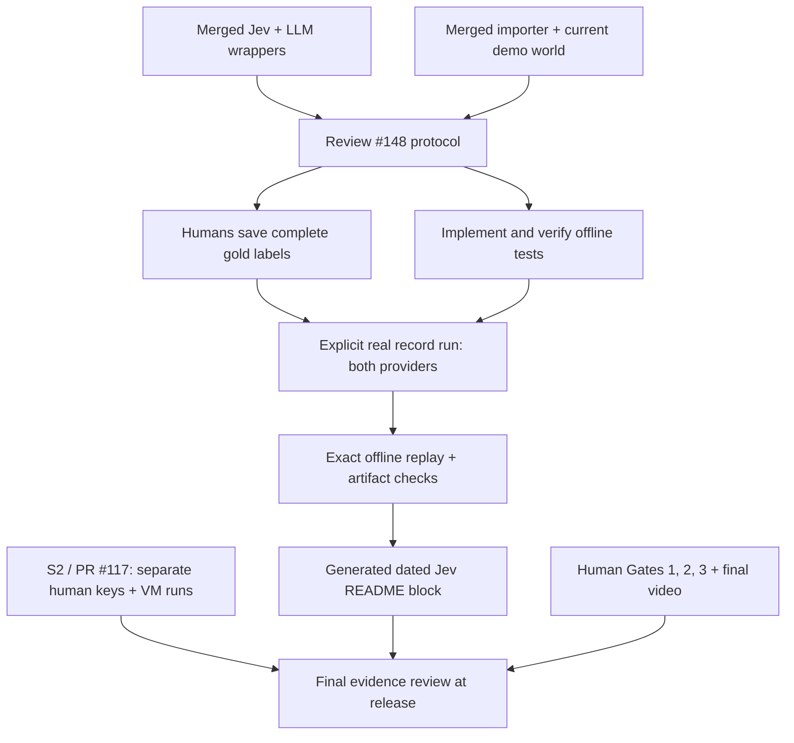

# #148: Whole-repository dependency and integration audit

Snapshot: **18 October 2026**, repository [AjinkyaTaranekar/theseus](https://github.com/AjinkyaTaranekar/theseus).
Audited main: [`591d0aaa42ecaee096a39b46d8c227ad2b0deac4`](https://github.com/AjinkyaTaranekar/theseus/commit/591d0aaa42ecaee096a39b46d8c227ad2b0deac4).
Local review branch: `jev-numbers`. [Feature design](../tasks/148.md). [PR draft](148-pr.md).

## What was verified and its limits

Inventoried all **64 issues** (17 open, 47 closed) and all **93 PR metadata/body records** (9 open, 5 closed
without merge, 79 merged). Reviewed repository issue discussions, task dependencies and relevant PR bodies,
branches, current main, source, task briefs/spec sections and S2's pending committed diff. Checked every one of the 79 reported merge SHAs with
`git merge-base --is-ancestor <merge-sha> 591d0aa...`: **all are ancestors of main**, including PRs stacked
through other branches. This is repository issue/PR state, not a claim that all human acceptance is complete.
The current GitHub main SHA matched the isolated checkout. No PoC folder was read.

**Project-board access limitation:** `gh project list --owner AjinkyaTaranekar --format json` was denied because
the token lacks `read:project`; #148's `projectItems` is empty. Consequently actual board columns, draft
cards, custom fields and board-only dependency links were not verified. No scope, assignment, issue, label,
comment or board state was changed. Issue-body dependencies and local briefs are the basis for the plan
below. The original generated `docs/tasks/dependencies.md` also omits later issue additions; it is not a
current completion ledger and was not hand-edited.

The shared checkout started on `scanner-findings` with unrelated modified AWS tests and an untracked #143 PR
draft. Those edits and its four commits beyond main were preserved. This design uses a separate managed
worktree based on main. Existing #143 review documents describe an older snapshot; this audit does not
rewrite them or treat their then-open PR list as current.

## The dependency decision for #148

**Code prerequisites are merged:** A2/#17 (Jev), A1/#16 (LLM wrapper), E1/#13 (importer), F4/#9 and C1/#22
(the expanded world), plus later #121 world growth. No other open feature must merge to implement the
benchmark. The outstanding prerequisites are a reviewed evaluation design, a human-owned full answer key,
and real Jev/fast-LLM collection to produce a publishable result.

**Coordination rather than blockers:** #39/PR #117 owns S2 benchmark cases and scale results; #142 owns
full-review latency; #143 owns scanner finding ingestion; #144 owns fixer traces/recordings; #146 owns optional
notifications; #150's merged docs are the README baseline. #148 owns only its proposed `bench/jev/` package,
its recording subtrees and generated README block. The shared AI_USE append also needs a normal merge.

**No dependency on a FalkorDB cleanup:** this evaluation imports rows without loading a graph. Do not make it
wait for #141, purge shared data or use a MemoryStore-served API. No new runtime dependency, protocol,
edge/category/node kind or product prompt change is proposed. Repeated sensitivity batches must not rely on
cached demo replay; fallback label-only output must not be assigned fabricated probabilities.

## Every open issue: next work and acceptance boundary

The prerequisites below distinguish work already merged from actual open dependencies. The proposed next
steps preserve each issue's scope; they do not authorize implementing every issue inside #148.

| Issue | Prerequisites/current evidence | Concrete next work and completion boundary |
| --- | --- | --- |
| [#3: P4: Finalize the video script](https://github.com/AjinkyaTaranekar/theseus/issues/3) | #2 done; PR #116 OPEN | Review the script, read it aloud, record duration and voice-over owner. Accept only after rehearsal; no dependency on #148 implementation. |
| [#6: P7: Rehearse the judge questions](https://github.com/AjinkyaTaranekar/theseus/issues/6) | #2 done | Both humans rehearse each judge question. Use measured N and explicit limits for Jev; do not quote 30/30 as this corpus. |
| [#23: G1: Gate 1: Beat 1 live](https://github.com/AjinkyaTaranekar/theseus/issues/23) | #20 merged | Run fresh intern demo end to end, verify three opened paths and says-versus-grants, save the clip. Existing open demo PRs are evidence candidates, not proof a clip exists. |
| [#34: G2: Gate 2: Demo 2 end to end](https://github.com/AjinkyaTaranekar/theseus/issues/34) | #23 OPEN; #24/#26/#29/#30 merged | After Gate 1, demonstrate approved fix B, commit, rerun and green check on a fresh demo branch; save the clip. Jev benchmark is not a gate prerequisite. |
| [#38: G3: Gate 3: Contain it and nobody breaks](https://github.com/AjinkyaTaranekar/theseus/issues/38) | #34 OPEN; #33/#35/#36/#37 merged | After Gate 2, demonstrate finding/containment/rotation, unused-grant U preserving usage, and code-PR warning; save all clips. Do not equate merged code with a passed human gate. |
| [#39: S2: Proof: benchmark against Checkov, and large-graph timings](https://github.com/AjinkyaTaranekar/theseus/issues/39) | #24/#25 merged; PR #117 OPEN | S2 harness is committed on s2-proof, not on main. Humans save 20 expected keys, prepare exact recordings, run all comparisons and VM scale samples, generate its report. No fabricated README numbers. |
| [#42: S6: Final video](https://github.com/AjinkyaTaranekar/theseus/issues/42) | #3/#38 OPEN | Finish reviewed script and Gate 3 clips, capture real/replayed behavior with accurate labels, upload the final video. Add Jev numbers only after a real approved run. |
| [#43: S7: Tag the release and submit](https://github.com/AjinkyaTaranekar/theseus/issues/43) | #41 closed; #42 OPEN | Review final evidence/AI disclosure, rerun test counts and report checks on the exact tagged commit, then humans publish/tag/submit Track 01. No release action authorized by this local design request. |
| [#44: S8: Blog post](https://github.com/AjinkyaTaranekar/theseus/issues/44) | #42 OPEN; publish after submission | Draft from the final evidence, name synthetic-case and replay limits, then publish after submission. Optional story work must not delay the human gates. |
| [#69: Design: paths through services, exposure, and other languages](https://github.com/AjinkyaTaranekar/theseus/issues/69) | Both-human design approval; defer beyond Gate 3 | Separate designs for inferred service paths, exposure edges and additional languages; agree contract/traversal/dependency changes first. Not a #148 blocker and no extra nodes added to this corpus. |
| [#112: Rotate these secrets: GHSA-demo-0001](https://github.com/AjinkyaTaranekar/theseus/issues/112) | Open rotation checklist; containment PR #111 OPEN | A human handles the listed synthetic-demo rotation/checklist and containment review. Never infer rotation occurred from a model score, open PR, or closed feature task. |
| [#141: Clean up and prevent leaked test graphs on the shared FalkorDB Cloud instance](https://github.com/AjinkyaTaranekar/theseus/issues/141) | #140 merged; #147/#156 handles product PR graphs | Finish dry-run/exact-name purge tooling and low-memory preflight with offline tests; human reviews and executes any shared cleanup. Use disposable local FalkorDB for integration. #148 needs no database, so it can proceed. |
| [#142: Cut a live review from ~58 s to under 10 s](https://github.com/AjinkyaTaranekar/theseus/issues/142) | Both-human approval of paths_many; deployment measurements | Measure real guest-box transport, test paths_many parity and cached graph lists, prewarm Try presets, decide placement, then prove cold review <10s. Keep full-review latency separate from #148 batch-call latency. |
| [#143: Read Trivy and Grype reports as findings](https://github.com/AjinkyaTaranekar/theseus/issues/143) | Local scanner branch has 4 commits beyond audited main; not merged | Review/finish neutral image finding, Workload image retention, parser/matcher/engine integration and publication. Humans own image-cve expected key. Add real API/feed/golden/parity coverage before completion. Coordinate corpus drift only if main Resource nodes change. |
| [#144: Show the agent choosing tools and correcting a fix](https://github.com/AjinkyaTaranekar/theseus/issues/144) | Existing fixer loop; real record/replay evidence | Record a real multi-tool/retry run, engine-verify both attempts and replay it offline; cover missing-recording logging. #132 improved CLI replay but pipeline.agent_fix still logs exc_info=True. Any prompt change needs separate approval. Do not select/fabricate favorable Jev evaluation samples. |
| [#146: Post findings to a Slack webhook](https://github.com/AjinkyaTaranekar/theseus/issues/146) | Optional config/notification design; no PR in snapshot | Add an opt-in secret webhook setting, bounded transport and per-finding deduplication; mocked tests prove payload facts/provenance, redaction, off/error/no-repeat behavior. Reconcile intentionally nonfatal notification errors with AGENTS exception rule in its design. No notification code in #148. |
| [#148: Measure Jev on the whole demo world](https://github.com/AjinkyaTaranekar/theseus/issues/148) | #17/#16/#13/#9/#22 merged; human labels + live provider runs missing | Review docs/tasks/148.md, accept the fallback Brier/entry point/sampling decisions, have humans save the key, implement test-first, record both providers, reproduce the report and generate the README block. Current deliverable is design only. |

## Every closed issue: reuse and what #148 must preserve

Closed human tasks are reported as closed, without inventing a code implementation. Closed feature tasks
are tied to their integrated PRs or source; the full ancestry ledger follows. #145/#147/#149/#150 were open
in the older scanner design audit but are closed in this snapshot.

| Issue | Integration/reuse and boundary |
| --- | --- |
| [#1: P1: Throwaway checks: FalkorDB and Terraform plan](https://github.com/AjinkyaTaranekar/theseus/issues/1) | Completed prep; reuse mock-only input planning. No PoC code reuse. |
| [#2: P3: Check the five scenarios on paper](https://github.com/AjinkyaTaranekar/theseus/issues/2) | Human scenario agreement; use the same human-owned answer-key handoff for labels. |
| [#4: P5: Check access and keys](https://github.com/AjinkyaTaranekar/theseus/issues/4) | Access setup is closed; validate current Jev/fast-LLM availability only during an explicit record run. |
| [#5: P6: Register the team and agree IP ownership](https://github.com/AjinkyaTaranekar/theseus/issues/5) | Team/IP prep; retain agent disclosure and human review. No implementation dependency. |
| [#7: F1: Repo, board and CI](https://github.com/AjinkyaTaranekar/theseus/issues/7) | Package/CI baseline is merged (#46); no new dependency or CI service for this benchmark. |
| [#8: F2: Freeze the contracts](https://github.com/AjinkyaTaranekar/theseus/issues/8) | Frozen neutral contracts (#47); define benchmark-local models, change no frozen contract. |
| [#9: F4: Demo world and fixture generator](https://github.com/AjinkyaTaranekar/theseus/issues/9) | Generated world (#59); use the existing base snapshot and plan, never hand-edit them. |
| [#10: F3: Run it: Compose, API stub and VM deploy](https://github.com/AjinkyaTaranekar/theseus/issues/10) | API/FalkorDB deployment (#49); evaluation needs no server/database or deployment. |
| [#11: F5: Hand-write expected.json](https://github.com/AjinkyaTaranekar/theseus/issues/11) | Human answer keys (#70); labels are a separate human-owned key, not an agent-generated expected.json. |
| [#12: F7: GitHub Action and App skeleton](https://github.com/AjinkyaTaranekar/theseus/issues/12) | Action/App (#60); no new workflow, webhook or write permission required. |
| [#13: E1: Importer: plan, structure, workloads and coverage](https://github.com/AjinkyaTaranekar/theseus/issues/13) | Importer (#61, integrated through #59); reuse load_world/build_rows and actual Resource labels. |
| [#14: E2: IAM: statements, matching, CAN and CAN_ASSUME](https://github.com/AjinkyaTaranekar/theseus/issues/14) | IAM/catalog (#50); reuse supported catalog/categories. Do not expand IAM or rederive permissions. |
| [#15: E3: Graph load, path diff and required access](https://github.com/AjinkyaTaranekar/theseus/issues/15) | Graph analysis (#72); benchmark uses rows only, not path queries or a graph store. |
| [#16: A1: LLM intent extraction](https://github.com/AjinkyaTaranekar/theseus/issues/16) | LLM wrapper (#51); all fallback calls use Llm.call(fast=True), preserving record/replay and retries. |
| [#17: A2: Jev: sensitivity labels and advisory urgency](https://github.com/AjinkyaTaranekar/theseus/issues/17) | Jev client (#53); primary code prerequisite, but historical 13 answers are not a full-world measurement. |
| [#18: A3: Says versus grants](https://github.com/AjinkyaTaranekar/theseus/issues/18) | Intent/effect (#73); unchanged. Accuracy cannot approve intent or access. |
| [#19: A4: PR comment: paths, fix table, trace and coverage](https://github.com/AjinkyaTaranekar/theseus/issues/19) | Comment renderer (#55); unchanged. Generated benchmark output belongs in README, not PR verdicts. |
| [#20: A5: Real analyze behind the Action](https://github.com/AjinkyaTaranekar/theseus/issues/20) | Action analysis (#74); independent of sensitivity evaluation; no live review needed to enumerate rows. |
| [#21: FM1: CI in the graph: workflows and OIDC trust](https://github.com/AjinkyaTaranekar/theseus/issues/21) | Workflow/OIDC import (#71); reused indirectly by the importer; no trust/traversal change. |
| [#22: C1: Demo backend: service code and platform resources](https://github.com/AjinkyaTaranekar/theseus/issues/22) | Expanded backend (#64/#59); current resources include nine queue/topic/log nodes, which must be evaluated. |
| [#24: E4: Minimum cut with MaxFlow](https://github.com/AjinkyaTaranekar/theseus/issues/24) | Minimum cut (#78); no execution dependency. Probability scores do not change cut capacities. |
| [#25: E5: Simulator on GRAPH.COPY](https://github.com/AjinkyaTaranekar/theseus/issues/25) | Simulation (#77); no execution dependency. Models still cannot decide a fix verdict. |
| [#26: E6: Rule-based fixes and ranking](https://github.com/AjinkyaTaranekar/theseus/issues/26) | Rule fixes (#90); no ranking or candidate change in #148. |
| [#27: E9: Terraform patch renderer](https://github.com/AjinkyaTaranekar/theseus/issues/27) | Terraform rendering (#76); no input mutation or render/replan step for #148. |
| [#28: A6: MCP server and tool trace](https://github.com/AjinkyaTaranekar/theseus/issues/28) | MCP (#93); in-process evaluation does not require a new tool or MCP connection. |
| [#29: A7: LLM fix agent](https://github.com/AjinkyaTaranekar/theseus/issues/29) | Fixer (#110/#108); independent of classification. No prompt change or new fixer recording here. |
| [#30: A9: /theseus apply command](https://github.com/AjinkyaTaranekar/theseus/issues/30) | Apply (#102/#115); independent. No commits to demo PRs or automatic approval. |
| [#31: C2: Python code reader](https://github.com/AjinkyaTaranekar/theseus/issues/31) | Code reader (#65/#59); importer can reuse it, but no code-usage-derived gold sensitivity labels. |
| [#32: FM3: Finding mode: blast radius and rotate list](https://github.com/AjinkyaTaranekar/theseus/issues/32) | Finding mode (#89); sensitivity metrics do not measure blast-radius correctness. |
| [#33: FM4: Finding extras: choke points, staging to prod, urgency](https://github.com/AjinkyaTaranekar/theseus/issues/33) | Urgency/staging/choke points (#92); sensitivity Brier does not establish urgency calibration. |
| [#35: FM6: Containment PR](https://github.com/AjinkyaTaranekar/theseus/issues/35) | Containment publication (#113/#109/#108); independent, no external write for evaluation. |
| [#36: C3: Unused grants, with usage capacities](https://github.com/AjinkyaTaranekar/theseus/issues/36) | Unused grants (integrated through #99/#108 despite unmerged PR #91); do not wait on its old branch. |
| [#37: C4: Use beyond intent](https://github.com/AjinkyaTaranekar/theseus/issues/37) | Use beyond intent (#101); unchanged; no new golden projection fields. |
| [#40: S4: Try-it page](https://github.com/AjinkyaTaranekar/theseus/issues/40) | Try page (#95); demo replay is not fresh measured model latency. |
| [#41: S5: README](https://github.com/AjinkyaTaranekar/theseus/issues/41) | README (#133/#139); foundation exists, but its closed state does not finish Jev/S2 result evidence. |
| [#57: Reject LLM answers the model cut short](https://github.com/AjinkyaTaranekar/theseus/issues/57) | Incomplete LLM answers rejected (#67); preserve wrapper validation and count failures explicitly. |
| [#58: Retry LLM API errors with a 5xx status](https://github.com/AjinkyaTaranekar/theseus/issues/58) | LLM status retries (#68); reuse retries and time the full logical call, including backoff. |
| [#63: Make the demo world demo-ready before F5](https://github.com/AjinkyaTaranekar/theseus/issues/63) | Demo readiness integrated through #59; do not alter Terraform or cited fixture lines. |
| [#103: O1: Posture of main, on push, nightly and on demand](https://github.com/AjinkyaTaranekar/theseus/issues/103) | Main posture (#109/#108); do not take corpus from a mutable saved posture document. |
| [#104: O2: Single points of failure and articulation points](https://github.com/AjinkyaTaranekar/theseus/issues/104) | SPOF/articulation (#109/#108); separate engine features, not labels or accuracy evidence. |
| [#105: O3: Cost estimate and savings](https://github.com/AjinkyaTaranekar/theseus/issues/105) | Cost (#109, extended #157/#155/#159); list-price proof is independent of model evaluation. |
| [#106: O4: Organisation dashboard](https://github.com/AjinkyaTaranekar/theseus/issues/106) | Dashboard (#109/#114/#108); no new dashboard controls or routes in #148. |
| [#107: O5: Onboarding: connect a repository](https://github.com/AjinkyaTaranekar/theseus/issues/107) | Onboarding (#109/#108); reuse configuration guidance, no new external account connector. |
| [#145: Start the MCP server on any machine](https://github.com/AjinkyaTaranekar/theseus/issues/145) | MCP launcher/docs merged in #152/#159; historical open-PR notes are obsolete. Clip evidence remains human-owned. |
| [#147: Delete a PR's graphs when it closes](https://github.com/AjinkyaTaranekar/theseus/issues/147) | PR graph cleanup merged in #156; do not recreate cleanup. Deployment/prune execution is separate from a merged fix. |
| [#149: Rank the containment fix like the rest](https://github.com/AjinkyaTaranekar/theseus/issues/149) | Containment ranking merged in #151/#159; preserve veto/engine semantics. #148 does not calibrate breakage. |
| [#150: Bring the docs up to date for release](https://github.com/AjinkyaTaranekar/theseus/issues/150) | Release docs merged in #154/#159; rerun counts on the eventual tag and retain uncompleted human sign-off honestly. |

## File ownership and merge coordination

| Work | Existing or pending files | Handoff for #148 |
| --- | --- | --- |
| Jev/A2 | `agent/jev.py`, `agent/sensitivity.py`, top-level `recordings/jev/*.json`, Jev tests | Reuse public wrappers and classification; add only nested benchmark recordings. Never refresh old demo records as a side effect. |
| S2/#39, PR #117 | `bench/run.py`, `checkov.py`, `scale.py`, generated `bench/cases/`, benchmark tests, `pyproject.toml`, `AI_USE.md` | Keep evaluation under `bench/jev/` and separate test filenames. Use `python -m bench.jev` from the checkout with installed dependencies; no shared pytest/packaging change is needed. Do not reuse its unreviewed cases as sensitivity gold. |
| Release docs/#150 | `README.md`, `AI_USE.md`, plan/overview/deploy docs and hygiene tests, merged #154/#159 | Insert only the generated Jev block; preserve S2 and timing claims with their original scope. Rerun release counts at the tag rather than copying this audit's count. Never mark human review done on an agent's say-so. |
| Latency/#142 | Store protocol/queries, pipeline, Try startup and deploy docs | No paths_many or placement change here. Model-batch percentiles are not evidence of a <10s cold review. Any protocol change remains that task's approval. |
| Scanner/#143 | Local committed finding contract/parser work plus broader design in shared branch | Workload image fields do not enter sensitivity questions. Freeze #148's Resource inventory by source/plan/name/category hashes; a future Resource addition requires human labels and a new run. No scanner adapter edits. |
| Agent demonstration/#144 | `agent/fixer.py`, spec 06, fixer replay/recordings, review trace UI | Separate purposes/directories. Sensitivity sampling is outcome-independent; no retry trace is fabricated or prompt changed. |
| Optional Slack/#146 | Configuration, `.env.example`, API notify/routes/containment and finding documents | No notification settings, calls, external posts or per-finding state in this evaluation. |
| Cleanup/#141/#147 | Test guards, future purge/preflight, merged PR-graph lifecycle/prune | No database operation in #148. Merged cleanup code does not prove old shared graphs were purged. |

S2's PR file API returned only its first 100 files, mostly generated cases. File ownership above was therefore
verified from `git diff --name-only origin/main...origin/s2-proof`, not inferred from that truncated response.
The PR metadata head matches that remote branch. S2's branch does not currently have `bench/__init__.py`;
namespace-package execution is already its approach. It is still pending, not a prerequisite for #148.

## Every pull request: actual integration ledger

The commit is GitHub's reported merge SHA, shortened only for display. `yes` means its full SHA is an
ancestor of the audited main, even when its base was another feature branch. A closed, unmerged PR is not
counted as delivered; its feature may have integrated elsewhere (#91 is an example). No open demo PR is
merged into main by this work.

| PR | State | Source branch → base | Merge commit | On audited main |
| --- | --- | --- | --- | --- |
| [#45: docs: Record scenario review notes](https://github.com/AjinkyaTaranekar/theseus/pull/45) | MERGED | `p3-check-the-five-scenarios-on-paper` → `main` | `b7d43ad0` | yes |
| [#46: chore: Add the package skeleton and CI](https://github.com/AjinkyaTaranekar/theseus/pull/46) | MERGED | `f1-repo-skeleton` → `main` | `0115c400` | yes |
| [#47: feat: Freeze vendor-neutral contracts](https://github.com/AjinkyaTaranekar/theseus/pull/47) | MERGED | `f2-contracts` → `main` | `8d37f456` | yes |
| [#49: feat: Run the API on FalkorDB Cloud](https://github.com/AjinkyaTaranekar/theseus/pull/49) | MERGED | `f3-run-it` → `main` | `936d343e` | yes |
| [#50: feat: Add the IAM evaluator and AWS catalog](https://github.com/AjinkyaTaranekar/theseus/pull/50) | MERGED | `e2-iam` → `main` | `20f00ba6` | yes |
| [#51: feat: Extract PR intent through the LLM wrapper](https://github.com/AjinkyaTaranekar/theseus/pull/51) | MERGED | `a1-intent` → `main` | `c27cb8a0` | yes |
| [#52: docs: Let PR words explain, never approve](https://github.com/AjinkyaTaranekar/theseus/pull/52) | MERGED | `intent-never-approves` → `main` | `635c8479` | yes |
| [#53: feat: Add Jev for sensitivity, urgency, steering](https://github.com/AjinkyaTaranekar/theseus/pull/53) | MERGED | `a2-jev` → `a1-intent` | `c27cb8a0` | yes |
| [#55: feat: Render the PR comment from a result](https://github.com/AjinkyaTaranekar/theseus/pull/55) | MERGED | `a4-pr-comment` → `a2-jev` | `c27cb8a0` | yes |
| [#56: docs: Say when Theseus reviews and blocks merges](https://github.com/AjinkyaTaranekar/theseus/pull/56) | MERGED | `merge-gate` → `main` | `3efb9b12` | yes |
| [#59: feat: Add the demo world and fixtures](https://github.com/AjinkyaTaranekar/theseus/pull/59) | MERGED | `f4-demo-world` → `main` | `2d1b4aa5` | yes |
| [#60: feat: Review PRs through the Action and the App](https://github.com/AjinkyaTaranekar/theseus/pull/60) | MERGED | `f7-action-app` → `main` | `0a1b4abe` | yes |
| [#61: feat: Build graphs from infrastructure inputs](https://github.com/AjinkyaTaranekar/theseus/pull/61) | MERGED | `e1-importer` → `f4-demo-world` | `1dc26414` | yes |
| [#62: docs: Note the quarterly support access review](https://github.com/AjinkyaTaranekar/theseus/pull/62) | CLOSED | `demo/trial-1` → `trial-base` | `—` | — |
| [#64: feat: Add the demo backend and platform resources](https://github.com/AjinkyaTaranekar/theseus/pull/64) | MERGED | `c1-demo-backend` → `f4-demo-world` | `6873d124` | yes |
| [#65: feat: Read service code into CALLS edges](https://github.com/AjinkyaTaranekar/theseus/pull/65) | MERGED | `c2-code-reader` → `f4-demo-world` | `db3b64e7` | yes |
| [#66: docs: Merge main into branches instead of rebasing](https://github.com/AjinkyaTaranekar/theseus/pull/66) | MERGED | `docs-merge-not-rebase` → `main` | `6f6c06ff` | yes |
| [#67: fix: Reject incomplete model answers](https://github.com/AjinkyaTaranekar/theseus/pull/67) | MERGED | `codex/57-reject-incomplete-llm` → `main` | `892548de` | yes |
| [#68: fix: Retry model API errors by status](https://github.com/AjinkyaTaranekar/theseus/pull/68) | MERGED | `codex/58-retry-llm-api-errors` → `main` | `02e55413` | yes |
| [#70: docs: Add the answer keys for every fixture](https://github.com/AjinkyaTaranekar/theseus/pull/70) | MERGED | `f5-hand-write-expected-json` → `main` | `4ab51c89` | yes |
| [#71: feat: Read workflows and their OIDC trust](https://github.com/AjinkyaTaranekar/theseus/pull/71) | MERGED | `fm1-ci-graph` → `main` | `b8d855f5` | yes |
| [#72: feat: Find the paths a PR opens in FalkorDB](https://github.com/AjinkyaTaranekar/theseus/pull/72) | MERGED | `e3-analyze` → `main` | `92da0aef` | yes |
| [#73: feat: Say what a PR grants against what it says](https://github.com/AjinkyaTaranekar/theseus/pull/73) | MERGED | `a3-says-vs-grants` → `main` | `07eeab3b` | yes |
| [#74: feat: Review a PR for real behind the Action](https://github.com/AjinkyaTaranekar/theseus/pull/74) | MERGED | `a5-real-analyze` → `main` | `d16856e1` | yes |
| [#75: Add Priya to support-engineers for prod log access](https://github.com/AjinkyaTaranekar/theseus/pull/75) | CLOSED | `demo/intern-1` → `main` | `—` | — |
| [#76: feat: Render verified Terraform fixes](https://github.com/AjinkyaTaranekar/theseus/pull/76) | MERGED | `e9-render-tf` → `main` | `093f95ab` | yes |
| [#77: feat: Verify fixes on graph copies](https://github.com/AjinkyaTaranekar/theseus/pull/77) | MERGED | `e5-simulate` → `main` | `ea3df006` | yes |
| [#78: feat: Derive minimum cuts from graph flows](https://github.com/AjinkyaTaranekar/theseus/pull/78) | MERGED | `e4-min-cut` → `main` | `a9a3e636` | yes |
| [#79: fix: Measure intent on the vocabulary it sees live](https://github.com/AjinkyaTaranekar/theseus/pull/79) | MERGED | `intent-live-vocabulary` → `main` | `b60df8a2` | yes |
| [#80: chore: Skip CI on demo PRs](https://github.com/AjinkyaTaranekar/theseus/pull/80) | MERGED | `ci-skip-demo-prs` → `main` | `0dcc64f7` | yes |
| [#81: feat: Show a review while it runs](https://github.com/AjinkyaTaranekar/theseus/pull/81) | MERGED | `ux-review-progress` → `main` | `57c9fc6f` | yes |
| [#82: feat: Lead the comment with a five-line card](https://github.com/AjinkyaTaranekar/theseus/pull/82) | MERGED | `ux-card` → `main` | `53ebfc95` | yes |
| [#83: feat: Label PRs with what the review found](https://github.com/AjinkyaTaranekar/theseus/pull/83) | MERGED | `ux-labels` → `main` | `a8e85b0b` | yes |
| [#84: feat: Read each commit's world in one query](https://github.com/AjinkyaTaranekar/theseus/pull/84) | MERGED | `ux-fast-reads` → `main` | `b900fa64` | yes |
| [#85: Add Priya to support-engineers for prod log access](https://github.com/AjinkyaTaranekar/theseus/pull/85) | CLOSED | `demo/intern-2` → `main` | `—` | — |
| [#86: fix: Load the LLM client before serving](https://github.com/AjinkyaTaranekar/theseus/pull/86) | MERGED | `load-llm-first` → `main` | `efaa12ad` | yes |
| [#87: feat: Draw the connections under the card](https://github.com/AjinkyaTaranekar/theseus/pull/87) | MERGED | `ux-card-diagram` → `main` | `69fb496d` | yes |
| [#88: feat: Link each review to its graph](https://github.com/AjinkyaTaranekar/theseus/pull/88) | MERGED | `ux-review-page` → `main` | `0b27fbe3` | yes |
| [#89: feat: Map what a compromised Action can reach](https://github.com/AjinkyaTaranekar/theseus/pull/89) | MERGED | `fm3-finding` → `main` | `56be50e2` | yes |
| [#90: feat: Verify and rank rule-based fixes](https://github.com/AjinkyaTaranekar/theseus/pull/90) | MERGED | `e6-candidates` → `main` | `fb57ea77` | yes |
| [#91: feat: Scan main for grants the code never calls](https://github.com/AjinkyaTaranekar/theseus/pull/91) | CLOSED | `c3-unused-grants` → `main` | `—` | — |
| [#92: feat: Add choke points, staging flags, urgency](https://github.com/AjinkyaTaranekar/theseus/pull/92) | MERGED | `fm4-finding-extras` → `main` | `2215490b` | yes |
| [#93: feat: Serve the tool registry over MCP](https://github.com/AjinkyaTaranekar/theseus/pull/93) | MERGED | `a6-mcp` → `main` | `a0818be6` | yes |
| [#94: fix: Keep FLOW edges off the review page](https://github.com/AjinkyaTaranekar/theseus/pull/94) | MERGED | `review-page-no-flow` → `main` | `a1fd141e` | yes |
| [#95: feat: Add the Try-it page](https://github.com/AjinkyaTaranekar/theseus/pull/95) | MERGED | `s4-try-it` → `main` | `76d8abc4` | yes |
| [#96: feat: Tell the review page's story at a glance](https://github.com/AjinkyaTaranekar/theseus/pull/96) | MERGED | `review-page-redesign` → `main` | `927d250c` | yes |
| [#97: chore: Integrate the reviewed PRs](https://github.com/AjinkyaTaranekar/theseus/pull/97) | MERGED | `integrate-wave-1` → `main` | `c64c002a` | yes |
| [#98: feat: Give each finding a page](https://github.com/AjinkyaTaranekar/theseus/pull/98) | MERGED | `finding-page` → `main` | `d96899b5` | yes |
| [#99: chore: Integrate the second wave of PRs](https://github.com/AjinkyaTaranekar/theseus/pull/99) | MERGED | `integrate-wave-2` → `main` | `01a34897` | yes |
| [#100: fix: Stop tracking a .venv symlink](https://github.com/AjinkyaTaranekar/theseus/pull/100) | MERGED | `fix-venv-symlink` → `main` | `934f8cff` | yes |
| [#101: feat: Flag code that reads data beyond intent](https://github.com/AjinkyaTaranekar/theseus/pull/101) | MERGED | `c4-beyond-intent` → `main` | `fe54bd92` | yes |
| [#102: feat: Apply a passing fix with /theseus apply](https://github.com/AjinkyaTaranekar/theseus/pull/102) | MERGED | `a9-apply` → `main` | `4ad3d482` | yes |
| [#108: chore: Integrate fixer, apply, beyond intent, Try-it](https://github.com/AjinkyaTaranekar/theseus/pull/108) | MERGED | `integrate-wave-3` → `main` | `7b411276` | yes |
| [#109: feat: Add the posture of main and a dashboard](https://github.com/AjinkyaTaranekar/theseus/pull/109) | MERGED | `posture-dashboard` → `integrate-wave-3` | `ed3cb223` | yes |
| [#110: feat: Let the LLM design candidate B](https://github.com/AjinkyaTaranekar/theseus/pull/110) | MERGED | `a7-fixer` → `main` | `c0cdfa02` | yes |
| [#111: fix: Contain GHSA-demo-0001](https://github.com/AjinkyaTaranekar/theseus/pull/111) | OPEN | `theseus/contain-GHSA-demo-0001` → `main` | `—` | — |
| [#113: feat: Open a containment PR for each finding](https://github.com/AjinkyaTaranekar/theseus/pull/113) | MERGED | `fm6-containment` → `posture-dashboard` | `4b8d8f2e` | yes |
| [#114: feat: Redesign the dashboard for any size of org](https://github.com/AjinkyaTaranekar/theseus/pull/114) | MERGED | `dashboard-redesign` → `fm6-containment` | `8a642a4f` | yes |
| [#115: test: Merge the last commit of the apply PR](https://github.com/AjinkyaTaranekar/theseus/pull/115) | MERGED | `merge-a9-followup` → `main` | `9e98a0ee` | yes |
| [#116: docs: Finalize the demo video script](https://github.com/AjinkyaTaranekar/theseus/pull/116) | OPEN | `p4-finalize-the-video-script` → `main` | `—` | — |
| [#117: feat: Add reproducible benchmark tooling](https://github.com/AjinkyaTaranekar/theseus/pull/117) | OPEN | `s2-proof` → `main` | `—` | — |
| [#118: feat: Draw each fix's graph on the review page](https://github.com/AjinkyaTaranekar/theseus/pull/118) | MERGED | `fix-graph-view` → `main` | `3f395023` | yes |
| [#119: feat: Suggest the passing fix on the PR's lines](https://github.com/AjinkyaTaranekar/theseus/pull/119) | MERGED | `fix-suggestions` → `main` | `dc5bc426` | yes |
| [#120: fix: Replay a reply that calls several tools](https://github.com/AjinkyaTaranekar/theseus/pull/120) | MERGED | `demo-forgotten-db` → `main` | `421bfd6b` | yes |
| [#121: feat: Plant gaps in the demo world for main](https://github.com/AjinkyaTaranekar/theseus/pull/121) | MERGED | `world-gaps` → `main` | `040e1584` | yes |
| [#122: feat: Show an outage's blast radius on main](https://github.com/AjinkyaTaranekar/theseus/pull/122) | MERGED | `incident` → `main` | `dcbdafec` | yes |
| [#123: test: Refresh the render snapshots for main](https://github.com/AjinkyaTaranekar/theseus/pull/123) | MERGED | `fix-render-snapshots` → `main` | `e67e965e` | yes |
| [#124: Fix a typo on the support page](https://github.com/AjinkyaTaranekar/theseus/pull/124) | OPEN | `demo/code-pr-e2e` → `main` | `—` | — |
| [#125: Add Priya to support-engineers for prod log access](https://github.com/AjinkyaTaranekar/theseus/pull/125) | OPEN | `demo/intern-e2e` → `main` | `—` | — |
| [#126: Remove casey-contractor from contractors](https://github.com/AjinkyaTaranekar/theseus/pull/126) | OPEN | `demo/offboard-e2e` → `main` | `—` | — |
| [#127: Make company-files public so marketing can link the pricing PDF](https://github.com/AjinkyaTaranekar/theseus/pull/127) | CLOSED | `demo/public-bucket-e2e` → `main` | `—` | — |
| [#128: Keep orders-api logs for 90 days](https://github.com/AjinkyaTaranekar/theseus/pull/128) | OPEN | `demo/safe-e2e` → `main` | `—` | — |
| [#129: Add Priya to support-engineers for prod log access](https://github.com/AjinkyaTaranekar/theseus/pull/129) | OPEN | `demo/steering-e2e` → `main` | `—` | — |
| [#130: fix: Answer the roast of the comment and dashboard](https://github.com/AjinkyaTaranekar/theseus/pull/130) | MERGED | `roast-fixes` → `main` | `69d9b31b` | yes |
| [#131: feat: Make the review page load faster](https://github.com/AjinkyaTaranekar/theseus/pull/131) | MERGED | `review-page-smooth` → `main` | `444ecb4b` | yes |
| [#132: fix: Run the CLI on the recordings in replay](https://github.com/AjinkyaTaranekar/theseus/pull/132) | MERGED | `cli-replay` → `main` | `65001886` | yes |
| [#133: docs: Rewrite the README for submission](https://github.com/AjinkyaTaranekar/theseus/pull/133) | MERGED | `s5-readme` → `main` | `6ce293f6` | yes |
| [#134: chore: Bring the review page speedup up to date](https://github.com/AjinkyaTaranekar/theseus/pull/134) | MERGED | `review-page-smooth-merge` → `main` | `40e10949` | yes |
| [#135: docs: Describe the architecture and its decisions](https://github.com/AjinkyaTaranekar/theseus/pull/135) | MERGED | `docs-architecture` → `main` | `d6657ecc` | yes |
| [#136: fix: Answer the rest of the roast](https://github.com/AjinkyaTaranekar/theseus/pull/136) | MERGED | `roast-fixes-2` → `main` | `2fe13b7f` | yes |
| [#137: Make company-files public so marketing can link the pricing PDF](https://github.com/AjinkyaTaranekar/theseus/pull/137) | OPEN | `demo/public-bucket-2` → `main` | `—` | — |
| [#138: fix: Keep Theseus's notes out of a PR's intent](https://github.com/AjinkyaTaranekar/theseus/pull/138) | MERGED | `containment-notes` → `main` | `3a557657` | yes |
| [#139: docs: Bring the README up to date with the demo](https://github.com/AjinkyaTaranekar/theseus/pull/139) | MERGED | `readme-followup` → `main` | `b05a22c7` | yes |
| [#140: test: Stop falkordb tests leaking graphs](https://github.com/AjinkyaTaranekar/theseus/pull/140) | MERGED | `fix-falkordb-test-leaks` → `main` | `2cfbfb6b` | yes |
| [#151: fix: Rank the containment fix like the rest](https://github.com/AjinkyaTaranekar/theseus/pull/151) | MERGED | `rank-containment` → `main` | `df64f20e` | yes |
| [#152: fix: Start the MCP server on any machine](https://github.com/AjinkyaTaranekar/theseus/pull/152) | MERGED | `mcp-any-machine` → `main` | `6f3fa228` | yes |
| [#153: fix: Start the hooks on a machine with no python](https://github.com/AjinkyaTaranekar/theseus/pull/153) | MERGED | `hooks-any-python` → `main` | `2cb4abe3` | yes |
| [#154: docs: Bring the docs up to date for release](https://github.com/AjinkyaTaranekar/theseus/pull/154) | MERGED | `docs-release` → `main` | `469c5714` | yes |
| [#155: feat: Show where every change lands](https://github.com/AjinkyaTaranekar/theseus/pull/155) | MERGED | `change-impact` → `main` | `d2112381` | yes |
| [#156: fix: Delete a PR's graphs when it closes](https://github.com/AjinkyaTaranekar/theseus/pull/156) | MERGED | `graph-hygiene` → `main` | `591d0aaa` | yes |
| [#157: feat: Prove each saving and link official prices](https://github.com/AjinkyaTaranekar/theseus/pull/157) | MERGED | `cost-proof` → `main` | `d2112381` | yes |
| [#158: feat: Make every page explain itself](https://github.com/AjinkyaTaranekar/theseus/pull/158) | MERGED | `ux-revamp` → `main` | `8e822ad9` | yes |
| [#159: chore: Merge the open PRs together](https://github.com/AjinkyaTaranekar/theseus/pull/159) | MERGED | `merge-all` → `main` | `4cea77d7` | yes |

## Open PR handoffs

- **#111:** containment proposal, not proof a person rotated secrets or merged the fix. Review separately
  from the open #112 rotation checklist; no benchmark approval can authorize containment.
- **#116:** script exists in a committed branch; human read-through, duration and video acceptance remain.
- **#117:** S2 tooling exists in a committed branch; its PR explicitly lists missing human answer keys,
  exact new-context recordings, full comparison, VM samples and generated report/README results. Green CI
  on tooling is not completed benchmark evidence. Merge main normally before final review, never rebase
  or force-push the published branch.
- **#124/#125/#126/#128/#129/#137:** code-PR, intern, offboarding, safe, steering and public-bucket demos.
  Preserve them for human gates/rehearsal. They are not six new implementation blockers for Jev evaluation.

The #148 source issue itself still says S2 (#117), which is a PR; the corresponding task issue is **#39**.
Distinguish the task state from its branch/PR throughout release coordination.

## Checks and remaining evidence

At the audited clean main, using the existing Python 3.12 virtual environment:

- `python -m pytest -q`: **2,190 passed, 38 skipped**, 124.43 s. The skips are FalkorDB-marked tests.
  Pytest emitted one cache-write warning because the managed worktree is outside the shell's writable roots;
  test results were successful. No test was weakened or answer key edited.
- `ruff check --no-cache .` and `ruff format --check --no-cache .`: pass, **277 Python files formatted**.
  The initial ordinary Ruff command could not create its cache for the same sandbox reason; disabling the
  optional cache completed both actual checks without changing the permissions or source.
- Read-only offline importer probe: 137 input resources, 86 graph nodes, **22 Resource nodes**; category counts
  Database 3, LogStore 6, MessageQueue 2, MessageTopic 1, ObjectStorage 6, Secret 4. Existing sensitivity records
  cover 13/22; the nine queue/topic/log nodes are missing. Base fixture files match the current demo inputs.
- All 79 reported merged PR SHAs are ancestors of the audited main. GitHub reports successful CI on
  [main's CI run](https://github.com/AjinkyaTaranekar/theseus/actions/runs/39079868086) and completed deploy runs.
  A successful deploy workflow is not a fresh live-site/gate or benchmark verification.
- Document links, inventory/state counts, proposed metric arithmetic and the scoped diff are checked locally
  before delivery; this design has no executable feature tests to demonstrate red/green yet.

Not run: new benchmark unit/replay/live tests (implementation/key/artifacts do not exist), new provider
recordings or latency measurements (design-only review; no human key), FalkorDB tests (no graph code change
and not needed for row enumeration), Windows CI for this design (not run locally), live-site/gate clips, shared
cleanup, release submission and project columns/custom fields (token limitation above). No model result,
new accuracy/Brier, gate completion or human sign-off is invented.

Before publication, the full offline suite was rerun on `jev-numbers` with its cache redirected to a writable
temporary directory: **2,190 passed, 38 skipped**, 122.66 s, no warnings. Ruff and document checks passed again.
The user authorized committing, pushing and opening a draft design PR; implementation remains proposed.

## Suggested group execution order

1. Humans continue #23 → #34 → #38 and finish #3/#6; these acceptance/clip tasks remain open despite merged
   feature code. #42 then has its real inputs; #43's release/tag follows final evidence and human review.
2. Review #148's concrete corpus/fallback/sampling/files proposal. Humans label once; the evaluator owner
   can implement its pure validation/metrics/tests without waiting for S2, scanner or latency work.
3. In parallel tracks of work, finish S2's keys/recordings/VM evidence and #142's measured deployment decision;
   handle #141's shared cleanup as a separate human operation. This is a work-order suggestion, not a request
   to start agents or modify other branches in this session.
4. Freeze the evaluated world, explicitly record both providers, exact-replay the artifacts, and merge only
   the generated Jev README block with the independently generated S2/timing sections.
5. Preserve outstanding product-design approvals in #69/#143, optional #146 and all human disclosure.
   The user has now authorized publishing the #148 design as a draft PR; feature implementation decisions
   and human acceptance remain for review.
