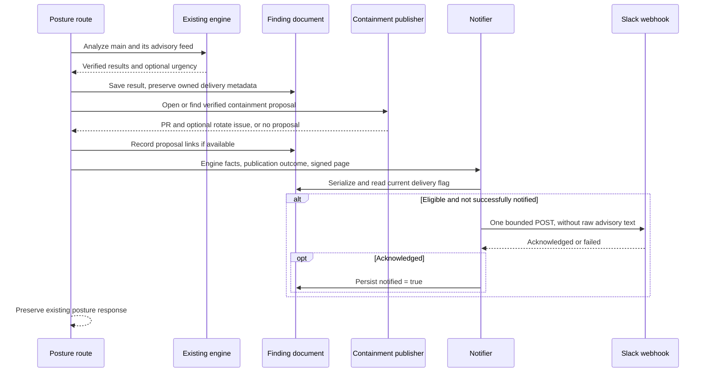

# #146: Slack finding alerts — design for review

Status: proposed design; product behavior and the decisions below are not yet approved or implemented.
Issue: [Post findings to a Slack webhook](https://github.com/AjinkyaTaranekar/theseus/issues/146).
Branch: `slack-alert`, isolated from the unfinished `scanner-findings` checkout.
Baseline: `591d0aaa42ecaee096a39b46d8c227ad2b0deac4`; audited 18 October 2026.
[Complete issue/PR audit and team handoffs](../reviews/146-board.md).
[Local PR description draft](../reviews/146-pr.md).

## Outcome

After a posture run saves an affected finding and opens or finds its containment proposal, post one short
Slack alert containing engine results and links. Also alert when a finding is urgent and has no passing
containment candidate. Keep the distinction between a verified proposal and an applied fix: opening a PR
has not contained the running system, and the compromise is an assumption. A person still approves changes.

An empty `SLACK_WEBHOOK_URL` disables the feature. Delivery failure leaves analysis, the saved posture,
containment PR and rotate issue intact. Advisory prose, PR prose, model explanations, secrets and scanner
text never enter the message. No model is called to compose it.

This issue is optional for the hackathon. The open G1–G3 rehearsals, benchmark acceptance, video and submission
remain separate delivery work. Do not hold those gates on Slack, scanners or new traversal semantics.

## Read first

- [Issue #146](https://github.com/AjinkyaTaranekar/theseus/issues/146): the requested behavior and respx checks.
- [07, Finding and scan outputs](../spec/07-github-and-deploy.md#finding-and-scan-outputs-tasks-fm6-c3): proposals, rotation and approval.
- [07, Environment variables](../spec/07-github-and-deploy.md#environment-variables-theseusconfigpy-envexample): configuration.
- [08, The rule](../spec/08-core-and-adapters.md#the-rule): core and vendor boundaries.
- [FM4](FM4.md), [FM6](FM6.md): urgency provenance and passing containment.
- `api/routes.py:posture`, `api/reviews.py:save_posture/save_finding/mark_contained`,
  `api/contain.py:_passing/contain`, `api/app.py:create_app`, `config.py:Settings`.

## Verified dependencies and traps

| Observation at the baseline | Evidence | Consequence |
| --- | --- | --- |
| Posture invokes finding analysis and persists every finding before publication | `routes.posture`; `reviews.save_posture` | Use this existing orchestration point; do not notify from engine code |
| K, rendering and proposal deduplication already exist | #35/#113; `api/contain.py`; `test_containment_pr.py` | Reuse them; do not open another PR or issue for notification |
| K ranking and the Jev veto are merged | #149/#151, included through #159 | A veto removes the recommendation, but a passing K still opens a proposal with a warning |
| Urgency is optional, `{p, source}` | `pipeline.finding_urgency`; FM4 #33/#92 | Do not invent a probability when it is absent |
| Saving a finding replaces its entire document | `reviews.save_finding` | Preserve delivery state across nightly runs, before sending |
| The replacement also discards containment metadata | Same function; offline probe below | Preserve existing proposal links for the same owner, then refresh them on publication |
| Finding keys currently contain only the finding ID | `reviews.finding_key` | This design does not solve same-ID collisions across repositories |
| CLI serving enables INFO logging | `cli.serve`; `agent.llm.load_client` restores HTTPX logging | HTTPX itself can disclose the webhook even if application warnings are clean |
| Workflow retries and thread concurrency exist | `.github/workflows/theseus-main.yml`; sync FastAPI routes | A flag alone is insufficient if read/send/write races with a finding refresh |
| Scanner support is unfinished local work, not merged | `scanner-findings` commits `cbc1cbf`, `9473f96`, plus dirty AWS changes | #143 is a coordination dependency, not a prerequisite |

Offline probes, with MemoryStore and a fake HTTP transport only:

- Save the real compromised-action result, add containment and `notified: true`, then save again:
  **both fields disappear** at this baseline.
- POST a deliberately fake webhook through HTTPX with INFO logging:
  **the configured URL appears in the HTTPX log**. No Slack request was made.
- The replayed finding has two workflows, three opened targets, `rotate = [secret:prod-db-credentials]`
  and passing, recommended K. Its urgency is absent with that replay stand-in. An alert must say
  “urgency unavailable” in this case; the design's scored example is a separate input.

## Decisions to approve before implementation

AGENTS.md, **Ask first**, requires stopping for “Anything the spec does not settle: a schema field, an edge
type, a file name, a rule.” The issue does not settle these rules. The recommendations below are proposals,
not inferred approvals. This reviewable design and its PR draft are complete before requesting a decision.

| Decision | Recommended narrow behavior | Consequence / alternative |
| --- | --- | --- |
| What is urgent? | A finite `p >= 0.80`, with source `jev` or `fallback`; unavailable is not urgent | Threshold is a notification rule only. Both humans may choose a different cutoff; engine verdicts do not change |
| What does “once” mean after failure? | Set `notified: true` only after Slack acknowledges `200` + `ok`; retry on a later posture run | Prevents repeats after recorded success. A timeout after Slack accepted, or a crash before saving, can duplicate. At-most-once attempts would instead risk silently losing alerts |
| What concurrency is supported? | One API process/replica, serialized finding-document mutations and delivery | Matches the checked launch scripts. Multiple processes require durable atomic coordination before promising no repeats |
| What is the deduplication scope? | The existing finding document, preserving metadata only when `repo` and `world_root` match | Support one allowlisted repository and skip sending if multiple are configured. Multi-repo same-ID isolation needs a separately approved document/key migration |
| Does the module belong in API? | `api/notify.py`, explicitly requested by #146, with the app selecting its transport | It follows the existing outbound `api/github.py` seam; it does not read cloud/CI facts or add an adapter protocol |
| How much fits in the alert? | Up to 10 workflows, 10 targets per workflow and 20 rotate names, each sorted, with omitted counts and the finding link; names capped at 120 characters | This is a new presentation rule; the complete engine result remains on the signed page |

A single flag cannot guarantee exactly-once external delivery through process crashes. Do not advertise that
property. A receipt write failure after acknowledged delivery is logged as uncertain; it never fails or
undoes containment. There is no immediate retry, background queue, timer or new scheduler in this issue.

## Event selection

Use `Candidate.verdict`, the existing K selection rule and the actual publication outcome. Jev urgency and
breakage judgments are advisory metadata; neither proves compromise nor changes an engine verdict.

| State after analysis and attempted publication | Alert | Wording |
| --- | --- | --- |
| `contain()` returns a proposal, newly opened or already open | Yes, unless successfully notified | “Containment proposed; review required” |
| The selected passing K has `needs_closer_look` | Same alert, explicit warning | “Engine verification passed; advisory check requires closer review” |
| No passing K; valid urgency meets the approved threshold; at least one affected workflow | Yes, unless successfully notified | “No passing containment verified; human investigation required” |
| No passing K; low, invalid or missing urgency | No | Keep the finding on the dashboard |
| Passing K, but publisher returns `None` because no rendered change remains | No new alert under this narrow scope | Do not invent a proposal or claim a deployed fix |
| Passing K, but GitHub/rendering fails | Existing containment error stays visible; no new alert category here | “Publication failed” must not be mislabeled “no safe fix”; an operational-failure alert is a separate policy choice |
| No affected workflow, no finding ID, or only a Try/fixture call | No | Never turn demo visitors into Slack notifications |
| Webhook unset/blank, document missing or owner mismatched | No send, no success flag | Missing/foreign state is logged safely and investigated |

A `fail` or `unknown` candidate never becomes a passing fix. A passing but vetoed candidate is still passing,
as settled by #149/#151. Share the publisher's selection helper rather than keeping a divergent K rule in
notification code; making `_passing` public in `api/contain.py` is the small additional file change below.
Do not extend this issue to U/S or change the agreed K publication policy. #143 will supply its own selection.

## Data flow and module seam



Proposed Pydantic models live beside the API notifier, outside frozen `contracts/`:

- `FindingAlert`: finding ID, repo, world root, publication state, optional urgency `{p, source}`,
  workflows paired with sorted reached target IDs, sorted rotate IDs, optional PR/issue/page URLs,
  and the engine's closer-review flag. No arbitrary `text`, `headline`, advisory map or Evidence input.
- `Delivery`: status `off`, `sent` or `failed`. A transport failure is an explicit result, not a swallowed
  exception or a success flag. Persistent-state access errors are handled at the best-effort coordinator.
- `Notifier.send(alert) -> Delivery`: transport only; configured and injected by `api/app.py`, using an
  owned httpx client with an injected client/transport seam for respx. Close an owned client in lifespan.
- `notify_once(...)`: the API coordinator reads the current document under the shared finding mutation
  guard, checks ownership and eligibility, composes the allowlisted alert, sends and records success.

`routes.py` calls the coordinator after `mark_contained`, and after the no-passing-candidate path. Do not place
it after the existing `continue` on publication error without considering the selection table. Preserve the
existing `contained` and `containment_failed` response shapes. One Slack failure must not skip the next finding.
No CLI, `/try`, fixture `/finding`, engine or importer side effects are added.

## Persistence and repeated runs

The internal finding document gains `notified: bool`, default false when absent. This is document metadata,
not a new AnalysisResult field. Preserve only the explicitly owned `notified` and `containment` metadata
when rebuilding a finding for the same `repo` and `world_root`. Never merge old `result`, graphs, timestamps,
verdict or SHA over the new analysis. Do not copy arbitrary old fields wholesale.

Use one shared reentrant finding-document guard in `reviews.py` for `save_finding`, `mark_contained` and the
notification coordinator's read/send/mark sequence. No guarded document update may replace the document with an old false
flag while another has recorded success. A single process-wide guard is sufficient for this small deployment;
the bounded Slack call temporarily holds it, which must be documented and tested. It serializes document
mutations, not engine graph computation. A new process/replica cannot share this lock.

Read the receipt from the store, never from the page cache or an in-memory “sent IDs” set. On acknowledgement,
re-read/update the document without losing its result or proposal links, write the flag, and clear the page
cache. A restart must still suppress a second successful alert. On failure or when disabled, retain false
(or an absent flag). Enabling Slack later therefore sends on the next eligible posture run.

Do not reset the flag because the SHA, urgency, candidate recommendation or webhook URL changed. The issue
asks for one successful notification per finding; it does not ask for escalation updates or per-channel
redelivery. If an urgent uncontained finding was already delivered, a later passing K does not send again.
Resolved/reintroduced occurrences and multi-repository identity need a separate lifecycle design.

Existing documents without the field remain readable. Preserve existing containment links as historical
proposal links, not a proof that their diff is still verified against a newer main. #143's stale-proposal
check belongs to its publication work, not this notification patch.

## Message and trust boundary

Build the payload from `result.finding.id/workflows/urgency`, `result.opened` grouped by `PathRecord.actor`,
`result.rotate`, the verified candidate's flags, the actual `Contained` URLs, and `reviews.finding_url`.
Deduplicate/sort all ID lists. Show secret **names**, never values or environment data. Keep each path's
`unknown` and `inferred` qualifiers: an unresolved path is described as possible/unverified access, never
certain reach. When grouping an actor/target, a certain path can support reach; otherwise retain the
uncertainty. Preserve path IDs in the typed alert for traceability to the signed finding result, without
putting full evidence or advisory objects into the payload.

Use plain-text Block Kit sections (`type: plain_text`, `emoji: false`) for dynamic names. Escape `&`, `<`, `>`
in the top-level fallback text and do not use automatic mentions. The fallback is a short summary with
finding ID, proposal state, counts and links, capped at 3,500 encoded characters. Each workflow and the
rotate list gets a separate plain-text section, within Slack's 3,000-character section limit; omit excess
entries with counts and keep the finding link. Do not interpolate a dynamic name into
mrkdwn links, blocks, `@here`/`@channel`, or Slack special syntax. Use only backend-built/validated HTTPS links
in a separate fixed-label link section, with `unfurl_links: false` and `unfurl_media: false`. In the fallback,
links are encoded as text, not user-controlled Slack link syntax. Signed finding links are bearer access to
private infrastructure; document that recipients must be entitled to this information.

Example message (links represented by labels; urgency here is a supplied example, not the unscored probe):

```text
Theseus: GHSA-demo-0001 — assumed compromise
Containment proposed; review required. Modeled access under an assumed compromise.
Urgency: 0.89 (jev)

demo-org/docs-site/preview.yml could reach:
  customer-db; demo-company-files/invoices/; prod-db-credentials
demo-org/website/lint.yml: no sensitive target in the reported opened paths
Rotate: prod-db-credentials

Containment PR | Rotate issue | Finding page
```

Only show a workflow's targets if its own engine paths say so. Do not attribute the union to every workflow.
A workload with no reported opened path is not proved harmless. If urgency is from fallback, append
“uncalibrated”; if absent, show “unavailable”. Missing links are omitted, not fabricated. The example is
illustrative; the implementation test must derive workflow-specific targets from the real engine result.

Formatting is an allowlist: exclude advisory `text`, `action` descriptions, raw reports, graph dumps, commit
messages, findings' free-text headline, LLM trace and PR/issue bodies. IDs/names are displayed literally,
with controls normalized and the proposed display limits applied. Notification creates no Evidence object.

## Transport and URL secrecy

Add `slack_webhook_url: SecretStr | None = None` to Settings, with existing blank-env behavior; treat
whitespace-only as off in the notifier as well. `.env.example` contains only `SLACK_WEBHOOK_URL=`. Secret
validation errors must not echo the submitted input. Do not print settings with secrets revealed.

Use existing httpx; no Slack SDK, OAuth scope or dependency is needed. Propose three seconds for each
connect/read/write/pool inactivity timeout, `follow_redirects=False`, one POST per attempt and no retry sleep.
This is bounded network inactivity, not a strict three-second end-to-end deadline. Reject invalid/non-HTTPS
configuration without throwing from containment. Treat redirects, 4xx/429/5xx, transport/configuration errors
and an unexpected success body as failed. Do not fetch a redirect, log the response body or serialize it into
the finding document. Slack documents successful incoming webhooks as HTTP 200 with plain `ok`.

Warnings contain a fixed delivery status and, if useful, exception class/HTTP status only. No URL, raw path,
exception message, traceback, request, response body, signed page link or payload goes in logs. Do not copy
`GitHub._call`'s error-string behavior: an HTTPX exception may contain the URL.

Install persistent, narrowly targeted redaction/suppression for this notifier's request logs **before its
first send**, including HTTPX INFO and the actual HTTPcore DEBUG emitters. A filter on a parent logger alone
does not filter child records, and temporarily changing global levels around a request races with other
threads. The proposed redactor matches only this configured webhook's full/canonical URL and its secret path,
formats a matching LogRecord before redacting it, clears its original formatting arguments, and never
retains a URL-bearing exception/traceback on that record. Install it on `httpx` and the transport's actual
HTTPcore emitting loggers once at app construction; test the formatted handler output with both logger
families enabled. Do not add it only to the root/parent logger. Preserve unrelated GitHub request logs. If the chosen filter cannot meet this test, change the transport/logging design before
shipping; `SecretStr` alone demonstrably fails. This logging acceptance check is part of the implementation,
not a claim that this design already supplies the filter.

Primary references checked during design:
[Slack incoming webhooks](https://docs.slack.dev/messaging/sending-messages-using-incoming-webhooks/),
[Slack text formatting](https://docs.slack.dev/messaging/formatting-message-text/),
[Slack text object limits](https://docs.slack.dev/reference/block-kit/composition-objects/text-object/),
[HTTPX logging](https://www.python-httpx.org/logging/),
[HTTPX timeouts](https://www.python-httpx.org/advanced/timeouts/).

## File ownership and team integration

| File | Planned change | Coordination |
| --- | --- | --- |
| `tests/unit/test_notify.py` (new) | respx payload/transport/logging tests | Proposed new file in this design |
| `tests/unit/test_config.py` | Disabled defaults, blank values, SecretStr repr | No new environment or network access in tests |
| `tests/unit/test_reviews.py` | Preserve flag/links, refresh result, clear cache, old documents | #143 also changes finding documents; agree this preservation seam |
| `tests/e2e/test_dashboard.py` | Route delivery, second run, failures, urgent no-fix, auth | Extend the actual existing posture-route tests |
| `theseus/config.py`, `.env.example` | Optional secret setting | #148/#142 may add settings; keep independent |
| `theseus/api/notify.py` (new) | Typed alert, bounded sender, best-effort coordinator | Selected in app; no graph queries or model calls |
| `theseus/api/app.py` | Construct/inject notifier and close owned client | #142 startup warming and #143 parser wiring touch this root |
| `theseus/api/routes.py` | Notify only from authenticated posture lifecycle | #147 is already merged; #143 remains a future overlap |
| `theseus/api/reviews.py` | Shared guard, preserved fields, receipt helpers/cache invalidation | Merge after current main; review #143 handoff explicitly |
| `theseus/api/contain.py` | Expose the existing selection helper without behavior change | Additional issue-external file needed to avoid two eligibility rules |
| `deploy/README.md` | Server-side secret setup, off switch, receipt/retry semantics, limitations | #150/#154 already merged; do not resurrect removed personal details |
| `docs/spec/07-github-and-deploy.md` | Add setting and approved notification policy | Both humans approve policy/spec together |
| `AI_USE.md` | Actual implementation and human-review disclosure | Preserve other task entries |

This design-only change creates this brief, `docs/reviews/146-board.md`, `docs/reviews/146-pr.md` and one
AI_USE line. These are the files outside an existing brief and are declared in the PR draft. It does not
edit contracts, expected files, generated dependency docs, product code, deployment or live configuration.

## Tests first and implementation order

1. Approve the policy decisions above. Write failing config and respx tests before product code.
2. Test/create the typed, allowlisted message builder and sender. Assert per-workflow reach, fixed assumption
   wording, source labels, limits, safe links, secret-name-only rotation and no raw advisory text.
3. Write the failing repeated-save regression; implement preservation and the shared document guard.
4. Wire the notifier through app lifespan and route dependencies. Extend the actual dashboard e2e tests,
   exercising two complete posture runs so the overwrite bug cannot hide behind a sender-only unit test.
5. Integrate reviewed main by merge; do not copy unfinished scanner or latency changes. Run offline checks.
6. Review the exact diff locally. Push only after the user's explicit approval; no real Slack send is part
   of local verification. A separately authorized operator may later enable the webhook on the server.

Acceptance matrix:

| Test | Required observation |
| --- | --- |
| Unset, empty env, whitespace-only | No POST, no successful receipt |
| Passing K, urgency missing | One engine-derived alert, urgency unavailable, proposal wording |
| Passing K plus veto | Alert includes closer-review warning, no false recommendation |
| No passing K: score below / at cutoff | No send below; one send at cutoff |
| No score, NaN, infinity, out-of-range or unknown source | No urgent classification |
| `unknown`/failed K at high urgency | Alert says no verified passing containment |
| Passing K but no proposal / publication error | Follow selection table; never say a deployed fix exists |
| Injected advisory text, headline, mention-shaped names | Prose absent; names literal; no mention/link injection |
| Multi-workflow paths and duplicate/reordered IDs | Each workflow gets its own sorted targets; output stable |
| Only unknown/inferred reach for a target | Alert preserves qualifiers and cites the actual result; no certainty is invented |
| Oversize lists/names | Approved bounded output, omitted counts, complete page link |
| Missing PR, issue or signed page | Omit absent link, no invented URL |
| `200` + `ok` | Mark `notified` and preserve result/links |
| Redirect, 400, 403, 404, 429, 500, bad body, malformed URL, timeout | Nonfatal failed result, no success flag, no immediate retry |
| INFO + DEBUG logs on success and exception containing fake URL | Neither URL nor its token path appears; unrelated HTTPX logs survive |
| Second full posture run, newer SHA and process/notifier restart | No repeated successful notification; newest result still saved |
| A failed delivery followed by later success | Retry according to approved rule; then suppress |
| Urgent no-fix delivery followed by passing K | No second successful alert under one-per-finding policy |
| Concurrent sends and save racing with acknowledgement | One POST after success under supported single-process lock |
| Receipt read/write error, missing document, owner mismatch | No false success; containment and other findings continue |
| Bad token / disallowed repo / multi-repo configuration / Try fixture | No Slack side effect |

Run `pytest -q`, `ruff check .`, `ruff format --check .` and `git diff --check`. No golden key change, new
recording, cloud call, new dependency or live model call is required. Local FalkorDB persistence testing can
be added after approval, against an isolated instance; do not use the nearly full shared instance to test Slack.

## Done when

The issue's five respx checks pass, including an entire second posture run; persistence/logging/concurrency
regressions above pass; deployment instructions accurately explain disabling and delivery uncertainty;
engine results are unchanged; no secret URL is logged; both humans have reviewed the diff; the user has
approved any push. Approval of this design does not itself close #146 or prove delivery in a live Slack channel.
