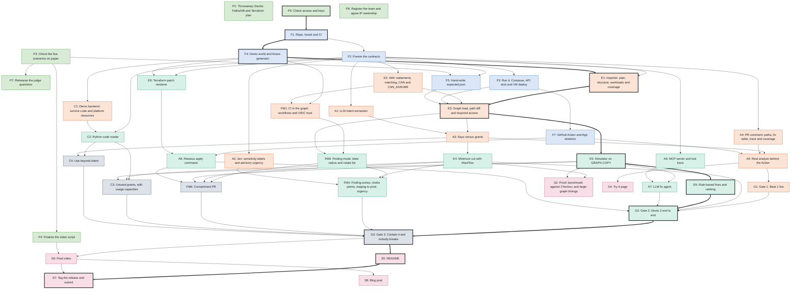

# Task dependencies

Generated by `python tools/dep_graph.py` from `tools/tasks.csv`. Do not edit by hand.

**Start here (they need nothing):** P1, P3, P5, P6. The build starts with **F1**.

**Critical path, the longest chain to submission, weighting tasks by size (11 tasks):** P5 → F1 → F4 → E1 → E3 → E5 → E6 → G2 → G3 → S5 → S7.
Whoever is free helps there first.

Colors are phases: Prep, Foundation, Beat 1, Beat 2, Beats 3 and 4, Ship. Thick arrows and dark borders are the critical path. G tasks are the
gates, where both humans check a beat end to end and record a backup clip.

