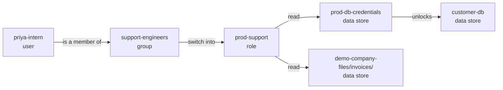

<!-- theseus:pr-comment -->
## 🔴 Merge blocked

**priya-intern**, a user, could read **customer-db**, a data store with data of unknown sensitivity (1 of 3 new ways in).

**Says:** stub.\
**Needs:** read **demo-app-logs/** · **Grants too:** **customer-db**, **demo-company-files/invoices/** and **prod-db-credentials**\
**Why:** **priya-intern** is a member of **support-engineers** → can switch into **prod-support** → can read **prod-db-credentials** → unlocks **customer-db**.\
**Do:** reply `/theseus apply B` to commit fix B (Candidate B). Theseus tested it on a copy of the graph: it closes all 3 ways in and breaks nothing.

Shaded: sensitive data. Thick red arrow: what this PR adds or changes. Each step links to its line under <b>The path, step by step</b>.

<b>The path, step by step</b> (3 ways in, with links to each line)

**What's at risk**

- **customer-db**, a data store: data of unknown sensitivity
- **demo-company-files/invoices/**, a data store: data of unknown sensitivity
- **prod-db-credentials**, a data store: the key that opens **customer-db**

| Actor | Target | Hops |
| --- | --- | --- |
| `user:priya-intern` | `db:customer-db` | 4 |
| `user:priya-intern` | `s3://demo-company-files/invoices/` | 3 |
| `user:priya-intern` | `secret:prod-db-credentials` | 3 |

How **priya-intern** reaches **customer-db**

1. `user:priya-intern` → `group:support-engineers` (MEMBER_OF): [terraform/people.tf:83](https://github.com/owner/theseus/blob/0123456789abcdef0123456789abcdef01234567/demo-infra/terraform/people.tf#L83)
2. `group:support-engineers` → `role:prod-support` (CAN_ASSUME): [terraform/people.tf:56](https://github.com/owner/theseus/blob/0123456789abcdef0123456789abcdef01234567/demo-infra/terraform/people.tf#L56)
3. `role:prod-support` → `secret:prod-db-credentials` (CAN): [terraform/roles.tf:36](https://github.com/owner/theseus/blob/0123456789abcdef0123456789abcdef01234567/demo-infra/terraform/roles.tf#L36)
4. `secret:prod-db-credentials` → `db:customer-db` (UNLOCKS): [terraform/data.tf:31](https://github.com/owner/theseus/blob/0123456789abcdef0123456789abcdef01234567/demo-infra/terraform/data.tf#L31)

How **priya-intern** reaches **demo-company-files/invoices/**

1. `user:priya-intern` → `group:support-engineers` (MEMBER_OF): [terraform/people.tf:83](https://github.com/owner/theseus/blob/0123456789abcdef0123456789abcdef01234567/demo-infra/terraform/people.tf#L83)
2. `group:support-engineers` → `role:prod-support` (CAN_ASSUME): [terraform/people.tf:56](https://github.com/owner/theseus/blob/0123456789abcdef0123456789abcdef01234567/demo-infra/terraform/people.tf#L56)
3. `role:prod-support` → `s3://demo-company-files/invoices/` (CAN): [terraform/roles.tf:30](https://github.com/owner/theseus/blob/0123456789abcdef0123456789abcdef01234567/demo-infra/terraform/roles.tf#L30)

How **priya-intern** reaches **prod-db-credentials**

1. `user:priya-intern` → `group:support-engineers` (MEMBER_OF): [terraform/people.tf:83](https://github.com/owner/theseus/blob/0123456789abcdef0123456789abcdef01234567/demo-infra/terraform/people.tf#L83)
2. `group:support-engineers` → `role:prod-support` (CAN_ASSUME): [terraform/people.tf:56](https://github.com/owner/theseus/blob/0123456789abcdef0123456789abcdef01234567/demo-infra/terraform/people.tf#L56)
3. `role:prod-support` → `secret:prod-db-credentials` (CAN): [terraform/roles.tf:36](https://github.com/owner/theseus/blob/0123456789abcdef0123456789abcdef01234567/demo-infra/terraform/roles.tf#L36)

<b>All 4 fixes Theseus tested</b>, each on a copy of the graph

**Smallest change:** No single permission can be removed without breaking required access.

| ID | Fix | Dangerous paths | Required access | Code calls | Verdict |
| --- | --- | --- | --- | --- | --- |
| A | Candidate A (rule) | all closed | kept | kept | fail |
| **B** | **Candidate B (stub)** | **all closed** | **kept** | **kept** | **pass** |
| C | Candidate C (rule) | all closed | kept | kept | unknown |
| D | Candidate D (rule) | all closed | kept | kept | fail |

Reply `/theseus apply B` to commit a fix.

<b>What Theseus checked</b>

Checkov 3.2.255 passed this commit (52 checks). It checks one resource at a time, so it cannot see a path that crosses several.

**What the change does:** Adds `aws_iam_user_group_membership.priya_support`. Opens 3 dangerous paths, closes 0.

**Unchanged paths**

| Actor | Target | Hops |
| --- | --- | --- |
| `workflow:demo-org/docs-site/preview.yml` | `db:customer-db` | 4 |
| `workflow:demo-org/docs-site/preview.yml` | `s3://demo-company-files/invoices/` | 3 |
| `workflow:demo-org/docs-site/preview.yml` | `secret:prod-db-credentials` | 3 |
| `workflow:demo-org/infra/deploy.yml` | `s3://demo-company-files/invoices/` | 3 |
| `workload:support-portal` | `db:customer-db` | 3 |
| `workload:support-portal` | `secret:prod-db-credentials` | 2 |

Coverage: not recorded.

Timings: not recorded.

Models: not recorded.

<b>What is Theseus?</b>

Theseus reviews infrastructure changes as a graph in FalkorDB: who can reach which data, through which groups, roles, secrets and code. It blocks a merge when a change opens a new way to sensitive data, and every step it shows links to the line that causes it.

