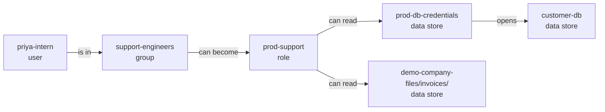

<!-- theseus:pr-comment -->
## 🔴 Merge blocked

**This PR would let priya-intern read customer-db**, which holds data of unknown sensitivity.

**The PR says:** stub.\
**It asked for:** read **demo-app-logs/** · **It would get:** **customer-db**, **demo-company-files/invoices/** and **prod-db-credentials**\
**How:** **priya-intern** is in **support-engineers** → can become **prod-support** → can read **prod-db-credentials** → opens **customer-db**.\
**Fix:** reply `/theseus apply` to commit the fix (candidate B). Tested on a copy of the graph: closes all 3 ways in, breaks nothing.

Red arrow: added by this PR · Shaded: sensitive data

<b>Step by step</b> (3 ways in, each linked to its line)

**What's at risk**

- **customer-db**, a data store: data of unknown sensitivity
- **demo-company-files/invoices/**, a data store: data of unknown sensitivity
- **prod-db-credentials**, a data store: the key that opens **customer-db**

| Actor | Target | Hops |
| --- | --- | --- |
| `user:priya-intern` | `db:customer-db` | 4 |
| `user:priya-intern` | `s3://demo-company-files/invoices/` | 3 |
| `user:priya-intern` | `secret:prod-db-credentials` | 3 |

How **priya-intern** reaches **customer-db**

1. `user:priya-intern` → `group:support-engineers` (MEMBER_OF): [terraform/people.tf:83](https://github.com/owner/theseus/blob/0123456789abcdef0123456789abcdef01234567/demo-infra/terraform/people.tf#L83)
2. `group:support-engineers` → `role:prod-support` (CAN_ASSUME): [terraform/people.tf:56](https://github.com/owner/theseus/blob/0123456789abcdef0123456789abcdef01234567/demo-infra/terraform/people.tf#L56)
3. `role:prod-support` → `secret:prod-db-credentials` (CAN): [terraform/roles.tf:36](https://github.com/owner/theseus/blob/0123456789abcdef0123456789abcdef01234567/demo-infra/terraform/roles.tf#L36)
4. `secret:prod-db-credentials` → `db:customer-db` (UNLOCKS): [terraform/data.tf:31](https://github.com/owner/theseus/blob/0123456789abcdef0123456789abcdef01234567/demo-infra/terraform/data.tf#L31)

How **priya-intern** reaches **demo-company-files/invoices/**

1. `user:priya-intern` → `group:support-engineers` (MEMBER_OF): [terraform/people.tf:83](https://github.com/owner/theseus/blob/0123456789abcdef0123456789abcdef01234567/demo-infra/terraform/people.tf#L83)
2. `group:support-engineers` → `role:prod-support` (CAN_ASSUME): [terraform/people.tf:56](https://github.com/owner/theseus/blob/0123456789abcdef0123456789abcdef01234567/demo-infra/terraform/people.tf#L56)
3. `role:prod-support` → `s3://demo-company-files/invoices/` (CAN): [terraform/roles.tf:30](https://github.com/owner/theseus/blob/0123456789abcdef0123456789abcdef01234567/demo-infra/terraform/roles.tf#L30)

How **priya-intern** reaches **prod-db-credentials**

1. `user:priya-intern` → `group:support-engineers` (MEMBER_OF): [terraform/people.tf:83](https://github.com/owner/theseus/blob/0123456789abcdef0123456789abcdef01234567/demo-infra/terraform/people.tf#L83)
2. `group:support-engineers` → `role:prod-support` (CAN_ASSUME): [terraform/people.tf:56](https://github.com/owner/theseus/blob/0123456789abcdef0123456789abcdef01234567/demo-infra/terraform/people.tf#L56)
3. `role:prod-support` → `secret:prod-db-credentials` (CAN): [terraform/roles.tf:36](https://github.com/owner/theseus/blob/0123456789abcdef0123456789abcdef01234567/demo-infra/terraform/roles.tf#L36)

<b>The fix that passes</b>, tested on a copy of the graph

**Smallest change:** No single permission can be removed without breaking required access.

| Fix | Dangerous paths | Required access | Code calls | Verdict |
| --- | --- | --- | --- | --- |
| **Candidate B (stub)** | **all closed** | **kept** | **kept** | **pass** |

Theseus also tried 3 other fixes that don't pass: candidate A (fail), candidate C (couldn't be checked) and candidate D (fail).

Reply `/theseus apply` to commit it.

<b>Details</b>

Checkov 3.2.255 passed this commit (52 checks). It checks one resource at a time, so it cannot see a path that crosses several.

**What the change does:** Adds `aws_iam_user_group_membership.priya_support`. Opens 3 dangerous paths, closes 0.

**Unchanged paths**

| Actor | Target | Hops |
| --- | --- | --- |
| `user:casey-contractor` | `db:customer-db` | 4 |
| `user:casey-contractor` | `s3://demo-company-files/invoices/` | 3 |
| `user:casey-contractor` | `secret:legacy-reports-password` | 3 |
| `user:casey-contractor` | `secret:payments-api-key` | 3 |
| `user:casey-contractor` | `secret:prod-db-credentials` | 3 |
| `user:casey-contractor` | `secret:smtp-credentials` | 3 |
| `workflow:demo-org/docs-site/preview.yml` | `db:customer-db` | 4 |
| `workflow:demo-org/docs-site/preview.yml` | `s3://demo-company-files/invoices/` | 3 |

and 15 more: every path is on the graph page.

Coverage: not recorded.

Timings: not recorded.

<b>About Theseus</b>

Theseus maps who can reach what in your infrastructure, as a graph in FalkorDB. It blocks a PR that opens a new way to sensitive data, and links every step to the line behind it.

