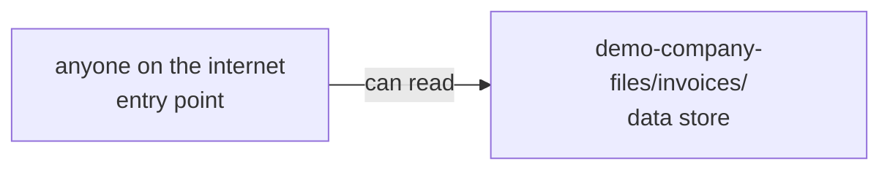

<!-- theseus:pr-comment -->
## 🔴 Merge blocked

**This PR would let anyone on the internet read demo-company-files/invoices/**, which holds data of unknown sensitivity.

**The PR says:** stub.\
**It asked for:** read **demo-company-files/public/** · **It would get:** **demo-company-files/invoices/**\
**How:** **anyone on the internet** can read **demo-company-files/invoices/**.\
**Fix:** reply `/theseus apply S` to commit fix S (Candidate S). Tested on a copy of the graph: closes all 1 way in, breaks nothing.

Red arrow: added by this PR · Shaded: sensitive data

<b>Step by step</b> (1 way in, each linked to its line)

**What's at risk**

- **demo-company-files/invoices/**, a data store: data of unknown sensitivity

| Actor | Target | Hops |
| --- | --- | --- |
| `entry:internet` | `s3://demo-company-files/invoices/` | 1 |

How **anyone on the internet** reaches **demo-company-files/invoices/**

1. `entry:internet` → `s3://demo-company-files/invoices/` (CAN): [terraform/data.tf:105](https://github.com/owner/theseus/blob/0123456789abcdef0123456789abcdef01234567/demo-infra/terraform/data.tf#L105)

<b>All 2 fixes Theseus tested</b>, each on a copy of the graph

**Smallest change:** One change closes every path: `entry:internet CAN s3://demo-company-files/invoices/` (unknown: stub).

| ID | Fix | Dangerous paths | Required access | Code calls | Verdict |
| --- | --- | --- | --- | --- | --- |
| A | Candidate A (rule) | all closed | kept | kept | fail |
| **S** | **Candidate S (rule)** | **all closed** | **kept** | **kept** | **pass** |

Reply `/theseus apply S` to commit a fix.

<b>Details</b>

Checkov 3.2.255 passed this commit (52 checks). It checks one resource at a time, so it cannot see a path that crosses several.

**What the change does:** Adds `aws_s3_bucket_policy.company_files_public`; updates `aws_s3_bucket_public_access_block.company_files`. Opens 1 dangerous path, closes 0.

**Unchanged paths**

| Actor | Target | Hops |
| --- | --- | --- |
| `workflow:demo-org/docs-site/preview.yml` | `db:customer-db` | 4 |
| `workflow:demo-org/docs-site/preview.yml` | `s3://demo-company-files/invoices/` | 3 |
| `workflow:demo-org/docs-site/preview.yml` | `secret:prod-db-credentials` | 3 |
| `workflow:demo-org/infra/deploy.yml` | `s3://demo-company-files/invoices/` | 3 |
| `workload:support-portal` | `db:customer-db` | 3 |
| `workload:support-portal` | `secret:prod-db-credentials` | 2 |

Coverage: not recorded.

Timings: not recorded.

Models: not recorded.

<b>About Theseus</b>

Theseus maps who can reach what in your infrastructure, as a graph in FalkorDB. It blocks a PR that opens a new way to sensitive data, and links every step to the line behind it.

