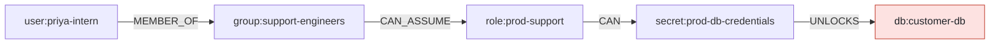
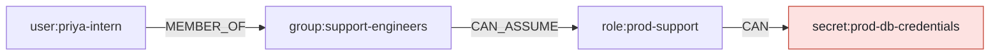
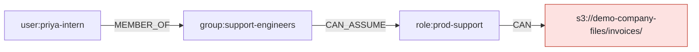

<!-- theseus:pr-comment -->
Adds `aws_iam_user_group_membership.priya_support`. Opens 3 dangerous paths, closes 0.

### Your PR says Priya reads the app logs. Your change grants db:customer-db.

> **Warning:** text in this PR tries to steer the review. Theseus ignored it, and nothing the PR asks for counts as approved.

#### Opened paths

| Actor | Target | Hops |
| --- | --- | --- |
| `user:priya-intern` | `db:customer-db` (regulated) | 4 |
| `user:priya-intern` | `secret:prod-db-credentials` (regulated) | 3 |
| `user:priya-intern` | `s3://demo-company-files/invoices/` (confidential) | 3 |

1. `user:priya-intern` → `group:support-engineers` (MEMBER_OF): [terraform/people.tf:20](https://github.com/owner/theseus/blob/0123456789abcdef0123456789abcdef01234567/demo-infra/terraform/people.tf#L20)
2. `group:support-engineers` → `role:prod-support` (CAN_ASSUME): [terraform/people.tf:30](https://github.com/owner/theseus/blob/0123456789abcdef0123456789abcdef01234567/demo-infra/terraform/people.tf#L30)
3. `role:prod-support` → `secret:prod-db-credentials` (CAN): [terraform/roles.tf:31](https://github.com/owner/theseus/blob/0123456789abcdef0123456789abcdef01234567/demo-infra/terraform/roles.tf#L31)
4. `secret:prod-db-credentials` → `db:customer-db` (UNLOCKS): unknown: the secret's db\_instance tag

1. `user:priya-intern` → `group:support-engineers` (MEMBER_OF): [terraform/people.tf:20](https://github.com/owner/theseus/blob/0123456789abcdef0123456789abcdef01234567/demo-infra/terraform/people.tf#L20)
2. `group:support-engineers` → `role:prod-support` (CAN_ASSUME): [terraform/people.tf:30](https://github.com/owner/theseus/blob/0123456789abcdef0123456789abcdef01234567/demo-infra/terraform/people.tf#L30)
3. `role:prod-support` → `secret:prod-db-credentials` (CAN): [terraform/roles.tf:31](https://github.com/owner/theseus/blob/0123456789abcdef0123456789abcdef01234567/demo-infra/terraform/roles.tf#L31)

1. `user:priya-intern` → `group:support-engineers` (MEMBER_OF): [terraform/people.tf:20](https://github.com/owner/theseus/blob/0123456789abcdef0123456789abcdef01234567/demo-infra/terraform/people.tf#L20)
2. `group:support-engineers` → `role:prod-support` (CAN_ASSUME): [terraform/people.tf:30](https://github.com/owner/theseus/blob/0123456789abcdef0123456789abcdef01234567/demo-infra/terraform/people.tf#L30)
3. `role:prod-support` → `s3://demo-company-files/invoices/` (CAN): [terraform/roles.tf:24](https://github.com/owner/theseus/blob/0123456789abcdef0123456789abcdef01234567/demo-infra/terraform/roles.tf#L24)

Checkov 3.2.255 on this commit: 52 passed, 0 failed.

**Minimum cut:** No single permission can be removed without breaking required access.

#### Fixes, each tested on a copy of the graph

| ID | Fix | Dangerous paths | Required access | Code calls | Verdict |
| --- | --- | --- | --- | --- | --- |
| A | Revert the membership (rule) | all closed | breaks I1 | kept | fail |
| **B** | **A new support-logs-read role for Priya (zai-org/GLM-5.3)** | **all closed** | **kept** | **kept** | **pass** |
| C | Deny Priya on prod-support (rule) | all closed | kept | kept | unknown |
| D | Remove AssumeProdSupport (rule) | 1 left | breaks R2, R3 | kept | fail |

Reply `/theseus apply B` to commit a fix.

#### Unknowns

- aws\_kms\_key.main: key policy conditions are not modeled

How Theseus decided

**Tool calls**

| # | Tool | Summary | ms |
| --- | --- | --- | --- |
| 1 | `explain_path` | P1: 5 hops to db:customer-db | 12 |
| 2 | `min_cut` | value 1000000, not cuttable | 48 |
| 3 | `simulate_fix` | B passes | 310 |

**Unchanged paths**

| Actor | Target | Hops |
| --- | --- | --- |
| `user:priya-intern` | `s3://demo-app-logs/` (internal) | 2 |

Read 46 resources, modeled 31; skipped 15 of types Theseus does not model, such as `aws_cloudwatch_metric_alarm` (6), `aws_sns_topic` (5) and `aws_kms_alias` (2).

Took 9.6 s: engine 1.2 s, LLM 8.0 s, Jev 0.3 s.

Models: LLM `zai-org/GLM-5.3`, Jev `jev-1.13.0`.

