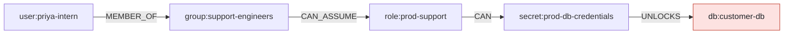
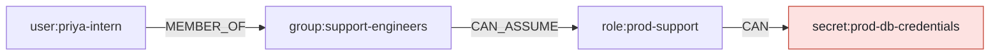
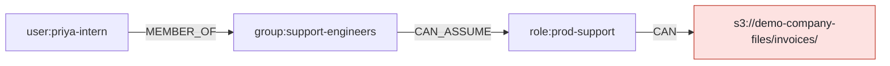

<!-- theseus:pr-comment -->
## 🔴 Merge blocked

**priya-intern**, a user, could read **customer-db**, a database with personal, payment or health data (1 of 3 new ways in).

**Says:** nothing about what it's for. Ask the author to describe it.\
**Grants:** **customer-db**, **prod-db-credentials** and **demo-company-files/invoices/**\
**Why:** **priya-intern** is a member of **support-engineers** ([terraform/people.tf:20](https://github.com/owner/theseus/blob/0123456789abcdef0123456789abcdef01234567/demo-infra/terraform/people.tf#L20), changed here) → can switch into **prod-support** → can read **prod-db-credentials** → unlocks **customer-db**.\
**Do:** reply `/theseus apply B` to commit fix B (A new support-logs-read role for Priya). Theseus tested it on a copy of the graph: it closes all 3 ways in and breaks nothing.

<b>The path, step by step</b> (3 ways in, with links to each line)

**What's at risk**

- **customer-db**, a database: personal, payment or health data, or a key that opens it
- **prod-db-credentials**, a secret: the key that opens **customer-db**
- **demo-company-files/invoices/**, a storage location: business-sensitive data, such as invoices or contracts

| Actor | Target | Hops |
| --- | --- | --- |
| `user:priya-intern` | `db:customer-db` (regulated) | 4 |
| `user:priya-intern` | `secret:prod-db-credentials` (regulated) | 3 |
| `user:priya-intern` | `s3://demo-company-files/invoices/` (confidential) | 3 |

How **priya-intern** reaches **customer-db**

1. `user:priya-intern` → `group:support-engineers` (MEMBER_OF): [terraform/people.tf:20](https://github.com/owner/theseus/blob/0123456789abcdef0123456789abcdef01234567/demo-infra/terraform/people.tf#L20)
2. `group:support-engineers` → `role:prod-support` (CAN_ASSUME): [terraform/people.tf:30](https://github.com/owner/theseus/blob/0123456789abcdef0123456789abcdef01234567/demo-infra/terraform/people.tf#L30)
3. `role:prod-support` → `secret:prod-db-credentials` (CAN): [terraform/roles.tf:31](https://github.com/owner/theseus/blob/0123456789abcdef0123456789abcdef01234567/demo-infra/terraform/roles.tf#L31)
4. `secret:prod-db-credentials` → `db:customer-db` (UNLOCKS): unknown: the secret's db\_instance tag

How **priya-intern** reaches **prod-db-credentials**

1. `user:priya-intern` → `group:support-engineers` (MEMBER_OF): [terraform/people.tf:20](https://github.com/owner/theseus/blob/0123456789abcdef0123456789abcdef01234567/demo-infra/terraform/people.tf#L20)
2. `group:support-engineers` → `role:prod-support` (CAN_ASSUME): [terraform/people.tf:30](https://github.com/owner/theseus/blob/0123456789abcdef0123456789abcdef01234567/demo-infra/terraform/people.tf#L30)
3. `role:prod-support` → `secret:prod-db-credentials` (CAN): [terraform/roles.tf:31](https://github.com/owner/theseus/blob/0123456789abcdef0123456789abcdef01234567/demo-infra/terraform/roles.tf#L31)

How **priya-intern** reaches **demo-company-files/invoices/**

1. `user:priya-intern` → `group:support-engineers` (MEMBER_OF): [terraform/people.tf:20](https://github.com/owner/theseus/blob/0123456789abcdef0123456789abcdef01234567/demo-infra/terraform/people.tf#L20)
2. `group:support-engineers` → `role:prod-support` (CAN_ASSUME): [terraform/people.tf:30](https://github.com/owner/theseus/blob/0123456789abcdef0123456789abcdef01234567/demo-infra/terraform/people.tf#L30)
3. `role:prod-support` → `s3://demo-company-files/invoices/` (CAN): [terraform/roles.tf:24](https://github.com/owner/theseus/blob/0123456789abcdef0123456789abcdef01234567/demo-infra/terraform/roles.tf#L24)

<b>All 4 fixes Theseus tested</b>, each on a copy of the graph

**Smallest change:** No single permission can be removed without breaking required access.

| ID | Fix | Dangerous paths | Required access | Code calls | Verdict |
| --- | --- | --- | --- | --- | --- |
| A | Revert the membership (rule) | all closed | breaks I1 | kept | fail |
| **B** | **A new support-logs-read role for Priya (zai-org/GLM-5.3)** | **all closed** | **kept** | **kept** | **pass** |
| C | Deny Priya on prod-support (rule) | all closed | kept | kept | unknown |
| D | Remove AssumeProdSupport (rule) | 1 left | breaks R2, R3 | kept | fail |

Reply `/theseus apply B` to commit a fix.

<b>What Theseus could not check</b> (1)

- aws\_kms\_key.main: key policy conditions are not modeled

<b>What Theseus checked</b>

Checkov 3.2.255 passed this commit (52 checks). It checks one resource at a time, so it cannot see a path that crosses several.

**What the change does:** Adds `aws_iam_user_group_membership.priya_support`. Opens 3 dangerous paths, closes 0.

**Tool calls**

| # | Tool | Summary | ms |
| --- | --- | --- | --- |
| 1 | `explain_path` | P1: 5 hops to db:customer-db | 12 |
| 2 | `min_cut` | value 1000000, not cuttable | 48 |
| 3 | `simulate_fix` | B passes | 310 |

**Unchanged paths**

| Actor | Target | Hops |
| --- | --- | --- |
| `user:priya-intern` | `s3://demo-app-logs/` (internal) | 2 |

Read 46 resources, modeled 31; skipped 15 of types Theseus does not model, such as `aws_cloudwatch_metric_alarm` (6), `aws_sns_topic` (5) and `aws_kms_alias` (2).

Took 9.6 s: engine 1.2 s, LLM 8.0 s, Jev 0.3 s.

Models: LLM `zai-org/GLM-5.3`, Jev `jev-1.13.0`.

<b>What is Theseus?</b>

Theseus reviews infrastructure changes as a graph in FalkorDB: who can reach which data, through which groups, roles, secrets and code. It blocks a merge when a change opens a new way to sensitive data, and every step it shows links to the line that causes it.

